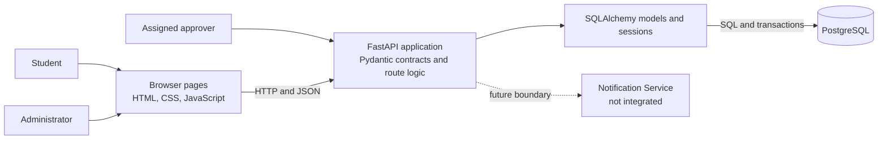
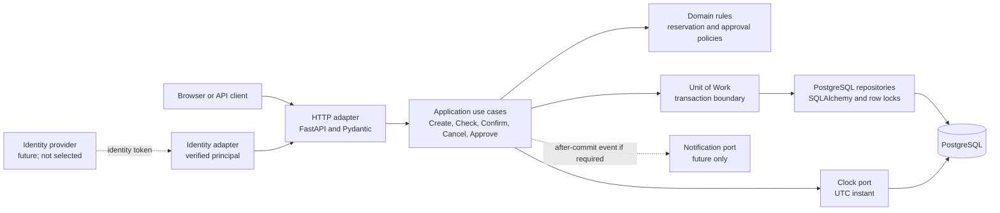

# Architecture and Decisions

## C03 Architecture Baseline

This document maps the implemented v0.2 baseline and the architecture drivers
carried into C03. It uses the C01 persistence spike and C02 behavior evidence.
Historical v0.1 notes are retained below. The Part B design and ADR are in
[C03 Architecture Design](c03-architecture.md).

### Scope and drivers

The system supports room discovery, reservation creation, approval,
confirmation, and cancellation. The current implementation is a small web
application backed by PostgreSQL. Its architecture prioritizes durable
reservation data, exclusive allocation, explicit business validation, and
preservation of v0.1 records during the v0.2 schema change.

| Driver | Current architectural response or limit |
| --- | --- |
| Identity and per-room authorization | `X-User-Id` is a trusted demo assertion; production authentication and authorization are not implemented. |
| Atomic transitions under contention | Confirm, cancel, and approve lock the related Room row. API transitions serialize per room; direct database writes bypass this rule. |
| Authoritative time and expiry | A UTC clock function and timezone-aware timestamps are used. Expiry is derived at read/transition time; multi-instance clock policy is unresolved. |
| Retry and idempotency | No idempotency key or duplicate-request policy is implemented. |
| Decision audit retention | The latest decision stores `decided_by` and `decided_at`; append-only history and retention policy are unresolved. |
| Schema evolution | A manual additive PostgreSQL migration preserves v0.1 records. No general migration framework or rollback policy is selected. |
| Notifications | Notification Service is an external boundary only. Whether proactive expiry/decision delivery is required remains unresolved. |

### Context and container view



The browser pages remain a v0.1 demonstration and do not expose the v0.2
approval workflow; the complete v0.2 interface is the HTTP API. The
Notification Service is not a runtime integration.

### Component responsibilities

| Component | Responsibility and implementation |
| --- | --- |
| Browser client | Static HTML, CSS, and JavaScript; calls the API over HTTP/JSON. Demo identity is configured in the client. |
| API and application logic | `src/main.py` defines FastAPI routes, request-scoped sessions, entity validation, approval rules, room locking, and transaction commits. There is no separate service layer. |
| Request/response contracts | `src/schemas.py` uses Pydantic for payload shape, timezone-aware timestamps, positive values, and room approval configuration. |
| Persistence mapping | `src/models.py` defines User, Room, and Reservation mappings, enums, foreign keys, checks, and derived approval status. |
| Database configuration | `src/database.py` creates the SQLAlchemy engine and session factory from `DATABASE_URL`; the API disposes the engine at shutdown. |
| Database | PostgreSQL stores users, rooms, reservations, constraints, and enum types. |

### AS-IS scenario trace — Confirm Reservation (OP-03)

This view records the current v0.2 implementation, not the proposed logical
architecture below.

**A1 — Scenario reference**

| Item | Value |
| --- | --- |
| Scenario / operation | [Confirm Reservation (OP-03)](baseline-v0.2.md#op-03--confirm-reservation-v02) |
| Requirements | REQ-03, REQ-04; REQ-08 deadline semantics |
| Rules / invariants | BR-01, BR-02, BR-04, BR-06, BR-07, BR-08, BR-10, BR-12 |
| Baseline | v0.2 |

**A2 — Main success path**

| Business-significant step | Implementation location | Evidence |
| --- | --- | --- |
| Caller submits a reservation id to confirm | `POST /reservations/{reservation_id}/confirm` route | [`confirm_reservation()` in src/main.py](../src/main.py#L181); response is `ReservationRead` |
| Load the reservation, serialize competing room transitions, and re-read after waiting | `lock_reservation_room()` loads the reservation, locks its Room with `with_for_update()`, then refreshes the reservation | [`lock_reservation_room()` in src/main.py](../src/main.py#L168); [test_concurrent_approved_confirms_still_exclusive()](../tests/test_approval.py#L169) |
| Check DRAFT lifecycle, effective approval and deadline, and current room capacity | `confirm_reservation()` checks `state`, calls `effective_approval_status(models.utc_now())`, and compares attendance to room capacity | [`confirm_reservation()` in src/main.py](../src/main.py#L181); [`effective_approval_status()` in src/models.py](../src/models.py#L111); [test_deadline_boundary_on_confirm_or_approve()](../tests/test_approval.py#L83); [test_confirm_rechecks_capacity()](../tests/test_baseline.py#L159) |
| Check there is no overlapping CONFIRMED reservation for that room | Route queries another reservation using the half-open overlap predicates | [`confirm_reservation()` in src/main.py](../src/main.py#L181); [BR-01 and BR-02](baseline-v0.1.md#shared-business-rules-and-invariants) |
| Change lifecycle to CONFIRMED without replacing approval metadata | Route assigns `reservation.state = ReservationState.CONFIRMED` after all guards pass | [`confirm_reservation()` in src/main.py](../src/main.py#L181); [test_approval_is_permission_not_allocation()](../tests/test_approval.py#L34) |
| Commit, refresh, and return the reservation | `save()` commits the SQLAlchemy session, refreshes the record, and the route returns it as `ReservationRead` | [`save()` and `confirm_reservation()` in src/main.py](../src/main.py#L53); [test_confirm_success_conflict_and_adjacent_interval()](../tests/test_baseline.py#L144) |

**A3 — Important alternative: an overlapping confirmed booking exists**

| v0.2 behavior | Where condition is detected | Where outcome is decided | Caller receives | Evidence / mismatch |
| --- | --- | --- | --- | --- |
| Reject confirmation with no state change | The overlap query in `confirm_reservation()` finds another CONFIRMED reservation for the same room where `existing.start_time < reservation.end_time` and `existing.end_time > reservation.start_time` | `if conflict is not None` raises HTTP 409; the request dependency rolls back on the exception | HTTP 409 with `Another confirmed reservation overlaps this room and time` | [test_confirm_success_conflict_and_adjacent_interval()](../tests/test_baseline.py#L144) checks 409 and unchanged stored rows; [test_delayed_approval_does_not_override_new_conflict()](../tests/test_approval.py#L125) checks the v0.2 approval path. No mismatch found for this branch. |

The route also returns 409 for non-DRAFT or ineligible approval states, and 422
when the current room capacity is insufficient. Those guards run before the
overlap query and leave the reservation unchanged on rejection.

**A4 — Main implementation elements**

| Element (type) | Contents | Role in this scenario | Evidence |
| --- | --- | --- | --- |
| Confirmation orchestration (module) | `src/main.py`: `confirm_reservation`, `lock_reservation_room`, `save`, `get_db` | HTTP operation, transition checks, room serialization, state assignment, and commit are co-located; there is no separate service or repository layer | [`src/main.py`](../src/main.py#L53) |
| Reservation and room mappings (module) | `src/models.py`: `Reservation`, `Room`, state/approval enums, `effective_approval_status`, `utc_now` | Maps persisted state and supplies the derived deadline eligibility check used by Confirm | [`src/models.py`](../src/models.py#L1) |
| Database setup (module) | `src/database.py`: `Base`, `create_db_engine`, `create_session_factory` | Configures the SQLAlchemy engine and request-session factory used by the API | [`src/database.py`](../src/database.py#L1) |

**A5 — State and rule enforcement**

| Question | Answer | Evidence |
| --- | --- | --- |
| Where is Reservation state persisted? | PostgreSQL `reservations` table, including `state`, approval decision, and deadline fields, mapped by `Reservation`. | [`Reservation` mapping in src/models.py](../src/models.py#L69); engine configuration reads `DATABASE_URL` in [`src/database.py`](../src/database.py#L11). |
| Which code decides and executes the transition? | `confirm_reservation()` decides eligibility and assigns `CONFIRMED`; `save()` commits and refreshes the mapped row. | [`src/main.py`](../src/main.py#L53) |
| For BR-02, where is an overlap detected? | The Confirm route queries for another same-room CONFIRMED reservation with intersecting half-open intervals. | [`confirm_reservation()` in src/main.py](../src/main.py#L181) |
| Where is the rejection outcome decided? | The route raises HTTP 409 when that query returns an id. The shared Room row lock serializes supported API transitions before the final checks. | [`confirm_reservation()` and `lock_reservation_room()` in src/main.py](../src/main.py#L168); [concurrent-confirm test](../tests/test_approval.py#L169) |
| Where is the resulting state change performed? | The route assigns `ReservationState.CONFIRMED` only after lifecycle, approval, capacity, and overlap guards pass; `save()` commits it. | [`confirm_reservation()` and `save()` in src/main.py](../src/main.py#L53) |

The BR-02 guarantee is implemented in the supported API transition path, not
as a database exclusion constraint. Direct database writes can bypass the
room-lock protocol, as BR-02's stated scope already notes.

**A6 — Relevant dependencies**

| Dependency | Where it connects | Code that knows its technical API | Evidence |
| --- | --- | --- | --- |
| PostgreSQL | Confirm reads reservation/room data, locks the Room row, checks overlaps, and commits the state | `src/main.py` uses SQLAlchemy `Session`, `select`, and `with_for_update`; `src/database.py` creates the engine from `DATABASE_URL` | [`src/main.py`](../src/main.py#L168); [`src/database.py`](../src/database.py#L11) |
| Inbound HTTP client (Swagger/API client) | Calls `POST /reservations/{id}/confirm` and receives JSON/HTTP status | FastAPI route and Pydantic `ReservationRead` contract in `src/main.py` / `src/schemas.py` | [README v0.2 run sequence](../README.md#current-baseline-v02--approval-workflow); [`confirm_reservation()`](../src/main.py#L181) |
| Process UTC clock | Approval eligibility is evaluated after acquiring the room lock; deadline checks compare that instant with persisted `approval_deadline` | `models.utc_now()` in `src/models.py`, called by the Confirm route | [`src/models.py`](../src/models.py#L19); [`confirm_reservation()`](../src/main.py#L181) |

Confirm has no Notification Service or identity-provider call. The baseline's
trusted demo identity assumption does not make the Confirm route authenticated;
this operation has no actor parameter or role check.

**A7 — AS-IS structural view**

```mermaid
flowchart LR
  Caller[HTTP client / Swagger]
  subgraph App[Application code]
    Main["module: src/main.py<br/>Confirm guards, locks, assigns state, commits"]
    Models["module: src/models.py<br/>Reservation and Room mappings;<br/>derived approval status"]
    Database["module: src/database.py<br/>SQLAlchemy engine and session factory"]
  end
  DB[(PostgreSQL)]

  Caller -->|POST confirm(id)| Main
  Main -->|check approval; update mapped Reservation| Models
  Main -->|create engine and session factory at startup| Database
  Database -->|open SQLAlchemy connection| DB
  Main -->|load; lock Room; refresh; query overlap; commit| DB
  DB -->|committed row / query results| Main
  Main -->|HTTP 200 ReservationRead or 409 / 422| Caller
```

This is deliberately module-level: `src/main.py` contains both the FastAPI
adapter and confirmation orchestration and issues ORM queries directly. The
database arrow represents SQL emitted through the request-scoped SQLAlchemy
Session; there is no repository abstraction. The application elements are the
three modules listed in A4.

**A8 — Question for the next architecture step**

| Item | Content |
| --- | --- |
| Question | Is the per-Room PostgreSQL row-lock protocol sufficient as the BR-02 consistency boundary, or should supported writers also be constrained by a database-level invariant? |
| Evidence | `lock_reservation_room()` locks the Room row before Confirm's overlap query and commit; `test_concurrent_approved_confirms_still_exclusive()` verifies one success and one conflict for synchronized API requests. Direct database writes bypass this application protocol, and no exclusion constraint is defined. |
| Why it matters | The architecture must state which writers are supported and how exclusive allocation remains true if another writer or future operation bypasses the current route. |

### Proposed logical architecture

Keep one deployable FastAPI application and one PostgreSQL database, but give
the code explicit internal boundaries. This modular-monolith approach preserves
the single-database transaction needed by reservation invariants without
introducing network calls between services. These are target boundaries, not
claims about the current source layout.



| Boundary | Owns |
| --- | --- |
| HTTP adapter | Parse and validate transport data, obtain a verified actor, call one use case, and map domain outcomes to HTTP responses. It must not decide reservation eligibility itself. |
| Application use cases | Coordinate Create, Check Availability, Confirm, Cancel, and Approve; enforce authorization; define the transaction boundary and call domain policies. |
| Domain | Express interval overlap, capacity, lifecycle, approval, and deadline rules independently of FastAPI and SQLAlchemy. |
| Persistence adapters | Implement repositories and a Unit of Work with PostgreSQL transactions. State-changing use cases use the same room-lock protocol; simple database constraints remain a second line of defense. |
| Identity adapter | Convert a verified external identity into an application actor. The current `X-User-Id` assertion is a demo adapter only. |
| Clock adapter | Supply one UTC instant to domain decisions. Tests substitute a controlled clock; a multi-instance deployment needs one authoritative source. |
| Notification adapter | Remains absent until requirements exist. If reliable post-commit delivery becomes required, use an outbox rather than coupling delivery success to reservation commit. |

The intended dependency direction is HTTP adapter → application → domain.
Persistence, identity, time, and notification implementations sit at the
outside and are called through application-owned interfaces. The domain does
not import FastAPI, Pydantic, or SQLAlchemy.

### Confirm transaction sequence

```mermaid
sequenceDiagram
  participant Admin
  participant API as HTTP adapter
  participant UC as Confirm use case
  participant DB as PostgreSQL Unit of Work
  Admin->>API: Confirm reservation
  API->>UC: actor and reservation id
  UC->>DB: begin transaction; load reservation and room
  UC->>DB: lock room row; refresh reservation
  Note over UC,DB: Re-read after lock; sample decision time after waiting
  UC->>UC: check state, approval, capacity, and overlap
  alt all guards pass
    UC->>DB: persist CONFIRMED and commit
    DB-->>API: committed reservation
    API-->>Admin: success
  else guard fails
    UC->>DB: rollback
    API-->>Admin: conflict or validation error
  end
```

Every state-changing use case must acquire the room lock before its final
eligibility checks and must re-read state after waiting. That common protocol
is why the reservation invariants belong in application/domain behavior backed
by one database transaction, rather than in separate services. Availability is
a read-only snapshot; Confirm always rechecks capacity and overlap.

### Runtime and data decisions

Create validates the request and references, checks room capacity, and stores
a DRAFT. For an approval-required room it also stores PENDING and a deadline
equal to the earlier of creation plus 24 hours or reservation start. Neither
state allocates or temporarily holds the room.

Approve, confirm, and cancel acquire the same PostgreSQL Room row lock and
refresh the reservation after waiting. Approval records one assigned
approver's decision without changing DRAFT. Confirmation rechecks lifecycle
state, approval eligibility, capacity, and overlap while holding the lock,
then commits CONFIRMED. Under READ COMMITTED, competing API transitions for a
room observe the preceding commit after acquiring the lock. This is an
application transaction guarantee, not a database exclusion constraint.

Availability filters by capacity and excludes only overlapping CONFIRMED
reservations. Expiry is derived for pending or approved DRAFT reservations
when UTC now is at or after the deadline; no background mutation occurs.
Intervals are half-open: overlap is `existing.start_time < requested.end_time`
and `existing.end_time > requested.start_time`, so adjacent bookings are
allowed.

Reservation lifecycle (DRAFT, CONFIRMED, CANCELLED) is separate from approval
decision (NOT_REQUIRED, PENDING, APPROVED, REJECTED). EXPIRED is derived for
eligible DRAFT states. User and Room references are foreign keys; Room capacity
and reservation attendance are positive; the reservation end must follow its
start. `room_name` is derived from the Room relationship rather than copied.

### Quality scenarios and evidence

These scenarios record demonstrated behavior, not numeric service objectives
or production-scale guarantees.

| Attribute | Stimulus and expected response | Evidence and limit |
| --- | --- | --- |
| Consistency under contention | Two independent requests confirm overlapping drafts for one room; at most one commits CONFIRMED. | C02 PostgreSQL tests synchronize separate sessions and observe one success and one conflict. They do not prove every schedule or high-load performance. |
| Durable persistence | A valid create commits a DRAFT, returns its id, and a new session reloads the reservation and references. | C01 persistence spike passed with real PostgreSQL. Process-restart recovery is not separately demonstrated. |
| Approval boundary correctness | At the exact deadline, approval/confirmation is rejected; a confirmed reservation remains allocated after the deadline. | v0.2 tests use a controlled clock. Multi-host clock drift and time-service failure remain unresolved. |
| Existing-data evolution | The v0.2 migration preserves v0.1 reservations as NOT_REQUIRED and can be applied repeatedly. | Migration tests cover this additive PostgreSQL migration only; general upgrade and rollback policy is not established. |
| Assigned approver | Only the assigned user's demo id can record a decision. | v0.2 tests cover assignment checks. The header is not authenticated and is not a security boundary. |

### Deployment and operations

The documented local topology runs FastAPI as a Python process, PostgreSQL as
a separate database service, and static browser files through a local HTTP
server. The API reads `DATABASE_URL`; it does not create or migrate tables on
import/startup. New databases use `python -m src.init_db`; existing v0.1
databases require the API to be stopped while `python -m src.migrate_v02`
runs. C02 tests create and remove isolated PostgreSQL schemas.

No production deployment topology, TLS termination, secret manager, backup or
restore procedure, monitoring, horizontal scaling policy, or recovery
objective has been specified or verified.

### C03 architectural decisions

| Decision | C03 stance | Status and consequence |
| --- | --- | --- |
| Deployment shape | Keep a modular monolith and shared PostgreSQL database. | Selected for this scale and the need for atomic transitions; a hot room serializes by design. Measure before considering partitioning or service extraction. |
| State-transition consistency | One application Unit of Work; Confirm, Cancel, and Approve share the room-row lock and refresh protocol. | Current behavior already follows this for API requests. Direct database writes remain unsupported and can bypass the invariant. |
| Identity | Require a verified principal at the HTTP boundary and pass an application actor to use cases. | Target boundary selected; provider, role mapping, and credential lifecycle remain open. The demo header is not production authentication. |
| Time | Inject a UTC clock. For multiple API instances, obtain the transition-time instant from PostgreSQL after acquiring the lock. | Target policy; current code calls a process-local UTC clock, so multi-host consistency is not yet guaranteed. Keep exact deadline tests on a replaceable clock. |
| Retries | Preserve existing state semantics. Add an idempotency-key record only when client retry requirements are agreed; replay the original result for the same actor/key/request, reject key reuse with a different request. | Not implemented. This avoids silently changing repeated Cancel from conflict to success. Key scope and retention need stakeholder agreement. |
| Decision history | Keep `decided_by` and `decided_at` on Reservation for the current one-time decision. | Matches v0.2; add append-only decision events only if retention, dispute, or multiple-decision requirements emerge. |
| Schema changes | Keep initialization separate from migration; use versioned migrations for future data-preserving changes. | v0.2 currently has a dedicated additive script. Select and adopt a migration tool before the next schema evolution; `create_all` is not migration. |
| Notifications | Do not add a queue or scheduler without a delivery requirement. | No delivery is implemented. If reliable notification becomes required, persist an outbox event in the reservation transaction and deliver asynchronously. |

### Remaining stakeholder decisions

1. Select an identity provider and derive actors from a verified server-side
   principal; define student, administrator, and per-room approver policies.
2. Set idempotency-key scope and retention if clients need transparent retries.
3. Confirm the PostgreSQL clock policy and acceptable clock-skew behavior for
   expiry reads and transitions in a multi-instance deployment.
4. Decide whether audit retention or dispute handling requires append-only
   decision events.
5. Select a migration tool and define rollback expectations before the next
   data-preserving schema change.
6. Establish whether notifications are required and their delivery guarantees.

## Historical v0.1 foundation (C01)

The following sections retain the original architecture and spike notes. Where
they differ from the C03 baseline above, the implemented v0.2 description above
is authoritative.

## System overview

The Study Room Reservation System is a small web application with
three main parts:

1. A browser frontend written in HTML, CSS, and JavaScript.
2. A FastAPI backend that implements reservation operations.
3. A PostgreSQL database accessed through SQLAlchemy.

The system reserves study rooms for users during defined time
intervals.

## Technology stack

- Python 3.13
- FastAPI
- Pydantic 2
- SQLAlchemy 2
- PostgreSQL
- psycopg 3
- pytest
- HTML
- CSS
- JavaScript

## Stack rationale

Python and FastAPI provide a small and understandable HTTP API suitable
for the project's walking skeleton.

Pydantic validates incoming API data before it reaches the persistence
layer.

SQLAlchemy provides explicit ORM mappings and separates database
configuration from endpoint logic.

PostgreSQL was selected because reservations require:

- Durable relational data.
- Foreign keys.
- Check constraints.
- Transactions.
- Enum values.
- Concurrency control.

The persistence spike uses a real PostgreSQL database rather than
SQLite so that the experiment verifies the selected production
database technology.

pytest provides an executable and repeatable persistence check.

The frontend uses plain HTML, CSS, and JavaScript because the current
interface is small and does not require a frontend framework.

## Application components

### Frontend

The frontend provides pages for:

- Searching room availability.
- Creating a reservation.
- Viewing a user's reservations.
- Administering all reservations.

The frontend communicates with the backend through HTTP and JSON.

Dates and times entered in the browser are converted into timezone-aware
ISO timestamps before being sent to the API.

### Backend API

The FastAPI backend provides operations for:

- Creating and viewing users.
- Creating and viewing rooms.
- Checking room availability.
- Creating reservations.
- Viewing reservations.
- Filtering reservations by user.
- Confirming reservations.
- Cancelling reservations.

### Persistence layer

`src/database.py` contains:

- The shared SQLAlchemy declarative base.
- Engine creation.
- Session factory creation.
- Environment-based database configuration.

`src/models.py` contains the shared ORM model definitions.

The backend and persistence tests use the same model definitions.

## Database configuration

The database connection URL is read from the `DATABASE_URL`
environment variable.

Example:

```text
postgresql+psycopg://postgres@localhost:5432/study_room_app
```

The password can be supplied through PostgreSQL's `PGPASSWORD`
environment variable.

Credentials are not stored in source code or tracked documentation.

Importing the database module does not connect to PostgreSQL and does
not create tables.

## Data model

### User

Table: `users`

Fields:

- `id` — primary key.
- `name` — required string, maximum length 100.
- `email` — required string, maximum length 255.

Relationships:

- A User can have multiple Reservations.

### Room

Table: `rooms`

Fields:

- `id` — primary key.
- `name` — required string, maximum length 100.
- `location` — required string, maximum length 255.
- `capacity` — required integer.

Constraints:

- `capacity > 0`

Relationships:

- A Room can have multiple Reservations.

### Reservation

Table: `reservations`

Fields:

- `id` — primary key.
- `user_id` — required foreign key to User.
- `room_id` — required foreign key to Room.
- `start_time` — required timezone-aware datetime.
- `end_time` — required timezone-aware datetime.
- `number_of_people` — required integer.
- `purpose` — required text.
- `state` — required Reservation state.

Constraints:

- `end_time > start_time`
- `number_of_people > 0`
- User must exist.
- Room must exist.
- State must be a supported enum value.

Relationships:

- A Reservation belongs to one User.
- A Reservation belongs to one Room.

The API derives `room_name` through the Room relationship. The room
name is not duplicated in the Reservation table.

## Reservation state representation

Reservation states are represented by the PostgreSQL enum
`reservation_state`.

Supported values:

```text
DRAFT
CONFIRMED
CANCELLED
```

SQLAlchemy supplies `DRAFT` when an ORM insert omits the state.

This is currently an ORM default rather than a PostgreSQL server
default.

## Time representation

Reservation start and end values use timezone-aware datetime columns.

The API requires timestamps that include a timezone or UTC offset.

The browser converts local date and time input into an ISO UTC
timestamp before sending it to the backend.

PostgreSQL may return the same instant using the timezone configured
for the database session. Tests compare instants rather than requiring
one particular displayed offset.

## API validation

The API validates:

- User identifier is positive.
- Room identifier is positive.
- User exists.
- Room exists.
- Start and end timestamps include timezone information.
- End time is later than start time.
- Number of people is greater than zero.
- Number of people does not exceed room capacity.
- Purpose is not empty.
- Names and locations respect the model length limits.

The database retains its own row-level constraints as a second layer of
protection.

## Availability decision

Only `CONFIRMED` reservations block room availability.

`DRAFT` reservations do not block a room because allocation occurs only on successful
confirmation.

`CANCELLED` reservations never block a room.

Availability also filters out rooms whose capacity is smaller than the
requested number of people.

## Overlap decision

Two confirmed reservations overlap when they reference the same Room
and satisfy:

```text
existing.start_time < requested.end_time
AND
existing.end_time > requested.start_time
```

Adjacent reservations are allowed.

For example:

```text
Reservation A: 10:00–11:00
Reservation B: 11:00–12:00
```

These reservations do not overlap.

## Confirmation and concurrency

Confirmation performs the following steps:

1. Load the Reservation.
2. Lock the related Room row using PostgreSQL `FOR UPDATE`.
3. Refresh the Reservation after acquiring the lock.
4. Verify that the Reservation is `DRAFT`.
5. Verify room capacity.
6. Check for overlapping `CONFIRMED` reservations.
7. Change the state to `CONFIRMED`.
8. Commit the transaction.

Confirm and cancel operations acquire the same Room lock.

Under PostgreSQL's default `READ COMMITTED` isolation, this serializes
state-changing operations for the same Room through the API.

This protects the API workflow from two simultaneous confirmations for
the same room and time.

This is application transaction behavior, not a database exclusion
constraint. Direct database writes can bypass the rule.

## Session and transaction handling

The backend opens one SQLAlchemy Session for each request.

Successful state-changing operations are explicitly committed.

If request processing raises an exception, the Session is rolled back.

The Session is closed after request processing.

The persistence spike creates the Reservation through `POST /reservations`
and reads it by the returned identifier in a new SQLAlchemy session. This
avoids mistaking SQLAlchemy's identity map or only an HTTP response for real
persistence.

## HTTP error decisions

The API uses:

- `404 Not Found` when User, Room, or Reservation does not exist.
- `409 Conflict` when a state transition or reservation confirmation
  conflicts with current state.
- `422 Unprocessable Entity` when request data violates validation or
  business constraints.

Business errors are not returned as successful HTTP 200 responses.

## Schema initialization

Application tables are initialized explicitly with:

```text
python -m src.init_db
```

Importing or starting the API does not create tables automatically.

`Base.metadata.create_all()` creates missing tables but does not migrate
existing tables when model definitions change.

A formal migration tool has not yet been selected.

A future schema change must introduce a migration strategy before
existing application data must be retained across model changes.

## Test isolation

The C01 persistence test uses a real PostgreSQL database.

For each test execution, it:

1. Creates a uniquely named PostgreSQL schema.
2. Creates the model tables in that schema.
3. Executes the persistence experiment.
4. Removes only the schema created by the test.

The test does not use SQLite and does not delete application tables.

## External boundary

The selected external boundary is a Notification Service.

The current system does not implement notification delivery.

A future integration may notify users after confirmation or
cancellation. Failure handling, retries, and delivery guarantees remain
open decisions.

## Security and current limitations

Authentication and authorization are not implemented.

The frontend currently assumes a demonstration user identity.

The Admin page is not protected by an authorization mechanism.

Notification delivery is not implemented.

Database migrations are not implemented.

These limitations are explicit and remain outside the C01 persistence
spike.

## Current decisions

The project currently retains the following decisions:

- Use PostgreSQL for persistent storage.
- Use SQLAlchemy 2 for ORM mapping.
- Use psycopg 3 as the PostgreSQL driver.
- Read database configuration from environment variables.
- Keep credentials out of source code.
- Use timezone-aware reservation timestamps.
- Create new reservations as `DRAFT`.
- Allow only `CONFIRMED` reservations to block availability.
- Enforce capacity in the API and through database row constraints
  where possible.
- Serialize state changes for the same Room with a PostgreSQL row lock.
- Treat Notification Service as an external boundary.
- Use Persistence as the single official C01 engineering spike.
