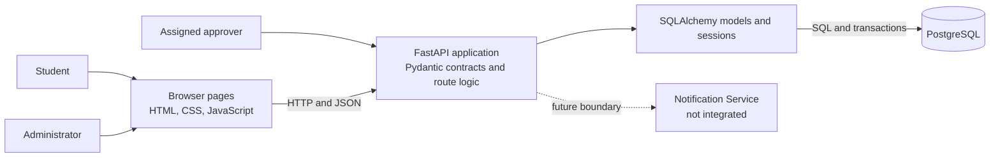
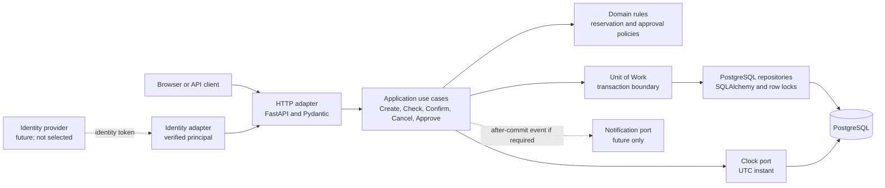
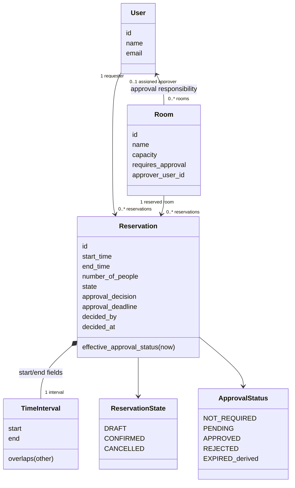
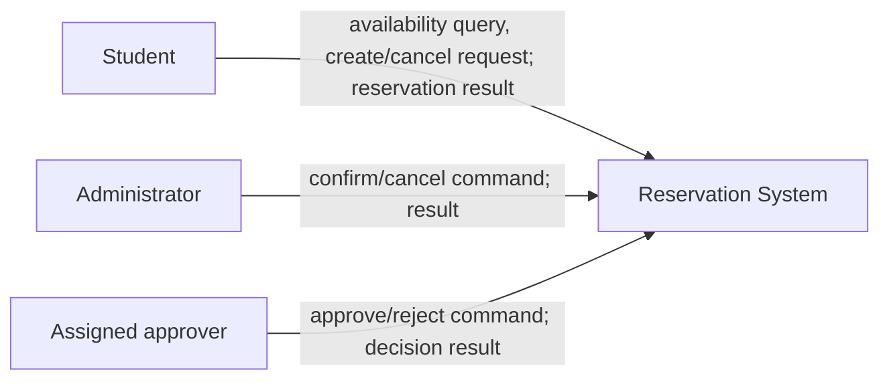
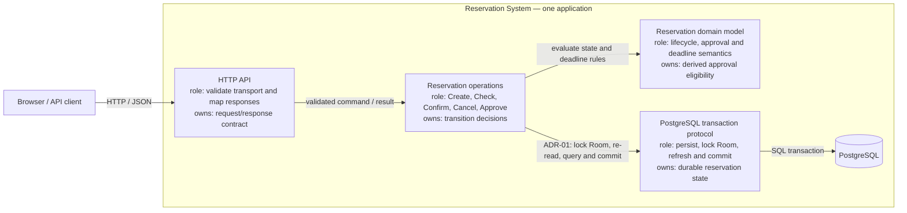
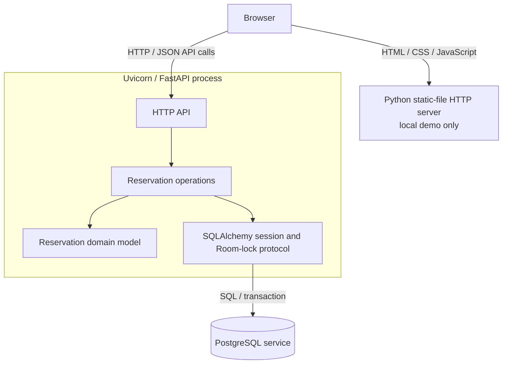
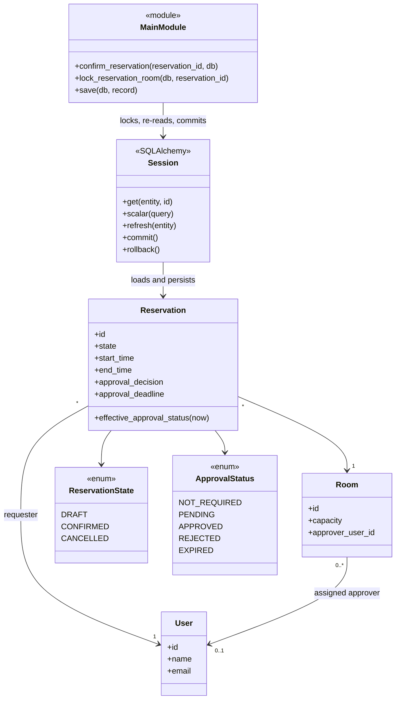
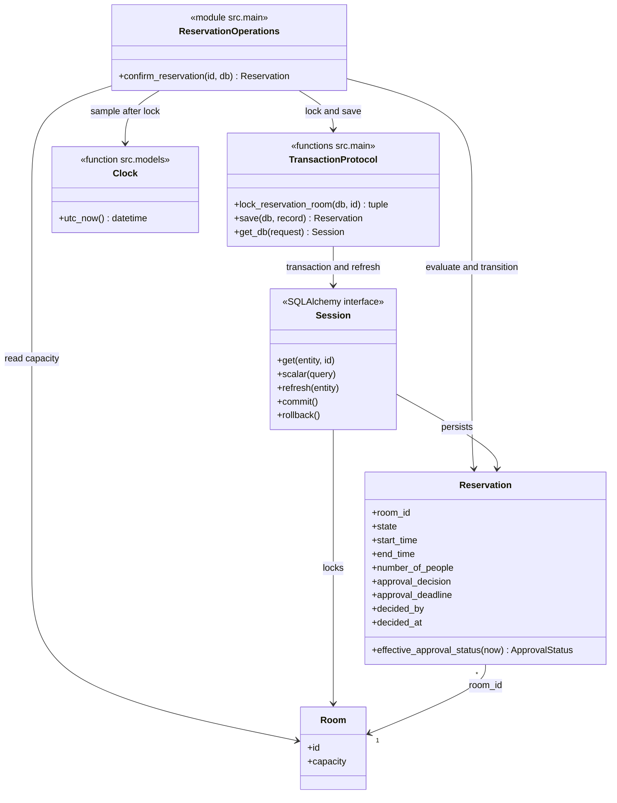

# Architecture and Decisions

Owns implementation structure, architectural decisions and detailed design.

**Reading order:** C03a records the implementation baseline; C03b records the Part B design and ADR. C03a and C03b are accepted per the project owner’s confirmation recorded on 2026-10-13. C01 architecture notes remain historical. C05 scope, detailed design and verification traceability are recorded below.

## Contents

- [c03a: Architecture and Decisions](#c03a)
- [c03b: C03 — Architecture Design (Part B)](#c03b)
- [C05 scope and work breakdown](#c05-preparation)
- [C05 detailed design](#c05-detailed-design)

<a id="c03a"></a>

<a id="architecture-and-decisions"></a>
<a id="c03a-architecture-and-decisions"></a>

## Architecture and Decisions

<a id="c03-architecture-baseline"></a>
<a id="c03a-c03-architecture-baseline"></a>

### C03 Architecture Baseline

This document maps the implemented v0.2 baseline and the architecture drivers
carried into C03. It uses the C01 persistence spike and C02 behavior evidence.
Historical v0.1 notes are retained below. The Part B design and ADR are in
[C03 Architecture Design](architecture-and-decisions.md#c03b).

<a id="scope-and-drivers"></a>
<a id="c03a-scope-and-drivers"></a>

#### Scope and drivers

The system supports room discovery, reservation creation, approval,
confirmation, and cancellation. The current implementation is a small web
application backed by PostgreSQL. Its architecture prioritizes durable
reservation data, exclusive allocation, explicit business validation, and
preservation of v0.1 records during the v0.2 schema change.

| Driver | Current architectural response or limit |
| --- | --- |
| Identity and per-room authorization | `X-User-Id` is a trusted demo assertion; production authentication and authorization are not implemented. |
| Atomic transitions under contention | Confirm, cancel, and approve lock the related Room row. API transitions serialize per room; direct database writes bypass this rule. |
| Authoritative time and expiry | A UTC clock function and timezone-aware timestamps are used. Expiry is derived at read/transition time; multi-instance clock policy is unresolved. |
| Retry and idempotency | No idempotency key or duplicate-request policy is implemented. |
| Decision audit retention | The latest decision stores `decided_by` and `decided_at`; append-only history and retention policy are unresolved. |
| Schema evolution | A manual additive PostgreSQL migration preserves v0.1 records. No general migration framework or rollback policy is selected. |
| Notifications | Notification Service is an external boundary only. Whether proactive expiry/decision delivery is required remains unresolved. |

<a id="context-and-container-view"></a>
<a id="c03a-context-and-container-view"></a>

#### Context and container view



The browser pages remain a v0.1 demonstration and do not expose the v0.2
approval workflow; the complete v0.2 interface is the HTTP API. The
Notification Service is not a runtime integration.

<a id="component-responsibilities"></a>
<a id="c03a-component-responsibilities"></a>

#### Component responsibilities

| Component | Responsibility and implementation |
| --- | --- |
| Browser client | Static HTML, CSS, and JavaScript; calls the API over HTTP/JSON. Demo identity is configured in the client. |
| API and application logic | `src/main.py` defines FastAPI routes, request-scoped sessions, entity validation, approval rules, room locking, and transaction commits. There is no separate service layer. |
| Request/response contracts | `src/schemas.py` uses Pydantic for payload shape, timezone-aware timestamps, positive values, and room approval configuration. |
| Persistence mapping | `src/models.py` defines User, Room, and Reservation mappings, enums, foreign keys, checks, and derived approval status. |
| Database configuration | `src/database.py` creates the SQLAlchemy engine and session factory from `DATABASE_URL`; the API disposes the engine at shutdown. |
| Database | PostgreSQL stores users, rooms, reservations, constraints, and enum types. |

<a id="as-is-scenario-trace--confirm-reservation-op-03"></a>
<a id="c03a-as-is-scenario-trace--confirm-reservation-op-03"></a>

#### AS-IS scenario trace — Confirm Reservation (OP-03)

This view records the current v0.2 implementation, not the proposed logical
architecture below.

**A1 — Scenario reference**

| Item | Value |
| --- | --- |
| Scenario / operation | [Confirm Reservation (OP-03)](intent-and-change.md#c02-v02-op-03--confirm-reservation-v02) |
| Requirements | REQ-03, REQ-04; REQ-08 deadline semantics |
| Rules / invariants | BR-01, BR-02, BR-04, BR-06, BR-07, BR-08, BR-10, BR-12 |
| Baseline | v0.2 |

**A2 — Main success path**

| Business-significant step | Implementation location | Evidence |
| --- | --- | --- |
| Caller submits a reservation id to confirm | `POST /reservations/{reservation_id}/confirm` route | [`confirm_reservation()` in src/main.py](../src/main.py#L181); response is `ReservationRead` |
| Load the reservation, serialize competing room transitions, and re-read after waiting | `lock_reservation_room()` loads the reservation, locks its Room with `with_for_update()`, then refreshes the reservation | [`lock_reservation_room()` in src/main.py](../src/main.py#L168); [test_concurrent_approved_confirms_still_exclusive()](../tests/test_approval.py#L169) |
| Check DRAFT lifecycle, effective approval and deadline, and current room capacity | `confirm_reservation()` checks `state`, calls `effective_approval_status(models.utc_now())`, and compares attendance to room capacity | [`confirm_reservation()` in src/main.py](../src/main.py#L181); [`effective_approval_status()` in src/models.py](../src/models.py#L111); [test_deadline_boundary_on_confirm_or_approve()](../tests/test_approval.py#L83); [test_confirm_rechecks_capacity()](../tests/test_baseline.py#L159) |
| Check there is no overlapping CONFIRMED reservation for that room | Route queries another reservation using the half-open overlap predicates | [`confirm_reservation()` in src/main.py](../src/main.py#L181); [BR-01 and BR-02](intent-and-change.md#c02-v01-shared-business-rules-and-invariants) |
| Change lifecycle to CONFIRMED without replacing approval metadata | Route assigns `reservation.state = ReservationState.CONFIRMED` after all guards pass | [`confirm_reservation()` in src/main.py](../src/main.py#L181); [test_approval_is_permission_not_allocation()](../tests/test_approval.py#L34) |
| Commit, refresh, and return the reservation | `save()` commits the SQLAlchemy session, refreshes the record, and the route returns it as `ReservationRead` | [`save()` and `confirm_reservation()` in src/main.py](../src/main.py#L53); [test_confirm_success_conflict_and_adjacent_interval()](../tests/test_baseline.py#L144) |

**A3 — Important alternative: an overlapping confirmed booking exists**

| v0.2 behavior | Where condition is detected | Where outcome is decided | Caller receives | Evidence / mismatch |
| --- | --- | --- | --- | --- |
| Reject confirmation with no state change | The overlap query in `confirm_reservation()` finds another CONFIRMED reservation for the same room where `existing.start_time < reservation.end_time` and `existing.end_time > reservation.start_time` | `if conflict is not None` raises HTTP 409; the request dependency rolls back on the exception | HTTP 409 with `Another confirmed reservation overlaps this room and time` | [test_confirm_success_conflict_and_adjacent_interval()](../tests/test_baseline.py#L144) checks 409 and unchanged stored rows; [test_delayed_approval_does_not_override_new_conflict()](../tests/test_approval.py#L125) checks the v0.2 approval path. No mismatch found for this branch. |

The route also returns 409 for non-DRAFT or ineligible approval states, and 422
when the current room capacity is insufficient. Those guards run before the
overlap query and leave the reservation unchanged on rejection.

**A4 — Main implementation elements**

| Element (type) | Contents | Role in this scenario | Evidence |
| --- | --- | --- | --- |
| Confirmation orchestration (module) | `src/main.py`: `confirm_reservation`, `lock_reservation_room`, `save`, `get_db` | HTTP operation, transition checks, room serialization, state assignment, and commit are co-located; there is no separate service or repository layer | [`src/main.py`](../src/main.py#L53) |
| Reservation and room mappings (module) | `src/models.py`: `Reservation`, `Room`, state/approval enums, `effective_approval_status`, `utc_now` | Maps persisted state and supplies the derived deadline eligibility check used by Confirm | [`src/models.py`](../src/models.py#L1) |
| Database setup (module) | `src/database.py`: `Base`, `create_db_engine`, `create_session_factory` | Configures the SQLAlchemy engine and request-session factory used by the API | [`src/database.py`](../src/database.py#L1) |

**A5 — State and rule enforcement**

| Question | Answer | Evidence |
| --- | --- | --- |
| Where is Reservation state persisted? | PostgreSQL `reservations` table, including `state`, approval decision, and deadline fields, mapped by `Reservation`. | [`Reservation` mapping in src/models.py](../src/models.py#L69); engine configuration reads `DATABASE_URL` in [`src/database.py`](../src/database.py#L11). |
| Which code decides and executes the transition? | `confirm_reservation()` decides eligibility and assigns `CONFIRMED`; `save()` commits and refreshes the mapped row. | [`src/main.py`](../src/main.py#L53) |
| For BR-02, where is an overlap detected? | The Confirm route queries for another same-room CONFIRMED reservation with intersecting half-open intervals. | [`confirm_reservation()` in src/main.py](../src/main.py#L181) |
| Where is the rejection outcome decided? | The route raises HTTP 409 when that query returns an id. The shared Room row lock serializes supported API transitions before the final checks. | [`confirm_reservation()` and `lock_reservation_room()` in src/main.py](../src/main.py#L168); [concurrent-confirm test](../tests/test_approval.py#L169) |
| Where is the resulting state change performed? | The route assigns `ReservationState.CONFIRMED` only after lifecycle, approval, capacity, and overlap guards pass; `save()` commits it. | [`confirm_reservation()` and `save()` in src/main.py](../src/main.py#L53) |

The BR-02 guarantee is implemented in the supported API transition path, not
as a database exclusion constraint. Direct database writes can bypass the
room-lock protocol, as BR-02's stated scope already notes.

**A6 — Relevant dependencies**

| Dependency | Where it connects | Code that knows its technical API | Evidence |
| --- | --- | --- | --- |
| PostgreSQL | Confirm reads reservation/room data, locks the Room row, checks overlaps, and commits the state | `src/main.py` uses SQLAlchemy `Session`, `select`, and `with_for_update`; `src/database.py` creates the engine from `DATABASE_URL` | [`src/main.py`](../src/main.py#L168); [`src/database.py`](../src/database.py#L11) |
| Inbound HTTP client (Swagger/API client) | Calls `POST /reservations/{id}/confirm` and receives JSON/HTTP status | FastAPI route and Pydantic `ReservationRead` contract in `src/main.py` / `src/schemas.py` | [README v0.2 run sequence](../README.md#current-baseline-v02--approval-workflow); [`confirm_reservation()`](../src/main.py#L181) |
| Process UTC clock | Approval eligibility is evaluated after acquiring the room lock; deadline checks compare that instant with persisted `approval_deadline` | `models.utc_now()` in `src/models.py`, called by the Confirm route | [`src/models.py`](../src/models.py#L19); [`confirm_reservation()`](../src/main.py#L181) |

Confirm has no Notification Service or identity-provider call. The baseline's
trusted demo identity assumption does not make the Confirm route authenticated;
this operation has no actor parameter or role check.

**A7 — AS-IS structural view**

```mermaid
flowchart LR
  Caller[HTTP client / Swagger]
  subgraph App[Application code]
    Main["module: src/main.py<br/>Confirm guards, locks, assigns state, commits"]
    Models["module: src/models.py<br/>Reservation and Room mappings;<br/>derived approval status"]
    Database["module: src/database.py<br/>SQLAlchemy engine and session factory"]
  end
  DB[(PostgreSQL)]

  Caller -->|POST confirm(id)| Main
  Main -->|check approval; update mapped Reservation| Models
  Main -->|create engine and session factory at startup| Database
  Database -->|open SQLAlchemy connection| DB
  Main -->|load; lock Room; refresh; query overlap; commit| DB
  DB -->|committed row / query results| Main
  Main -->|HTTP 200 ReservationRead or 409 / 422| Caller
```

This is deliberately module-level: `src/main.py` contains both the FastAPI
adapter and confirmation orchestration and issues ORM queries directly. The
database arrow represents SQL emitted through the request-scoped SQLAlchemy
Session; there is no repository abstraction. The application elements are the
three modules listed in A4.

**A8 — Question for the next architecture step**

| Item | Content |
| --- | --- |
| Question | Is the per-Room PostgreSQL row-lock protocol sufficient as the BR-02 consistency boundary, or should supported writers also be constrained by a database-level invariant? |
| Evidence | `lock_reservation_room()` locks the Room row before Confirm's overlap query and commit; `test_concurrent_approved_confirms_still_exclusive()` verifies one success and one conflict for synchronized API requests. Direct database writes bypass this application protocol, and no exclusion constraint is defined. |
| Why it matters | The architecture must state which writers are supported and how exclusive allocation remains true if another writer or future operation bypasses the current route. |

<a id="proposed-logical-architecture"></a>
<a id="c03a-proposed-logical-architecture"></a>

#### Proposed logical architecture

Keep one deployable FastAPI application and one PostgreSQL database, but give
the code explicit internal boundaries. This modular-monolith approach preserves
the single-database transaction needed by reservation invariants without
introducing network calls between services. These are target boundaries, not
claims about the current source layout.



| Boundary | Owns |
| --- | --- |
| HTTP adapter | Parse and validate transport data, obtain a verified actor, call one use case, and map domain outcomes to HTTP responses. It must not decide reservation eligibility itself. |
| Application use cases | Coordinate Create, Check Availability, Confirm, Cancel, and Approve; enforce authorization; define the transaction boundary and call domain policies. |
| Domain | Express interval overlap, capacity, lifecycle, approval, and deadline rules independently of FastAPI and SQLAlchemy. |
| Persistence adapters | Implement repositories and a Unit of Work with PostgreSQL transactions. State-changing use cases use the same room-lock protocol; simple database constraints remain a second line of defense. |
| Identity adapter | Convert a verified external identity into an application actor. The current `X-User-Id` assertion is a demo adapter only. |
| Clock adapter | Supply one UTC instant to domain decisions. Tests substitute a controlled clock; a multi-instance deployment needs one authoritative source. |
| Notification adapter | Remains absent until requirements exist. If reliable post-commit delivery becomes required, use an outbox rather than coupling delivery success to reservation commit. |

The intended dependency direction is HTTP adapter → application → domain.
Persistence, identity, time, and notification implementations sit at the
outside and are called through application-owned interfaces. The domain does
not import FastAPI, Pydantic, or SQLAlchemy.

<a id="confirm-transaction-sequence"></a>
<a id="c03a-confirm-transaction-sequence"></a>

#### Confirm transaction sequence

```mermaid
sequenceDiagram
  participant Admin
  participant API as HTTP adapter
  participant UC as Confirm use case
  participant DB as PostgreSQL Unit of Work
  Admin->>API: Confirm reservation
  API->>UC: actor and reservation id
  UC->>DB: begin transaction; load reservation and room
  UC->>DB: lock room row; refresh reservation
  Note over UC,DB: Re-read after lock; sample decision time after waiting
  UC->>UC: check state, approval, capacity, and overlap
  alt all guards pass
    UC->>DB: persist CONFIRMED and commit
    DB-->>API: committed reservation
    API-->>Admin: success
  else guard fails
    UC->>DB: rollback
    API-->>Admin: conflict or validation error
  end
```

Every state-changing use case must acquire the room lock before its final
eligibility checks and must re-read state after waiting. That common protocol
is why the reservation invariants belong in application/domain behavior backed
by one database transaction, rather than in separate services. Availability is
a read-only snapshot; Confirm always rechecks capacity and overlap.

<a id="runtime-and-data-decisions"></a>
<a id="c03a-runtime-and-data-decisions"></a>

#### Runtime and data decisions

Create validates the request and references, checks room capacity, and stores
a DRAFT. For an approval-required room it also stores PENDING and a deadline
equal to the earlier of creation plus 24 hours or reservation start. Neither
state allocates or temporarily holds the room.

Approve, confirm, and cancel acquire the same PostgreSQL Room row lock and
refresh the reservation after waiting. Approval records one assigned
approver's decision without changing DRAFT. Confirmation rechecks lifecycle
state, approval eligibility, capacity, and overlap while holding the lock,
then commits CONFIRMED. Under READ COMMITTED, competing API transitions for a
room observe the preceding commit after acquiring the lock. This is an
application transaction guarantee, not a database exclusion constraint.

Availability filters by capacity and excludes only overlapping CONFIRMED
reservations. Expiry is derived for pending or approved DRAFT reservations
when UTC now is at or after the deadline; no background mutation occurs.
Intervals are half-open: overlap is `existing.start_time < requested.end_time`
and `existing.end_time > requested.start_time`, so adjacent bookings are
allowed.

Reservation lifecycle (DRAFT, CONFIRMED, CANCELLED) is separate from approval
decision (NOT_REQUIRED, PENDING, APPROVED, REJECTED). EXPIRED is derived for
eligible DRAFT states. User and Room references are foreign keys; Room capacity
and reservation attendance are positive; the reservation end must follow its
start. `room_name` is derived from the Room relationship rather than copied.

<a id="quality-scenarios-and-evidence"></a>
<a id="c03a-quality-scenarios-and-evidence"></a>

#### Quality scenarios and evidence

These scenarios record demonstrated behavior, not numeric service objectives
or production-scale guarantees.

| Attribute | Stimulus and expected response | Evidence and limit |
| --- | --- | --- |
| Consistency under contention | Two independent requests confirm overlapping drafts for one room; at most one commits CONFIRMED. | C02 PostgreSQL tests synchronize separate sessions and observe one success and one conflict. They do not prove every schedule or high-load performance. |
| Durable persistence | A valid create commits a DRAFT, returns its id, and a new session reloads the reservation and references. | C01 persistence spike passed with real PostgreSQL. Process-restart recovery is not separately demonstrated. |
| Approval boundary correctness | At the exact deadline, approval/confirmation is rejected; a confirmed reservation remains allocated after the deadline. | v0.2 tests use a controlled clock. Multi-host clock drift and time-service failure remain unresolved. |
| Existing-data evolution | The v0.2 migration preserves v0.1 reservations as NOT_REQUIRED and can be applied repeatedly. | Migration tests cover this additive PostgreSQL migration only; general upgrade and rollback policy is not established. |
| Assigned approver | Only the assigned user's demo id can record a decision. | v0.2 tests cover assignment checks. The header is not authenticated and is not a security boundary. |

<a id="deployment-and-operations"></a>
<a id="c03a-deployment-and-operations"></a>

#### Deployment and operations

The documented local topology runs FastAPI as a Python process, PostgreSQL as
a separate database service, and static browser files through a local HTTP
server. The API reads `DATABASE_URL`; it does not create or migrate tables on
import/startup. New databases use `python -m src.init_db`; existing v0.1
databases require the API to be stopped while `python -m src.migrate_v02`
runs. C02 tests create and remove isolated PostgreSQL schemas.

No production deployment topology, TLS termination, secret manager, backup or
restore procedure, monitoring, horizontal scaling policy, or recovery
objective has been specified or verified.

<a id="c03-architectural-decisions"></a>
<a id="c03a-c03-architectural-decisions"></a>

#### C03 architectural decisions

| Decision | C03 stance | Status and consequence |
| --- | --- | --- |
| Deployment shape | Keep a modular monolith and shared PostgreSQL database. | Selected for this scale and the need for atomic transitions; a hot room serializes by design. Measure before considering partitioning or service extraction. |
| State-transition consistency | One application Unit of Work; Confirm, Cancel, and Approve share the room-row lock and refresh protocol. | Current behavior already follows this for API requests. Direct database writes remain unsupported and can bypass the invariant. |
| Identity | Require a verified principal at the HTTP boundary and pass an application actor to use cases. | Target boundary selected; provider, role mapping, and credential lifecycle remain open. The demo header is not production authentication. |
| Time | Inject a UTC clock. For multiple API instances, obtain the transition-time instant from PostgreSQL after acquiring the lock. | Target policy; current code calls a process-local UTC clock, so multi-host consistency is not yet guaranteed. Keep exact deadline tests on a replaceable clock. |
| Retries | Preserve existing state semantics. Add an idempotency-key record only when client retry requirements are agreed; replay the original result for the same actor/key/request, reject key reuse with a different request. | Not implemented. This avoids silently changing repeated Cancel from conflict to success. Key scope and retention need stakeholder agreement. |
| Decision history | Keep `decided_by` and `decided_at` on Reservation for the current one-time decision. | Matches v0.2; add append-only decision events only if retention, dispute, or multiple-decision requirements emerge. |
| Schema changes | Keep initialization separate from migration; use versioned migrations for future data-preserving changes. | v0.2 currently has a dedicated additive script. Select and adopt a migration tool before the next schema evolution; `create_all` is not migration. |
| Notifications | Do not add a queue or scheduler without a delivery requirement. | No delivery is implemented. If reliable notification becomes required, persist an outbox event in the reservation transaction and deliver asynchronously. |

<a id="remaining-stakeholder-decisions"></a>
<a id="c03a-remaining-stakeholder-decisions"></a>

#### Remaining stakeholder decisions

1. Select an identity provider and derive actors from a verified server-side
   principal; define student, administrator, and per-room approver policies.
2. Set idempotency-key scope and retention if clients need transparent retries.
3. Confirm the PostgreSQL clock policy and acceptable clock-skew behavior for
   expiry reads and transitions in a multi-instance deployment.
4. Decide whether audit retention or dispute handling requires append-only
   decision events.
5. Select a migration tool and define rollback expectations before the next
   data-preserving schema change.
6. Establish whether notifications are required and their delivery guarantees.

<a id="historical-v01-foundation-c01"></a>
<a id="c03a-historical-v01-foundation-c01"></a>

### Historical v0.1 foundation (C01)

The following sections retain the original architecture and spike notes. Where
they differ from the C03 baseline above, the implemented v0.2 description above
is authoritative.

<a id="system-overview"></a>
<a id="c03a-system-overview"></a>

### System overview

The Study Room Reservation System is a small web application with
three main parts:

1. A browser frontend written in HTML, CSS, and JavaScript.
2. A FastAPI backend that implements reservation operations.
3. A PostgreSQL database accessed through SQLAlchemy.

The system reserves study rooms for users during defined time
intervals.

<a id="technology-stack"></a>
<a id="c03a-technology-stack"></a>

### Technology stack

- Python 3.13
- FastAPI
- Pydantic 2
- SQLAlchemy 2
- PostgreSQL
- psycopg 3
- pytest
- HTML
- CSS
- JavaScript

<a id="stack-rationale"></a>
<a id="c03a-stack-rationale"></a>

### Stack rationale

Python and FastAPI provide a small and understandable HTTP API suitable
for the project's walking skeleton.

Pydantic validates incoming API data before it reaches the persistence
layer.

SQLAlchemy provides explicit ORM mappings and separates database
configuration from endpoint logic.

PostgreSQL was selected because reservations require:

- Durable relational data.
- Foreign keys.
- Check constraints.
- Transactions.
- Enum values.
- Concurrency control.

The persistence spike uses a real PostgreSQL database rather than
SQLite so that the experiment verifies the selected production
database technology.

pytest provides an executable and repeatable persistence check.

The frontend uses plain HTML, CSS, and JavaScript because the current
interface is small and does not require a frontend framework.

<a id="application-components"></a>
<a id="c03a-application-components"></a>

### Application components

<a id="frontend"></a>
<a id="c03a-frontend"></a>

#### Frontend

The frontend provides pages for:

- Searching room availability.
- Creating a reservation.
- Viewing a user's reservations.
- Administering all reservations.

The frontend communicates with the backend through HTTP and JSON.

Dates and times entered in the browser are converted into timezone-aware
ISO timestamps before being sent to the API.

<a id="backend-api"></a>
<a id="c03a-backend-api"></a>

#### Backend API

The FastAPI backend provides operations for:

- Creating and viewing users.
- Creating and viewing rooms.
- Checking room availability.
- Creating reservations.
- Viewing reservations.
- Filtering reservations by user.
- Confirming reservations.
- Cancelling reservations.

<a id="persistence-layer"></a>
<a id="c03a-persistence-layer"></a>

#### Persistence layer

`src/database.py` contains:

- The shared SQLAlchemy declarative base.
- Engine creation.
- Session factory creation.
- Environment-based database configuration.

`src/models.py` contains the shared ORM model definitions.

The backend and persistence tests use the same model definitions.

<a id="database-configuration"></a>
<a id="c03a-database-configuration"></a>

### Database configuration

The database connection URL is read from the `DATABASE_URL`
environment variable.

Example:

```text
postgresql+psycopg://postgres@localhost:5432/study_room_app
```

The password can be supplied through PostgreSQL's `PGPASSWORD`
environment variable.

Credentials are not stored in source code or tracked documentation.

Importing the database module does not connect to PostgreSQL and does
not create tables.

<a id="data-model"></a>
<a id="c03a-data-model"></a>

### Data model

<a id="user"></a>
<a id="c03a-user"></a>

#### User

Table: `users`

Fields:

- `id` — primary key.
- `name` — required string, maximum length 100.
- `email` — required string, maximum length 255.

Relationships:

- A User can have multiple Reservations.

<a id="room"></a>
<a id="c03a-room"></a>

#### Room

Table: `rooms`

Fields:

- `id` — primary key.
- `name` — required string, maximum length 100.
- `location` — required string, maximum length 255.
- `capacity` — required integer.

Constraints:

- `capacity > 0`

Relationships:

- A Room can have multiple Reservations.

<a id="reservation"></a>
<a id="c03a-reservation"></a>

#### Reservation

Table: `reservations`

Fields:

- `id` — primary key.
- `user_id` — required foreign key to User.
- `room_id` — required foreign key to Room.
- `start_time` — required timezone-aware datetime.
- `end_time` — required timezone-aware datetime.
- `number_of_people` — required integer.
- `purpose` — required text.
- `state` — required Reservation state.

Constraints:

- `end_time > start_time`
- `number_of_people > 0`
- User must exist.
- Room must exist.
- State must be a supported enum value.

Relationships:

- A Reservation belongs to one User.
- A Reservation belongs to one Room.

The API derives `room_name` through the Room relationship. The room
name is not duplicated in the Reservation table.

<a id="reservation-state-representation"></a>
<a id="c03a-reservation-state-representation"></a>

### Reservation state representation

Reservation states are represented by the PostgreSQL enum
`reservation_state`.

Supported values:

```text
DRAFT
CONFIRMED
CANCELLED
```

SQLAlchemy supplies `DRAFT` when an ORM insert omits the state.

This is currently an ORM default rather than a PostgreSQL server
default.

<a id="time-representation"></a>
<a id="c03a-time-representation"></a>

### Time representation

Reservation start and end values use timezone-aware datetime columns.

The API requires timestamps that include a timezone or UTC offset.

The browser converts local date and time input into an ISO UTC
timestamp before sending it to the backend.

PostgreSQL may return the same instant using the timezone configured
for the database session. Tests compare instants rather than requiring
one particular displayed offset.

<a id="api-validation"></a>
<a id="c03a-api-validation"></a>

### API validation

The API validates:

- User identifier is positive.
- Room identifier is positive.
- User exists.
- Room exists.
- Start and end timestamps include timezone information.
- End time is later than start time.
- Number of people is greater than zero.
- Number of people does not exceed room capacity.
- Purpose is not empty.
- Names and locations respect the model length limits.

The database retains its own row-level constraints as a second layer of
protection.

<a id="availability-decision"></a>
<a id="c03a-availability-decision"></a>

### Availability decision

Only `CONFIRMED` reservations block room availability.

`DRAFT` reservations do not block a room because allocation occurs only on successful
confirmation.

`CANCELLED` reservations never block a room.

Availability also filters out rooms whose capacity is smaller than the
requested number of people.

<a id="overlap-decision"></a>
<a id="c03a-overlap-decision"></a>

### Overlap decision

Two confirmed reservations overlap when they reference the same Room
and satisfy:

```text
existing.start_time < requested.end_time
AND
existing.end_time > requested.start_time
```

Adjacent reservations are allowed.

For example:

```text
Reservation A: 10:00–11:00
Reservation B: 11:00–12:00
```

These reservations do not overlap.

<a id="confirmation-and-concurrency"></a>
<a id="c03a-confirmation-and-concurrency"></a>

### Confirmation and concurrency

Confirmation performs the following steps:

1. Load the Reservation.
2. Lock the related Room row using PostgreSQL `FOR UPDATE`.
3. Refresh the Reservation after acquiring the lock.
4. Verify that the Reservation is `DRAFT`.
5. Verify room capacity.
6. Check for overlapping `CONFIRMED` reservations.
7. Change the state to `CONFIRMED`.
8. Commit the transaction.

Confirm and cancel operations acquire the same Room lock.

Under PostgreSQL's default `READ COMMITTED` isolation, this serializes
state-changing operations for the same Room through the API.

This protects the API workflow from two simultaneous confirmations for
the same room and time.

This is application transaction behavior, not a database exclusion
constraint. Direct database writes can bypass the rule.

<a id="session-and-transaction-handling"></a>
<a id="c03a-session-and-transaction-handling"></a>

### Session and transaction handling

The backend opens one SQLAlchemy Session for each request.

Successful state-changing operations are explicitly committed.

If request processing raises an exception, the Session is rolled back.

The Session is closed after request processing.

The persistence spike creates the Reservation through `POST /reservations`
and reads it by the returned identifier in a new SQLAlchemy session. This
avoids mistaking SQLAlchemy's identity map or only an HTTP response for real
persistence.

<a id="http-error-decisions"></a>
<a id="c03a-http-error-decisions"></a>

### HTTP error decisions

The API uses:

- `404 Not Found` when User, Room, or Reservation does not exist.
- `409 Conflict` when a state transition or reservation confirmation
  conflicts with current state.
- `422 Unprocessable Entity` when request data violates validation or
  business constraints.

Business errors are not returned as successful HTTP 200 responses.

<a id="schema-initialization"></a>
<a id="c03a-schema-initialization"></a>

### Schema initialization

Application tables are initialized explicitly with:

```text
python -m src.init_db
```

Importing or starting the API does not create tables automatically.

`Base.metadata.create_all()` creates missing tables but does not migrate
existing tables when model definitions change.

A formal migration tool has not yet been selected.

A future schema change must introduce a migration strategy before
existing application data must be retained across model changes.

<a id="test-isolation"></a>
<a id="c03a-test-isolation"></a>

### Test isolation

The C01 persistence test uses a real PostgreSQL database.

For each test execution, it:

1. Creates a uniquely named PostgreSQL schema.
2. Creates the model tables in that schema.
3. Executes the persistence experiment.
4. Removes only the schema created by the test.

The test does not use SQLite and does not delete application tables.

<a id="external-boundary"></a>
<a id="c03a-external-boundary"></a>

### External boundary

The selected external boundary is a Notification Service.

The current system does not implement notification delivery.

A future integration may notify users after confirmation or
cancellation. Failure handling, retries, and delivery guarantees remain
open decisions.

<a id="security-and-current-limitations"></a>
<a id="c03a-security-and-current-limitations"></a>

### Security and current limitations

Authentication and authorization are not implemented.

The frontend currently assumes a demonstration user identity.

The Admin page is not protected by an authorization mechanism.

Notification delivery is not implemented.

Database migrations are not implemented.

These limitations are explicit and remain outside the C01 persistence
spike.

<a id="current-decisions"></a>
<a id="c03a-current-decisions"></a>

### Current decisions

The project currently retains the following decisions:

- Use PostgreSQL for persistent storage.
- Use SQLAlchemy 2 for ORM mapping.
- Use psycopg 3 as the PostgreSQL driver.
- Read database configuration from environment variables.
- Keep credentials out of source code.
- Use timezone-aware reservation timestamps.
- Create new reservations as `DRAFT`.
- Allow only `CONFIRMED` reservations to block availability.
- Enforce capacity in the API and through database row constraints
  where possible.
- Serialize state changes for the same Room with a PostgreSQL row lock.
- Treat Notification Service as an external boundary.
- Use Persistence as the single official C01 engineering spike.


---

<a id="c03b"></a>

<a id="c03b-c03--architecture-design-part-b"></a>

## C03 — Architecture Design (Part B)

This document records the architecture work that follows the Part A
implementation map in
[Architecture and Decisions](architecture-and-decisions.md#c03a-c03-architecture-baseline).
It uses the v0.2 specification, its C02 behavior evidence, and the implemented
Confirm Reservation (OP-03) path.

Status: accepted. The project owner confirmed acceptance on 2026-10-13.
See [acceptance provenance](evidence-and-evolution.md#acceptance-and-c05-handoff);
this confirmation does not imply a separately recorded GitHub review.

<a id="c03b-b-architecture-drivers"></a>

### B. Architecture drivers

| Driver | Evidence / source | Architectural consequence | Question to answer |
| --- | --- | --- | --- |
| Exclusive allocation under contention | REQ-04 / BR-02; Part A records a per-Room PostgreSQL row lock and a concurrent-confirm test. The guarantee covers supported API transitions, not arbitrary database writers. | The final eligibility check and commit must share a consistency boundary. | Where must the authoritative confirmation decision happen so two competing requests cannot both allocate one room? |
| Assigned-approver authorization | REQ-07 / BR-08; v0.2 tests missing, wrong, and unknown `X-User-Id` values. The header is a trusted demo assertion, not authenticated identity. | The approval decision needs one authorization owner and a future verified-identity boundary. | Who establishes the actor identity and enforces the room's assigned-approver rule? |
| Deadline correctness | REQ-08 / BR-10; exact-boundary tests use a controlled clock. The implementation evaluates a process-local UTC clock; multi-host clock policy is open. | Approval eligibility must use one explicit instant after waiting for transition serialization. | Which clock supplies the decision instant, and when is it sampled? |
| Notification failure semantics | C01 identifies a Notification Service boundary; C02 does not implement delivery or require proactive notifications. | Do not couple an unrequired external delivery failure to a reservation transaction. Revisit if reliable delivery becomes a requirement. | If notifications become required, should state commit independently and who owns retry? |

<a id="c03b-c1-domain-class-model"></a>

### C1. Domain class model

The model focuses on concepts in OP-03 and the drivers above. `TimeInterval`
is a conceptual value represented in the current model by `start_time` and
`end_time`; approval is stored as decision and attribution fields on
`Reservation`, not as a separate persistent entity.



Invariants: `end_time > start_time`; attendance and room capacity are positive;
attendance does not exceed room capacity at creation or confirmation; only
CONFIRMED reservations allocate a room; same-room CONFIRMED intervals do not
overlap. Intervals are half-open, so adjacent reservations are allowed.
EXPIRED is derived for eligible DRAFT reservations at/after their deadline;
it is not a stored lifecycle state.

<a id="c03b-c2-responsibilities-and-ownership-needs"></a>

### C2. Responsibilities and ownership needs

| Source | Responsibility | Must decide / own | Group with | Separate from | One clear owner needed? |
| --- | --- | --- | --- | --- | --- |
| HTTP operations | Validate transport shape and map outcomes to HTTP | Request/response contract and status mapping | HTTP parsing | Reservation policy and persistence details | Yes |
| OP-03 / statechart | Decide whether confirmation is allowed | DRAFT, approval, capacity, and overlap guards | Shared transition rules | HTTP formatting and notification delivery | Yes |
| OP-05 / REQ-07 | Authorize and record approval or rejection | Assigned-approver check and one decision with actor/time | Approval state and transition serialization | Identity-provider protocol | Yes |
| BR-02 / REQ-04 | Preserve exclusive room allocation | Serialize supported competing transitions and commit | Final overlap check and state write | Availability's read-only snapshot | Yes |
| REQ-08 / BR-10 | Evaluate deadline eligibility | Deadline rule and sampled UTC instant | Approval eligibility | Transport clock formatting | Yes |
| C01 persistence / OP-01–05 | Store and retrieve reservation state | Database session and transaction outcome | State mutation and room lock | Notification network calls | Yes |

<a id="c03b-d-main-decision-question"></a>

### D. Main decision question

**Where should the authoritative Confirm decision be enforced so BR-02 remains
true for competing reservation requests?**

<a id="c03b-e1e3-alternatives-and-scenario-comparison"></a>

### E1–E3. Alternatives and scenario comparison

The same complication is used for both alternatives: two approved DRAFTs for
the same room and overlapping interval are confirmed concurrently.

<a id="c03b-e1-structural-alternatives"></a>

#### E1. Structural alternatives

**Alternative A — application transaction with a per-Room row lock (selected)**

```text
[Reservation API / transition operations]
          | lock Room, re-read, evaluate, commit
          v
     [PostgreSQL]
```

Every supported state-changing API operation locks the Room row before its
final checks, refreshes the reservation after waiting, and commits the decision
in that transaction.

**Alternative B — database exclusion constraint**

```text
[Reservation API / transition operations]
          | attempt CONFIRMED write
          v
 [PostgreSQL exclusion constraint]
```

A PostgreSQL range exclusion constraint rejects overlapping CONFIRMED
intervals at commit, including writes that bypass the API. The API translates
the constraint violation to the established conflict response. This would
require a data-preserving migration and a supported range/GiST index setup.

<a id="c03b-e2-consequences-against-drivers"></a>

#### E2. Consequences against drivers

| Driver / criterion | Alternative A: application row lock | Alternative B: database exclusion |
| --- | --- | --- |
| BR-02 consistency | Serializes the supported API transition protocol; all relevant checks happen before commit. Direct database writers can bypass it. | Database rejects overlapping confirmed rows from any writer subject to the constraint. Application still needs to enforce approval, capacity, and lifecycle rules. |
| Approval/cancel coordination | Confirm, Approve, and Cancel already share the same Room lock, so their decisions serialize together. | Constraint protects allocation overlap only; approval and cancellation still need an application transaction protocol. |
| Change and migration risk | Matches the current code and existing concurrency tests; no schema migration is needed for this choice. | Requires a PostgreSQL-specific migration, extension/index support, and conflict mapping; deployment must verify the constraint on existing data. |
| Operations / failure behavior | A hot Room is intentionally serialized; lock waits occur in the application transaction. | Constraint is an additional last-line guarantee, but lock/constraint violations still require a defined API error mapping. |

<a id="c03b-e3-concurrent-scenario-walkthrough"></a>

#### E3. Concurrent scenario walkthrough

| Step / event | Alternative A | Alternative B |
| --- | --- | --- |
| Two Confirm requests start for overlapping drafts | Each request loads its reservation and tries to lock the same Room row. | Both attempt their final CONFIRMED write; application may also lock a Room for approval/cancel coordination. |
| First request reaches the decision | It acquires the lock, refreshes, validates approval/capacity/overlap, then commits CONFIRMED. | One transaction commits; the exclusion constraint records the interval as occupied. |
| Second request reaches the decision | It acquires the lock after the first commit, refreshes, observes the conflict, and returns HTTP 409 without changing state. | Its write violates the exclusion constraint; the transaction rolls back and the API maps the violation to HTTP 409. |
| Important limitation | A direct SQL writer that does not follow the lock protocol can bypass the application guarantee. | The constraint protects overlap even for direct writers, but does not replace authorization, approval, capacity, or transition checks. |

<a id="c03b-f-adr-01--where-should-the-authoritative-confirm-decision-be-enforced"></a>

### F. ADR-01 — Where should the authoritative Confirm decision be enforced?

**Context:** Confirm must preserve exclusive allocation while approval can be
delayed and room availability can change. The implemented API already uses a
shared Room-row lock for Confirm, Approve, and Cancel and re-reads after
waiting.

**Drivers:** BR-02 / REQ-04 consistency; REQ-07 approval authorization; REQ-08
deadline correctness; migration and operational simplicity.

**Alternative A:** Enforce final checks and the state transition in the API
transaction after acquiring the Room-row lock.

**Alternative B:** Enforce no overlapping CONFIRMED intervals with a
PostgreSQL exclusion constraint, while retaining application guards for other
rules.

**Decision:** Select Alternative A as the consistency boundary for supported
application API writers. Keep Confirm, Approve, and Cancel on the same Room
lock-and-refresh protocol. This is the least-disruptive choice supported by the
current implementation and synchronized API tests; it does not claim database
protection from arbitrary direct writers.

**Accepted negative consequences:** A hot Room serializes transitions.
Supported writers must use the API protocol. Direct database writes can
bypass BR-02, and a future writer must not be added without adopting the same
lock protocol or revisiting this ADR.

**Reconsider when:** A supported non-API writer is introduced, contention
measurements show unacceptable lock waits, or the system requires the database
to enforce exclusivity against every writer.

<a id="c03b-g1-system-context"></a>

### G1. System context

Only actors and real external systems are shown. PostgreSQL is an internal
runtime dependency, not an external business actor; Notification Service is
not integrated and is therefore not shown as a live connection.



<a id="c03b-g2-to-be-logical-architecture"></a>

### G2. TO-BE logical architecture

The selected design uses one deployable. The elements below group logical
responsibilities within the existing Python modules. The transaction/row-lock
owner implements the ADR decision.



| Logical element | Primary responsibility / ownership | Current implementation location |
| --- | --- | --- |
| HTTP API | Owns transport validation and response/error mapping; does not own a separate allocation policy. | FastAPI routes in `src/main.py`; Pydantic contracts in `src/schemas.py`. |
| Reservation operations | Owns the final Create, Confirm, Cancel, and Approve decisions. | Operation functions in `src/main.py`. |
| Reservation domain model | Owns lifecycle/approval data representation and derived deadline status. | `Reservation`, enums, `effective_approval_status()`, and `utc_now()` in `src/models.py`. |
| PostgreSQL transaction protocol | Owns durable state and the selected lock-refresh-commit consistency mechanism. | `lock_reservation_room()`, `save()`, and request session use in `src/main.py`; engine/session configuration in `src/database.py`. |

The present implementation co-locates HTTP and operation responsibilities in
`src/main.py`; the table names logical owners, not new classes or packages.
The single primary owner for the Confirm decision is the Reservation
operations element. The transaction protocol supplies the required atomic
serialization mechanism.

<a id="c03b-g3-transition-ownership"></a>

### G3. Transition ownership

| Transition / decision | Decision owner | Who may request it |
| --- | --- | --- |
| Create → DRAFT with NOT_REQUIRED or PENDING | Reservation operations (`create_reservation`) | Student/client submitting a valid create request |
| DRAFT → CONFIRMED | Reservation operations (`confirm_reservation`), using the shared Room lock and all current guards | Administrator/API caller; current Confirm endpoint has no authenticated actor check |
| PENDING → APPROVED or REJECTED | Reservation operations (`approve_reservation`) after assigned-approver check | Assigned approver only by the trusted demo `X-User-Id` check |
| DRAFT or CONFIRMED → CANCELLED | Reservation operations (`cancel_reservation`) using the shared Room lock | Administrator/API caller under current demo policy |
| Pending/approved DRAFT → effective EXPIRED | Domain model (`effective_approval_status(now)`); derived on read/validation, no stored transition | No requester; the clock reaching the deadline makes the derived status observable |

<a id="c03b-g4-runtime--deployment-mapping"></a>

### G4. Runtime / deployment mapping



All four logical architecture elements run inside one API process; PostgreSQL
is a separate database service. The optional static-file server is a separate
local demo process. No approval worker, scheduler, notification service, or
identity provider is currently deployed.

<a id="c03b-h1-design-sequence--concurrent-confirm"></a>

### H1. Design sequence — concurrent Confirm

This realizes OP-03 for an approved DRAFT while another overlapping Confirm
competes for the same Room. Participants match G2 and G4.

```mermaid
sequenceDiagram
    actor AdminA as API caller A
    actor AdminB as API caller B
    participant HTTP as HTTP API
    participant Ops as Reservation operations
    participant Tx as PostgreSQL transaction protocol
    participant DB as PostgreSQL
    participant Domain as Reservation domain model

    par competing request A
        AdminA->>HTTP: POST /reservations/{id}/confirm
        HTTP->>Ops: confirm(reservation id)
        Ops->>Tx: load reservation; lock its Room; refresh
        Tx->>DB: SELECT reservation and Room FOR UPDATE
        DB-->>Tx: locked Room and current reservation
        Tx-->>Ops: refreshed state
        Ops->>Domain: evaluate DRAFT, approval, deadline and capacity
        Domain-->>Ops: guards pass
        Ops->>Tx: check for an overlapping CONFIRMED reservation
        Tx->>DB: SELECT overlapping reservation
        DB-->>Tx: no conflict
        Tx-->>Ops: no conflict
        Ops->>Ops: assign state = CONFIRMED
        Ops->>Tx: commit
        Tx->>DB: COMMIT
    and competing request B
        AdminB->>HTTP: POST /reservations/{id}/confirm
        HTTP->>Ops: confirm(reservation id)
        Ops->>Tx: load reservation; wait for same Room lock
    end
    DB-->>Tx: commit succeeds for A
    Tx-->>HTTP: confirmed reservation
    HTTP-->>AdminA: 200 ReservationRead
    Tx->>DB: lock released; refresh B after lock
    DB-->>Tx: current room state includes A's booking
    Tx-->>Ops: refreshed state for B
    Ops->>Tx: check overlap
    Tx->>DB: SELECT overlapping CONFIRMED reservation
    DB-->>Tx: conflict found
    Tx-->>Ops: conflict
    Ops-->>HTTP: reject without state change
    HTTP-->>AdminB: 409 conflict
```

<a id="c03b-h2-focused-design-class-diagram"></a>

### H2. Focused design class diagram

`MainModule` is marked as a module because the implementation has route
functions rather than a separate application-service class. This keeps
operation ownership consistent with G2 and Part A.



<a id="c03b-i-cross-view-consistency-check"></a>

### I. Cross-view consistency check

| Check | Result | Evidence / correction |
| --- | --- | --- |
| C02 rules ↔ G2 | Pass for supported API behavior. Confirm checks approval, current capacity and overlap; availability is not treated as a hold. | [OP-03 and BR-02](intent-and-change.md#c02-v02); row-lock sequence in H1. Direct SQL writers remain outside the selected guarantee. |
| C2 responsibilities ↔ G2 | Pass. Each listed responsibility has one primary logical owner; the existing implementation co-locates some owners in `src/main.py`. | Responsibility table and implementation mapping in G2. |
| G2 ↔ H1 | Pass. H1 uses only HTTP API, Reservation operations, domain model, PostgreSQL transaction protocol, and PostgreSQL shown in G2/G4. | Concurrent-success and conflict branches are explicit. |
| H1 ↔ H2 | Pass. `confirm_reservation`, `lock_reservation_room`, and `save` belong to `MainModule`; persistence operations belong to `Session`; state and deadline data belong to `Reservation` and its enums. | H2 names the module rather than inventing a nonexistent service class. |
| Statechart ↔ G3/H1 | Pass. Confirm requires an eligible DRAFT; approval remains separate from allocation; expiry is derived; the losing concurrent Confirm remains unchanged. | [v0.2 lifecycle and approval views](intent-and-change.md#c02-v02-views). |
| G2 ↔ G4 | Pass. Logical elements map to one Uvicorn process and a separate PostgreSQL service. | No worker or notification process is claimed. |
| ADR-01 ↔ G2/G4 | Pass. The row-lock/refresh/commit protocol is explicit in G2 and maps to the API process and PostgreSQL in G4. | ADR-01 and H1. |

<a id="c03b-j-as-is--to-be-delta"></a>

### J. AS-IS → TO-BE delta

| Area | AS-IS | Accepted design | Action |
| --- | --- | --- | --- |
| Confirm guards and transition | `confirm_reservation()` in `src/main.py` owns the decision and writes CONFIRMED after checks. | Reservation operations remains the single decision owner. | KEEP |
| Cross-operation concurrency | Confirm, Approve, and Cancel use `lock_reservation_room()` and refresh after waiting. | Shared per-Room lock protocol remains the selected consistency boundary. | KEEP |
| Durable state / persistence | SQLAlchemy session and PostgreSQL persist reservation and approval state. | Same database and transaction boundary. | KEEP |
| Approval eligibility | `Reservation.effective_approval_status(now)` derives EXPIRED from the deadline. | Preserve on-demand expiry; no worker is required. | KEEP |
| Direct state-mutation ownership | Existing code places persisted lifecycle assignments in Confirm and Cancel; Create initializes DRAFT. | Only Confirm and Cancel may mutate an existing reservation lifecycle in application code. | VERIFY |
| Identity and time | Demo `X-User-Id`; process-local UTC clock. | Production identity and the multi-host clock source remain open decisions. | VERIFY |

No application refactor is required by this decision: the selected logical
owners and transaction protocol already match the supported API implementation.
The lifecycle-ownership VERIFY row is checked by the architecture test below.
Identity and clock limitations remain documented as open decisions.

<a id="c03b-k-implementation-changes"></a>

### K. Implementation changes

- Added a repeatable AST-based architecture test for lifecycle mutation
  ownership.
- No application behavior or persistence code was changed because every J
  `CHANGE` candidate was resolved as KEEP or VERIFY.

<a id="c03b-l1-behavior-verification"></a>

### L1. Behavior verification

| Verification | Result | Evidence |
| --- | --- | --- |
| Successful approval then Confirm; approval does not allocate by itself | Passed in the recorded v0.2 suite; not rerun during this documentation/test-only change. | `test_approval_is_permission_not_allocation` in `tests/test_approval.py`; recorded baseline result in [v0.2 evidence](evidence-and-evolution.md#c02-v02-evidence). |
| Concurrent overlapping Confirm | Passed in the recorded v0.2 suite; not rerun during this documentation/test-only change. | `test_concurrent_approved_confirms_still_exclusive` in `tests/test_approval.py`; Part A trace in [Architecture and Decisions](architecture-and-decisions.md#c03a-c03-architecture-baseline). |
| Recheck conflict after delayed approval | Passed in the recorded v0.2 suite; not rerun during this documentation/test-only change. | `test_delayed_approval_does_not_override_new_conflict` in `tests/test_approval.py`. |

The repository's recorded v0.2 run reports 55 passed and 2 warnings on
2026-09-28. The PostgreSQL suite was not rerun for this C03 change.

<a id="c03b-l2-architecture-conformance"></a>

### L2. Architecture conformance

**Architecture rule:** Only the Confirm and Cancel operation functions may
assign the lifecycle state of an existing reservation. Creation initializes a
new reservation as DRAFT.

**Check:** `tests/test_architecture.py` parses `src/main.py` and asserts that
all Python modules under `src/` assign `.state` only in
`confirm_reservation()` and `cancel_reservation()` in `src/main.py`.

**Result:** Passed: `tests/test_architecture.py` — 1 passed. See
[C03 Architecture Evidence](evidence-and-evolution.md#milestone-evidence-c03--architecture-evidence).

<a id="c03b-m-evidence-and-remaining-uncertainty"></a>

### M. Evidence and remaining uncertainty

The C03 evidence summary is maintained in
[evidence-and-evolution.md](evidence-and-evolution.md#milestone-evidence-c03--architecture-evidence).
Remaining risks are trusted demo identity, process-local clock consistency,
unsupported direct database writers, unknown production deployment
requirements, and unresolved notification delivery requirements.

**Commit/tag:** `c265c90ad4dbd34635c5bef6d7fc39c561013a57` — C03 architecture
design, evidence, and conformance test. This evidence reference is recorded in
a follow-up documentation commit.


<a id="c05-preparation"></a>

## C05 — Detailed Design preparation

Status: scope established; the resulting [detailed design](#c05-detailed-design) follows this work breakdown.

**Selected architecture responsibility:** Reservation operations — Confirm
Reservation (OP-03), within the accepted C03 architecture and ADR-01.

**Requirements:** REQ-03 confirmation eligibility, REQ-04 exclusive allocation,
and REQ-08 deadline semantics. Relevant rules are BR-01 interval semantics,
BR-02 exclusivity, BR-04 capacity, BR-06 lifecycle eligibility, BR-07 atomicity,
BR-08 approval eligibility, BR-10 deadlines and BR-12 competing actions.
See the [current operation contract](intent-and-change.md#c02-v02-op-03--confirm-reservation-v02).

**Scenarios:** eligible DRAFT confirmation; invalid lifecycle; pending, rejected
or expired approval; capacity or overlap failure; adjacent intervals; competing
confirmations; coordination with Approve and Cancel through the shared Room lock.
Approval and cancellation are collaborators in this scope, not separate units
to redesign. Authentication and notification delivery remain outside this DD.

| Step | Required output |
| --- | --- |
| 1. Establish boundary | Selected unit, requirements, scenarios and business rules |
| 2. Derive responsibilities | Internal decisions and the reason each is needed |
| 3. Define structure and contracts | Ownership/data table, meaningful interface contract and focused UML with 4–8 significant elements |
| 4. Specify behavior | Significant operations, pre/postconditions, side effects, failures, algorithm and detailed sequence |
| 5. Derive verification | At least five DD-linked tests; justify the level of at least two tests |
| 6. Implement and compare | Execute tests; record DD/code consistency, mismatches, risks and actual revision/commit/tag evidence |

Design intent must be explicit before adapting the implementation. Existing
code and tests are comparison material. Real PostgreSQL verification is needed
for transaction and concurrency guarantees. DD belongs in this document; test
execution and implementation comparison belong in
[evidence and evolution](evidence-and-evolution.md#acceptance-and-c05-handoff).

<a id="c05-detailed-design"></a>

## C05 — Detailed Design: Confirm Reservation

Design intent recorded on 2026-10-13, before adding the C05 verification cases.
This refines the accepted C03 reservation-operations responsibility and ADR-01.
Existing implementation is the comparison baseline, not the definition of
correctness. No new service layer or database constraint is required by this DD.

### 1. Boundary and requirements

Selected unit: the Confirm operation and its domain/transaction collaborators.
The public entry is `POST /reservations/{reservation_id}/confirm`; internal
entry is `confirm_reservation(reservation_id, db)` in `src/main.py`.
Requirements and scenarios are the [C05 scope](#c05-preparation), grounded in
[OP-03](intent-and-change.md#c02-v02-op-03--confirm-reservation-v02).
Only Confirm owns DRAFT → CONFIRMED. Approve and Cancel remain separate operations
but must participate in the same Room serialization protocol.

### 2. Detailed responsibilities

| ID | Detailed responsibility | Why needed? |
| --- | --- | --- |
| DD-01 | Resolve reservation, lock its Room and refresh reservation | Decisions must use state after preceding serialized transitions, not a stale identity-map value |
| DD-02 | Admit only DRAFT | Prevent reconfirmation and resurrection of cancelled requests |
| DD-03 | Sample UTC time after serialization and evaluate effective approval | Waiting for a lock may cross the approval deadline |
| DD-04 | Recheck current Room capacity | Capacity may have changed after Create |
| DD-05 | Detect same-room CONFIRMED overlap using half-open intervals | Preserve exclusive allocation while allowing adjacent bookings |
| DD-06 | Persist CONFIRMED atomically, retaining approval attribution | Confirmation allocates the room without rewriting the approval decision |
| DD-07 | Reject failures without a durable reservation change | Errors must not leave a partial transition or held request transaction |
| DD-08 | Derive expiry without storing EXPIRED or changing lifecycle | Read-time expiry must not cancel an already confirmed allocation |

### 3. Ownership, state and interfaces

| Responsibility | Owner | State/data | Why here? |
| --- | --- | --- | --- |
| DD-01 | `lock_reservation_room` | Session, Reservation.room_id, locked Room, refreshed Reservation | Central shared protocol for Confirm/Approve/Cancel |
| DD-02–06 | `confirm_reservation` | Lifecycle, effective approval, attendance, capacity, interval and conflict id | One authoritative operation owns the allocation decision |
| DD-03/08 | `models.utc_now` and `Reservation.effective_approval_status(now)` | Explicit decision instant, stored approval decision/deadline, lifecycle | Replaceable clock and a deterministic, side-effect-free domain query |
| DD-06/07 | `save` and `get_db` | Request-scoped SQLAlchemy Session and transaction | Commit, rollback and session cleanup have a shared owner |
| Persisted data | Reservation and Room models | IDs, timezone-aware interval, capacity, decision and actor/time fields | Existing ORM entities retain durable state; no duplicate policy state |

**Public interface contract — ConfirmReservation** (implemented by a route function;
no abstract class is needed): input is an integer reservation ID, output on success
is HTTP 200 `ReservationRead` with state CONFIRMED. No request body is needed.
Caller supplies an existing ID for success. A well-formed persisted reservation
has positive attendance, a valid timezone-aware interval and existing references;
Create/schema constraints establish these invariants. DRAFT, approval, current
capacity and non-overlap are checked guards, not assumptions trusted from callers.
Postcondition: one committed allocation, preserved interval/requester/approval
metadata, and no overlapping CONFIRMED reservation among supported API writers.
Failures: missing reservation/Room → 404; invalid lifecycle/approval/overlap → 409;
capacity exceeded → 422. Malformed path input is rejected by FastAPI with 422.
Confirm has no authenticated role check in the accepted demo scope.

**Internal transaction interface — `lock_reservation_room(db, id) -> (Reservation, Room)`**:
requires an open request Session and supported writers following ADR-01 under
PostgreSQL READ COMMITTED. Returns the refreshed reservation and locked Room;
lock remains held until transaction end. Missing records raise 404. It neither
commits nor changes lifecycle. Reservation.room_id is immutable through supported
operations, so it is safe to choose the lock from the initial lookup.

**Domain query interface — `effective_approval_status(now) -> ApprovalStatus`**:
requires timezone-aware `now` and persisted approval invariants. Returns EXPIRED
only for a DRAFT whose stored decision is PENDING/APPROVED and whose non-null
deadline satisfies `now >= deadline`; otherwise returns the stored decision.
It performs no I/O and changes no fields. EXPIRED is derived, never persisted by
this query. A missing deadline on protected data is outside valid creation
invariants; this DD does not invent a repair policy for corrupted direct writes.



The six elements represent logical owners and existing functions, not six new
classes. Enum values are recorded in the contracts rather than additional boxes.

### 4. Significant operations and decision behavior

| Operation | Input / output | Preconditions and postconditions | Side effects / failures |
| --- | --- | --- | --- |
| `confirm_reservation` | ID, Session → persisted Reservation | Valid persistence context; all guards pass → CONFIRMED and metadata retained | Locks, queries and writes; 404/409/422 as above |
| `lock_reservation_room` | ID, Session → reservation/room pair | Open Session → Room locked and reservation refreshed | DB reads/lock wait; 404 on missing record |
| `effective_approval_status` | Explicit aware instant → status | Valid domain state → status per DD-08 | None; no mutation or database access |
| `save` | Session, modified record → refreshed record | Guarded change in active transaction → commit before return | IntegrityError: rollback and 409; other database failures propagate to request cleanup |
| `get_db` | Request → yielded Session | Session factory configured → request-scoped lifetime | Exception: rollback and re-raise; always close Session |

Guard order is lifecycle, effective approval, capacity, overlap. The first failed
guard determines the response when multiple conditions fail. Validation failures
do not assign CONFIRMED. There is no automatic retry or idempotency key; repeat
Confirm is a lifecycle conflict.

```text
reservation = load(id) or fail 404
room = SELECT Room(reservation.room_id) FOR UPDATE or fail 404
refresh(reservation)                       # after lock acquisition
if reservation.state != DRAFT: fail 409
now = utc_now()                            # after any lock wait
approval = reservation.effective_approval_status(now)
if approval not in {NOT_REQUIRED, APPROVED}: fail 409
if reservation.number_of_people > room.capacity: fail 422
conflict = any other reservation where:
    room_id == room.id AND state == CONFIRMED
    AND start_time < reservation.end_time
    AND end_time > reservation.start_time
if conflict: fail 409
reservation.state = CONFIRMED
commit; refresh; return reservation
on pre-commit request failure: rollback; propagate mapped error
finally: close request Session
```

| Decision | Outcome |
| --- | --- |
| DRAFT + NOT_REQUIRED, remaining guards pass | Confirm |
| DRAFT + APPROVED, now < deadline, remaining guards pass | Confirm |
| DRAFT + PENDING/REJECTED or effective EXPIRED | 409, unchanged durable state |
| now == deadline or later, stored APPROVED/PENDING on DRAFT | Effective EXPIRED; Confirm rejects |
| Existing booking ends exactly at requested start (or starts at requested end) | No overlap |
| Overlapping DRAFT/CANCELLED or reservation in another Room | Does not block |
| Previously CONFIRMED reaches its approval deadline | Remains allocated; derived query returns stored approval |

```mermaid
sequenceDiagram
    actor Caller
    participant Op as confirm_reservation
    participant Tx as lock_reservation_room / save
    participant DB as Session / PostgreSQL
    participant Clock as models.utc_now
    participant R as Reservation
    Caller->>Op: POST confirm(id)
    Op->>Tx: lock_reservation_room(db, id)
    Tx->>DB: load Reservation; SELECT Room FOR UPDATE
    Note over Tx,DB: Wait for competing transition to commit/rollback
    Tx->>DB: refresh Reservation
    Tx-->>Op: current reservation, locked room
    Op->>R: check DRAFT
    Op->>Clock: utc_now()
    Clock-->>Op: decision instant
    Op->>R: effective_approval_status(instant)
    R-->>Op: effective status
    Op->>Op: validate approval and capacity
    Op->>DB: query other CONFIRMED half-open overlap
    DB-->>Op: conflict id or none
    alt all guards pass
        Op->>R: state = CONFIRMED
        Op->>Tx: save(db, reservation)
        Tx->>DB: commit; refresh
        Tx-->>Op: persisted reservation
        Op-->>Caller: 200 ReservationRead
    else first guard fails (stop at that guard)
        Op-->>Caller: mapped 404 / 409 / 422
        Note over Op,DB: get_db rolls back on exception and closes session
    end
```

The sequence expands the successful path; missing entities and failed guards
exit immediately without later checks. For two competing Confirms, the second
acquires the lock after the first transaction finishes, refreshes, and queries
current committed overlap. It must then fail if the first allocated an overlapping
interval. All supported lifecycle writers must retain this lock protocol.

**Failure boundary:** a failure before commit rolls back. If commit succeeds but
response refresh/serialization or delivery fails, the allocation may already be
durable; cleanup cannot undo that commit. The caller can read the reservation to
resolve ambiguity. Database disconnection/lock timeouts are not given a new
business error code or retry policy by this DD.

### 5. Verification derived from design

The DD-to-test matrix, levels and execution results are maintained in
[C05 verification](evidence-and-evolution.md#c05-verification). Existing behavioral
tests may satisfy DD decisions; new tests cover deterministic domain expiry and
the post-lock clock boundary. No claim of exhaustive concurrency scheduling is made.

### 6. Design / implementation consistency

See the [C05 consistency record](evidence-and-evolution.md#c05-consistency).
A mismatch requires deciding whether the design or the code is correct before
changing either. The selected design retains the existing function-based owners.
