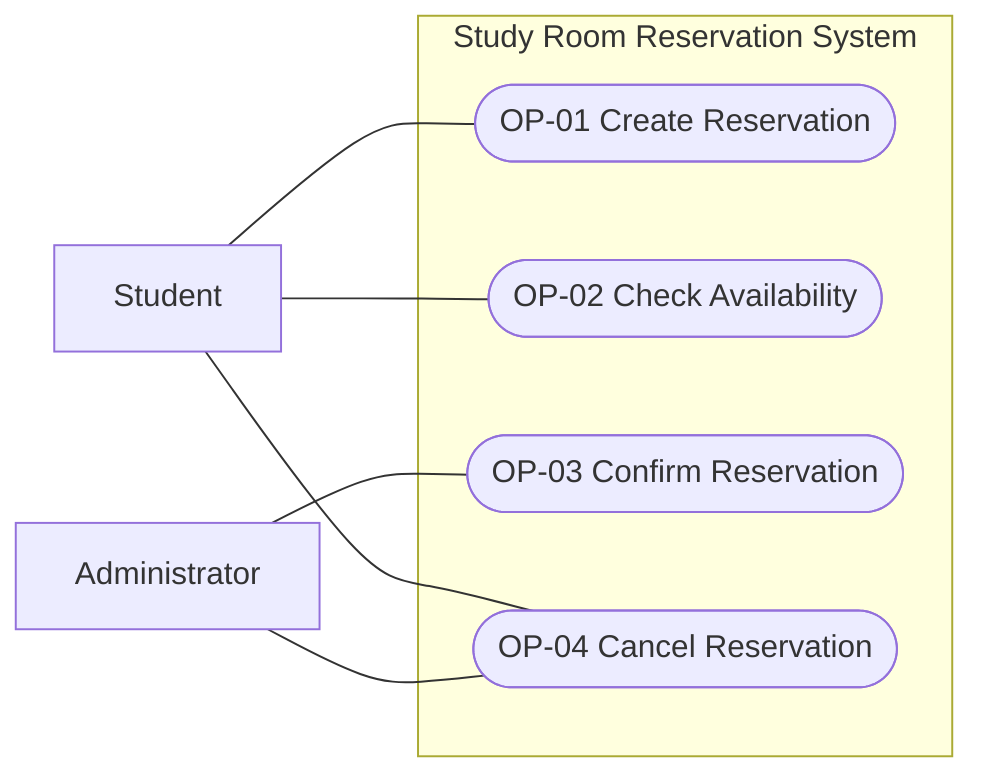
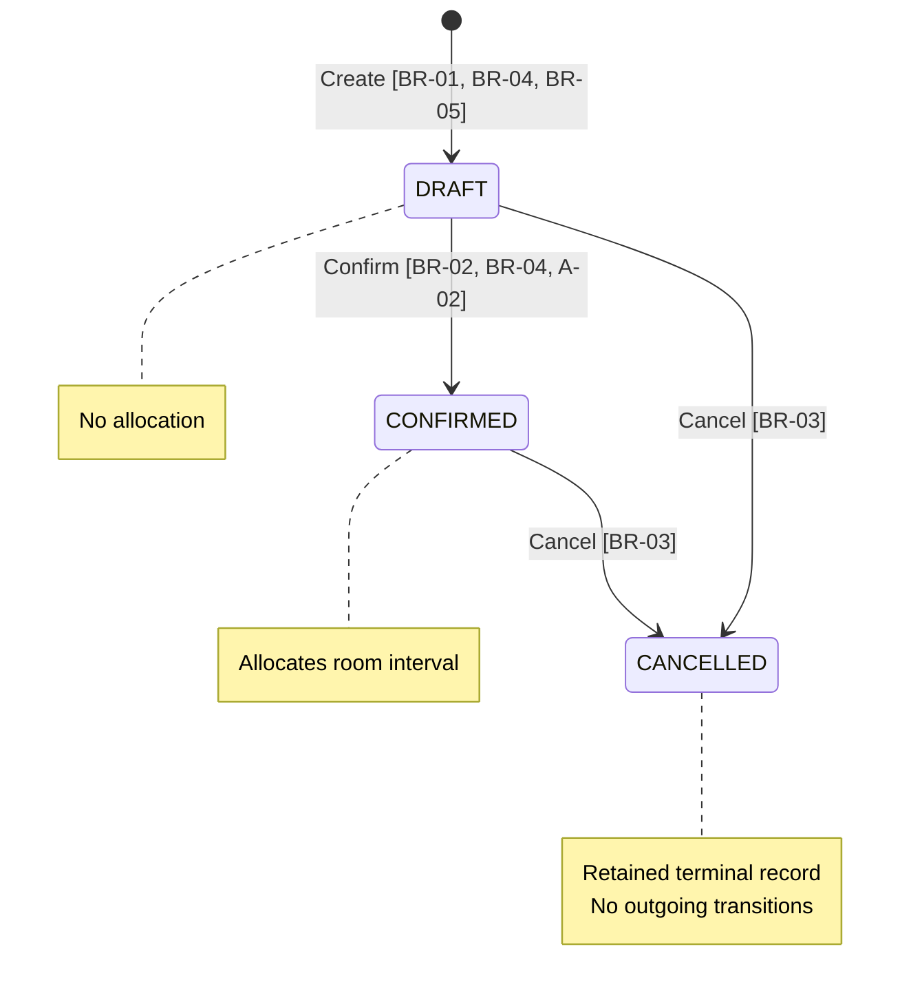
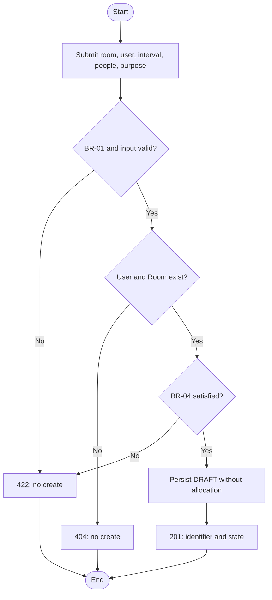
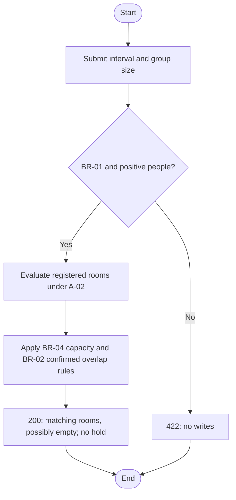
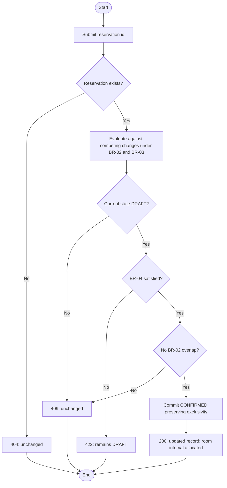
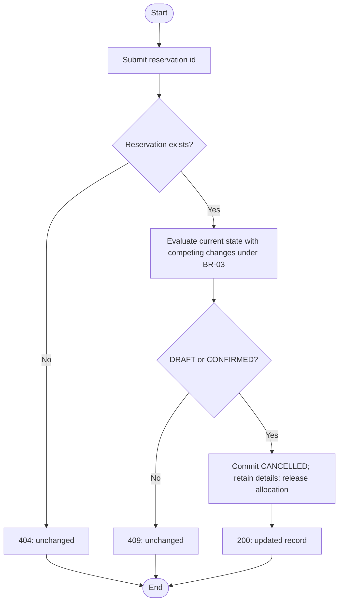

# Baseline v0.1 — behavior views

These diagrams reference the authoritative [operation slices and shared
rules](baseline-v0.1.md). They describe observable behavior, not database
or framework structure. Actor associations are demo responsibilities under
A-01, not security enforcement.

## Actor-goal view

The Notification Service has no interaction in v0.1 and is therefore not
shown as a supporting actor. User/room setup and reads are supporting
capabilities, not additional core goals.

## Reservation lifecycle statechart

Rejected operations do not transition. Repeated Confirm and repeated Cancel
are rejected as defined in the slices. Check Availability reads state without
transitioning. Concurrent transitions must obey BR-02 and BR-03.

## OP-01 activity — Create Reservation

A-01 is assumed at entry. An occupied interval does not prevent Create.

## OP-02 activity — Check Availability

## OP-03 activity — Confirm Reservation

A-02 supplies the active-resource condition. The evaluate-through-commit
behavior is indivisible with respect to conflicting operations; the boxes
do not authorize an unsafe check-then-update implementation.

## OP-04 activity — Cancel Reservation

BR-03 has no time cutoff, so this flow contains no clock decision.
