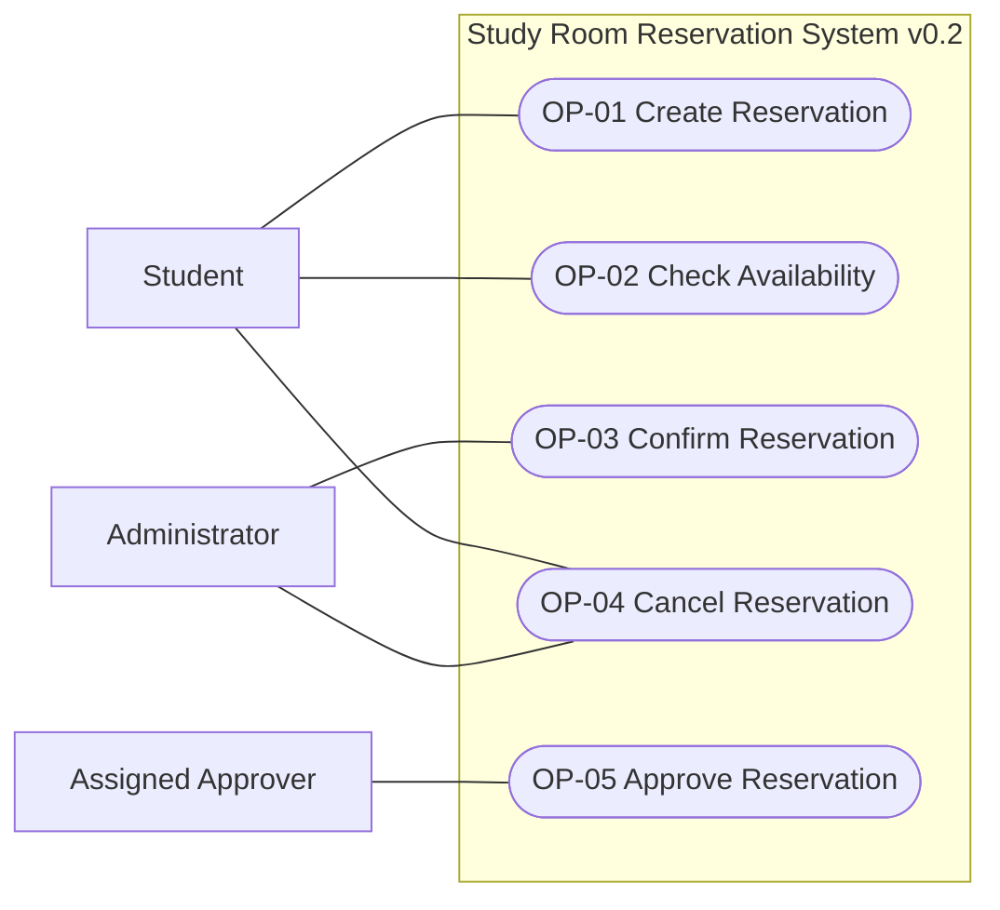
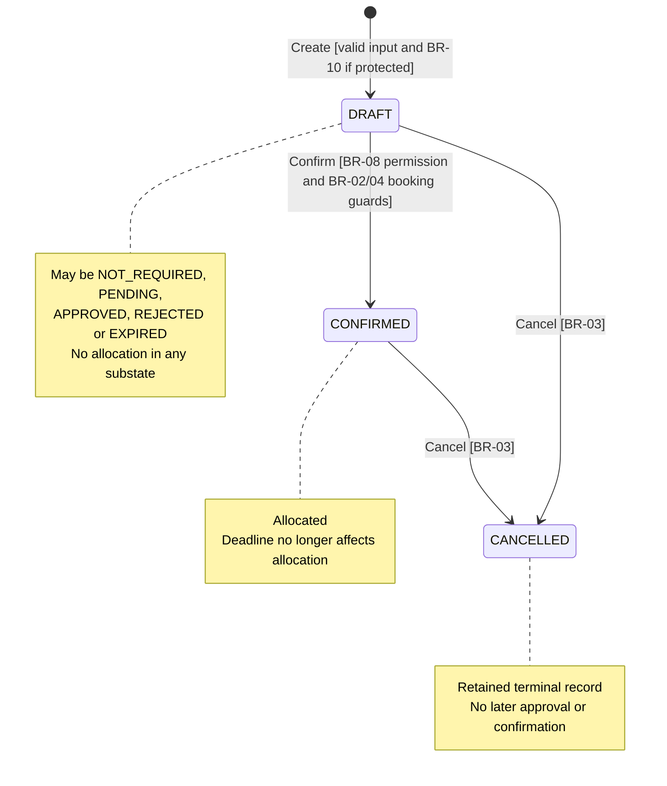
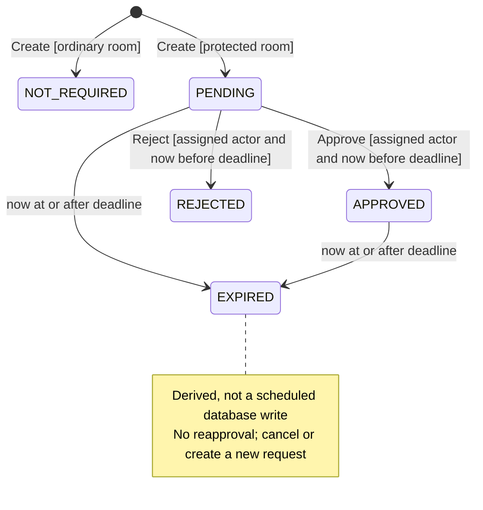
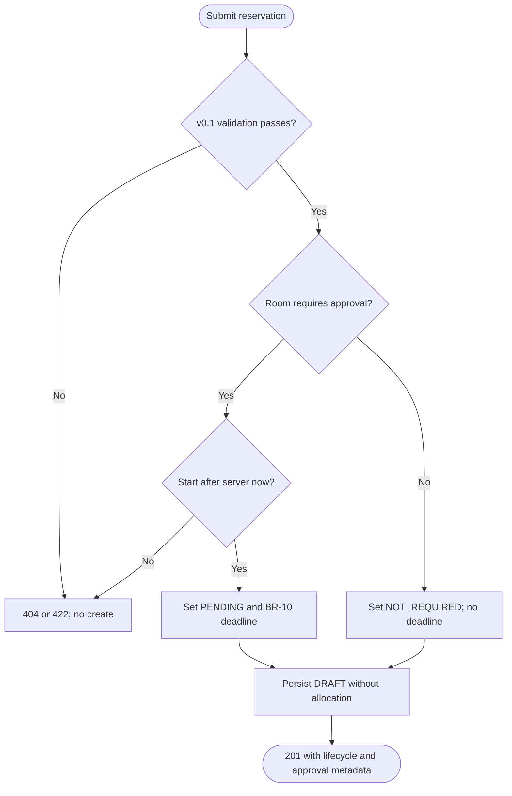
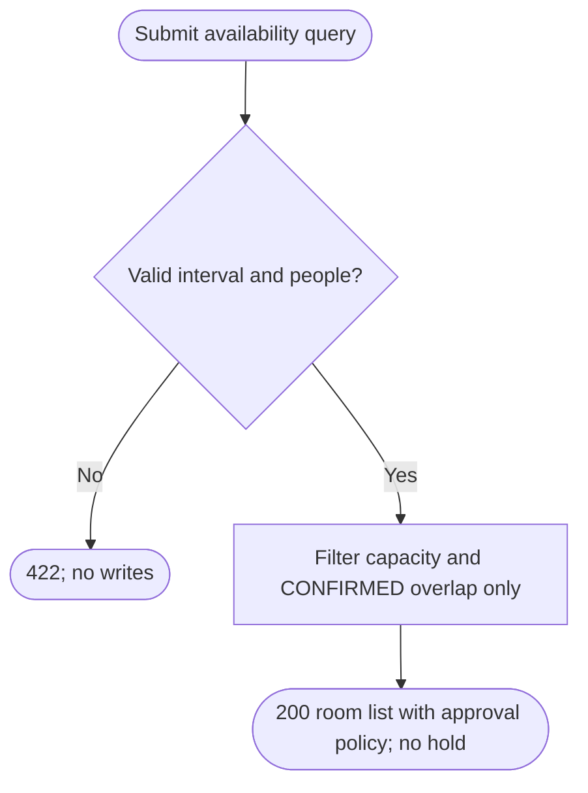
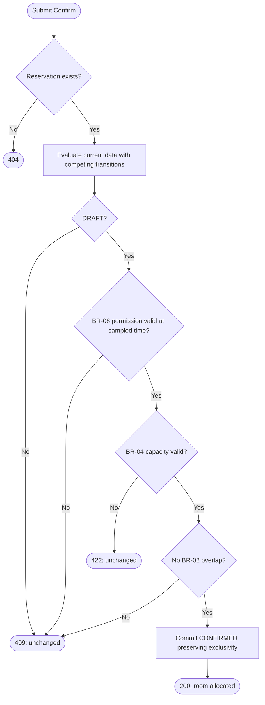
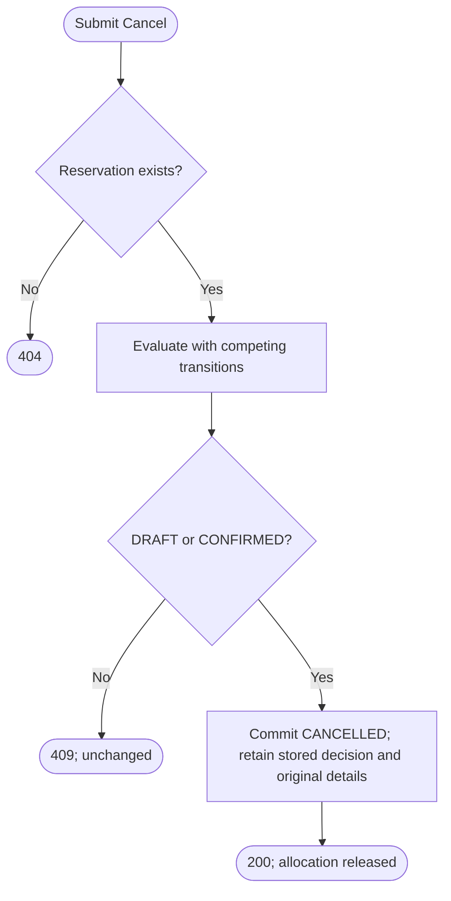
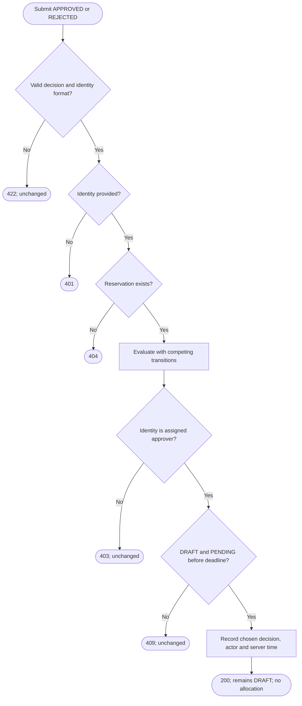

# Baseline v0.2 — behavior views

Rules and guards reference [v0.2](baseline-v0.2.md). Approval and lifecycle are
separate dimensions. These are logical activity views, not architectural choices.

## Actor-goal view

Approve includes an authorized rejection outcome. An Approver can also be an
administrator, but administrative UI access alone does not grant assignment.
No Notification Service interaction is implemented.

## Reservation lifecycle

## Effective approval state while DRAFT

NOT_REQUIRED and unexpired APPROVED satisfy the permission guard for Confirm;
neither allocates by itself. Cancel ends the DRAFT lifecycle from any substate.
Once outside DRAFT, the API shows the recorded decision as history (BR-11), not
an active approval state. REJECTED has no approval transition; Cancel is still
available through the reservation lifecycle.

## OP-01 activity

## OP-02 activity

## OP-03 activity

Evaluate-through-commit is consistent with BR-12; the flow does not prescribe
an unsafe non-atomic check/update sequence.

## OP-04 activity

No approval-state or clock restriction is added to cancellation.

## OP-05 activity

