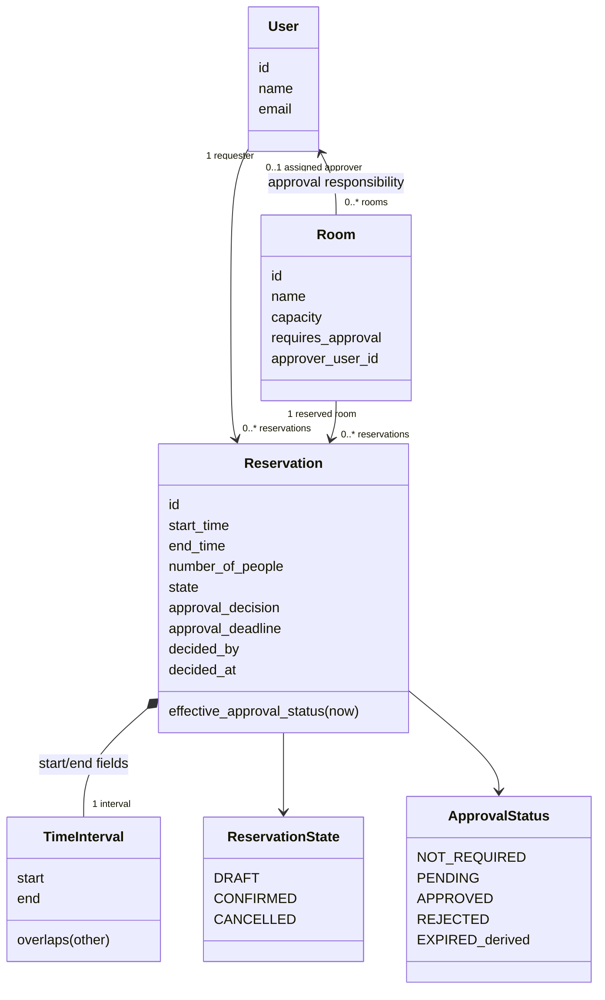
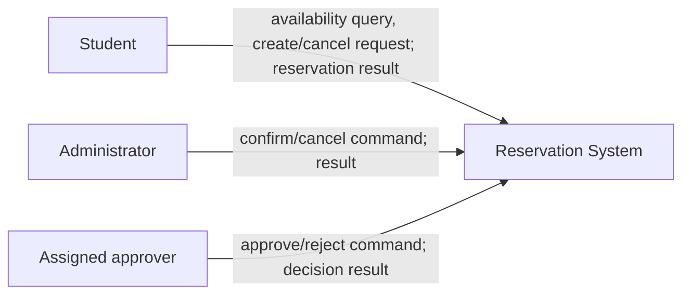
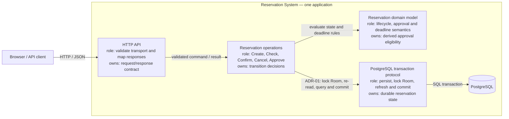
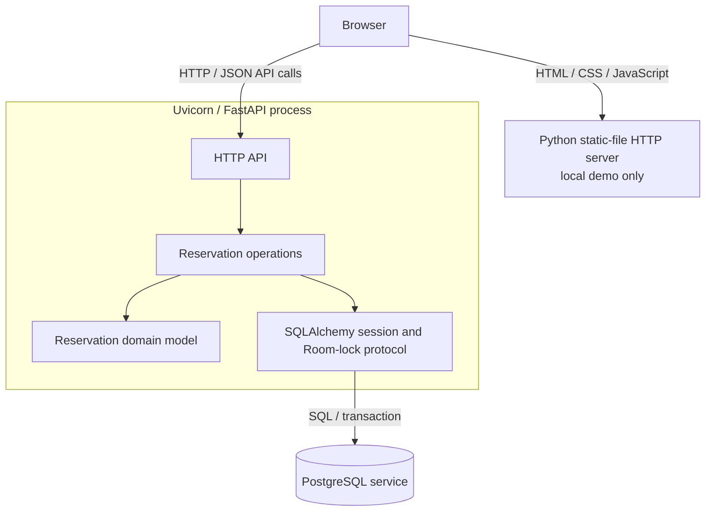
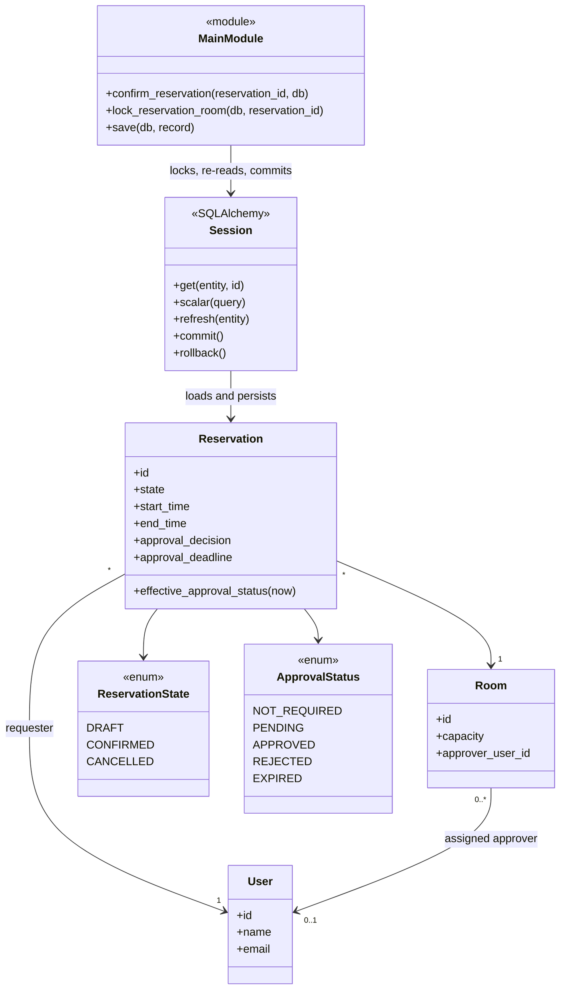

# C03 — Architecture Design (Part B)

This document records the architecture work that follows the Part A
implementation map in
[Architecture and Decisions](architecture-and-decisions.md#c03-architecture-baseline).
It uses the v0.2 specification, its C02 behavior evidence, and the implemented
Confirm Reservation (OP-03) path.

Status: architecture proposal awaiting team review.

## B. Architecture drivers

| Driver | Evidence / source | Architectural consequence | Question to answer |
| --- | --- | --- | --- |
| Exclusive allocation under contention | REQ-04 / BR-02; Part A records a per-Room PostgreSQL row lock and a concurrent-confirm test. The guarantee covers supported API transitions, not arbitrary database writers. | The final eligibility check and commit must share a consistency boundary. | Where must the authoritative confirmation decision happen so two competing requests cannot both allocate one room? |
| Assigned-approver authorization | REQ-07 / BR-08; v0.2 tests missing, wrong, and unknown `X-User-Id` values. The header is a trusted demo assertion, not authenticated identity. | The approval decision needs one authorization owner and a future verified-identity boundary. | Who establishes the actor identity and enforces the room's assigned-approver rule? |
| Deadline correctness | REQ-08 / BR-10; exact-boundary tests use a controlled clock. The implementation evaluates a process-local UTC clock; multi-host clock policy is open. | Approval eligibility must use one explicit instant after waiting for transition serialization. | Which clock supplies the decision instant, and when is it sampled? |
| Notification failure semantics | C01 identifies a Notification Service boundary; C02 does not implement delivery or require proactive notifications. | Do not couple an unrequired external delivery failure to a reservation transaction. Revisit if reliable delivery becomes a requirement. | If notifications become required, should state commit independently and who owns retry? |

## C1. Domain class model

The model focuses on concepts in OP-03 and the drivers above. `TimeInterval`
is a conceptual value represented in the current model by `start_time` and
`end_time`; approval is stored as decision and attribution fields on
`Reservation`, not as a separate persistent entity.



Invariants: `end_time > start_time`; attendance and room capacity are positive;
attendance does not exceed room capacity at creation or confirmation; only
CONFIRMED reservations allocate a room; same-room CONFIRMED intervals do not
overlap. Intervals are half-open, so adjacent reservations are allowed.
EXPIRED is derived for eligible DRAFT reservations at/after their deadline;
it is not a stored lifecycle state.

## C2. Responsibilities and ownership needs

| Source | Responsibility | Must decide / own | Group with | Separate from | One clear owner needed? |
| --- | --- | --- | --- | --- | --- |
| HTTP operations | Validate transport shape and map outcomes to HTTP | Request/response contract and status mapping | HTTP parsing | Reservation policy and persistence details | Yes |
| OP-03 / statechart | Decide whether confirmation is allowed | DRAFT, approval, capacity, and overlap guards | Shared transition rules | HTTP formatting and notification delivery | Yes |
| OP-05 / REQ-07 | Authorize and record approval or rejection | Assigned-approver check and one decision with actor/time | Approval state and transition serialization | Identity-provider protocol | Yes |
| BR-02 / REQ-04 | Preserve exclusive room allocation | Serialize supported competing transitions and commit | Final overlap check and state write | Availability's read-only snapshot | Yes |
| REQ-08 / BR-10 | Evaluate deadline eligibility | Deadline rule and sampled UTC instant | Approval eligibility | Transport clock formatting | Yes |
| C01 persistence / OP-01–05 | Store and retrieve reservation state | Database session and transaction outcome | State mutation and room lock | Notification network calls | Yes |

## D. Main decision question

**Where should the authoritative Confirm decision be enforced so BR-02 remains
true for competing reservation requests?**

## E1–E3. Alternatives and scenario comparison

The same complication is used for both alternatives: two approved DRAFTs for
the same room and overlapping interval are confirmed concurrently.

### E1. Structural alternatives

**Alternative A — application transaction with a per-Room row lock (selected)**

```text
[Reservation API / transition operations]
          | lock Room, re-read, evaluate, commit
          v
     [PostgreSQL]
```

Every supported state-changing API operation locks the Room row before its
final checks, refreshes the reservation after waiting, and commits the decision
in that transaction.

**Alternative B — database exclusion constraint**

```text
[Reservation API / transition operations]
          | attempt CONFIRMED write
          v
 [PostgreSQL exclusion constraint]
```

A PostgreSQL range exclusion constraint rejects overlapping CONFIRMED
intervals at commit, including writes that bypass the API. The API translates
the constraint violation to the established conflict response. This would
require a data-preserving migration and a supported range/GiST index setup.

### E2. Consequences against drivers

| Driver / criterion | Alternative A: application row lock | Alternative B: database exclusion |
| --- | --- | --- |
| BR-02 consistency | Serializes the supported API transition protocol; all relevant checks happen before commit. Direct database writers can bypass it. | Database rejects overlapping confirmed rows from any writer subject to the constraint. Application still needs to enforce approval, capacity, and lifecycle rules. |
| Approval/cancel coordination | Confirm, Approve, and Cancel already share the same Room lock, so their decisions serialize together. | Constraint protects allocation overlap only; approval and cancellation still need an application transaction protocol. |
| Change and migration risk | Matches the current code and existing concurrency tests; no schema migration is needed for this choice. | Requires a PostgreSQL-specific migration, extension/index support, and conflict mapping; deployment must verify the constraint on existing data. |
| Operations / failure behavior | A hot Room is intentionally serialized; lock waits occur in the application transaction. | Constraint is an additional last-line guarantee, but lock/constraint violations still require a defined API error mapping. |

### E3. Concurrent scenario walkthrough

| Step / event | Alternative A | Alternative B |
| --- | --- | --- |
| Two Confirm requests start for overlapping drafts | Each request loads its reservation and tries to lock the same Room row. | Both attempt their final CONFIRMED write; application may also lock a Room for approval/cancel coordination. |
| First request reaches the decision | It acquires the lock, refreshes, validates approval/capacity/overlap, then commits CONFIRMED. | One transaction commits; the exclusion constraint records the interval as occupied. |
| Second request reaches the decision | It acquires the lock after the first commit, refreshes, observes the conflict, and returns HTTP 409 without changing state. | Its write violates the exclusion constraint; the transaction rolls back and the API maps the violation to HTTP 409. |
| Important limitation | A direct SQL writer that does not follow the lock protocol can bypass the application guarantee. | The constraint protects overlap even for direct writers, but does not replace authorization, approval, capacity, or transition checks. |

## F. ADR-01 — Where should the authoritative Confirm decision be enforced?

**Context:** Confirm must preserve exclusive allocation while approval can be
delayed and room availability can change. The implemented API already uses a
shared Room-row lock for Confirm, Approve, and Cancel and re-reads after
waiting.

**Drivers:** BR-02 / REQ-04 consistency; REQ-07 approval authorization; REQ-08
deadline correctness; migration and operational simplicity.

**Alternative A:** Enforce final checks and the state transition in the API
transaction after acquiring the Room-row lock.

**Alternative B:** Enforce no overlapping CONFIRMED intervals with a
PostgreSQL exclusion constraint, while retaining application guards for other
rules.

**Decision:** Select Alternative A as the consistency boundary for supported
application API writers. Keep Confirm, Approve, and Cancel on the same Room
lock-and-refresh protocol. This is the least-disruptive choice supported by the
current implementation and synchronized API tests; it does not claim database
protection from arbitrary direct writers.

**Accepted negative consequences:** A hot Room serializes transitions.
Supported writers must use the API protocol. Direct database writes can
bypass BR-02, and a future writer must not be added without adopting the same
lock protocol or revisiting this ADR.

**Reconsider when:** A supported non-API writer is introduced, contention
measurements show unacceptable lock waits, or the system requires the database
to enforce exclusivity against every writer.

## G1. System context

Only actors and real external systems are shown. PostgreSQL is an internal
runtime dependency, not an external business actor; Notification Service is
not integrated and is therefore not shown as a live connection.



## G2. TO-BE logical architecture

The selected design uses one deployable. The elements below group logical
responsibilities within the existing Python modules. The transaction/row-lock
owner implements the ADR decision.



| Logical element | Primary responsibility / ownership | Current implementation location |
| --- | --- | --- |
| HTTP API | Owns transport validation and response/error mapping; does not own a separate allocation policy. | FastAPI routes in `src/main.py`; Pydantic contracts in `src/schemas.py`. |
| Reservation operations | Owns the final Create, Confirm, Cancel, and Approve decisions. | Operation functions in `src/main.py`. |
| Reservation domain model | Owns lifecycle/approval data representation and derived deadline status. | `Reservation`, enums, `effective_approval_status()`, and `utc_now()` in `src/models.py`. |
| PostgreSQL transaction protocol | Owns durable state and the selected lock-refresh-commit consistency mechanism. | `lock_reservation_room()`, `save()`, and request session use in `src/main.py`; engine/session configuration in `src/database.py`. |

The present implementation co-locates HTTP and operation responsibilities in
`src/main.py`; the table names logical owners, not new classes or packages.
The single primary owner for the Confirm decision is the Reservation
operations element. The transaction protocol supplies the required atomic
serialization mechanism.

## G3. Transition ownership

| Transition / decision | Decision owner | Who may request it |
| --- | --- | --- |
| Create → DRAFT with NOT_REQUIRED or PENDING | Reservation operations (`create_reservation`) | Student/client submitting a valid create request |
| DRAFT → CONFIRMED | Reservation operations (`confirm_reservation`), using the shared Room lock and all current guards | Administrator/API caller; current Confirm endpoint has no authenticated actor check |
| PENDING → APPROVED or REJECTED | Reservation operations (`approve_reservation`) after assigned-approver check | Assigned approver only by the trusted demo `X-User-Id` check |
| DRAFT or CONFIRMED → CANCELLED | Reservation operations (`cancel_reservation`) using the shared Room lock | Administrator/API caller under current demo policy |
| Pending/approved DRAFT → effective EXPIRED | Domain model (`effective_approval_status(now)`); derived on read/validation, no stored transition | No requester; the clock reaching the deadline makes the derived status observable |

## G4. Runtime / deployment mapping



All four logical architecture elements run inside one API process; PostgreSQL
is a separate database service. The optional static-file server is a separate
local demo process. No approval worker, scheduler, notification service, or
identity provider is currently deployed.

## H1. Design sequence — concurrent Confirm

This realizes OP-03 for an approved DRAFT while another overlapping Confirm
competes for the same Room. Participants match G2 and G4.

```mermaid
sequenceDiagram
    actor AdminA as API caller A
    actor AdminB as API caller B
    participant HTTP as HTTP API
    participant Ops as Reservation operations
    participant Tx as PostgreSQL transaction protocol
    participant DB as PostgreSQL
    participant Domain as Reservation domain model

    par competing request A
        AdminA->>HTTP: POST /reservations/{id}/confirm
        HTTP->>Ops: confirm(reservation id)
        Ops->>Tx: load reservation; lock its Room; refresh
        Tx->>DB: SELECT reservation and Room FOR UPDATE
        DB-->>Tx: locked Room and current reservation
        Tx-->>Ops: refreshed state
        Ops->>Domain: evaluate DRAFT, approval, deadline and capacity
        Domain-->>Ops: guards pass
        Ops->>Tx: check for an overlapping CONFIRMED reservation
        Tx->>DB: SELECT overlapping reservation
        DB-->>Tx: no conflict
        Tx-->>Ops: no conflict
        Ops->>Ops: assign state = CONFIRMED
        Ops->>Tx: commit
        Tx->>DB: COMMIT
    and competing request B
        AdminB->>HTTP: POST /reservations/{id}/confirm
        HTTP->>Ops: confirm(reservation id)
        Ops->>Tx: load reservation; wait for same Room lock
    end
    DB-->>Tx: commit succeeds for A
    Tx-->>HTTP: confirmed reservation
    HTTP-->>AdminA: 200 ReservationRead
    Tx->>DB: lock released; refresh B after lock
    DB-->>Tx: current room state includes A's booking
    Tx-->>Ops: refreshed state for B
    Ops->>Tx: check overlap
    Tx->>DB: SELECT overlapping CONFIRMED reservation
    DB-->>Tx: conflict found
    Tx-->>Ops: conflict
    Ops-->>HTTP: reject without state change
    HTTP-->>AdminB: 409 conflict
```

## H2. Focused design class diagram

`MainModule` is marked as a module because the implementation has route
functions rather than a separate application-service class. This keeps
operation ownership consistent with G2 and Part A.



## I. Cross-view consistency check

| Check | Result | Evidence / correction |
| --- | --- | --- |
| C02 rules ↔ G2 | Pass for supported API behavior. Confirm checks approval, current capacity and overlap; availability is not treated as a hold. | [OP-03 and BR-02](baseline-v0.2.md); row-lock sequence in H1. Direct SQL writers remain outside the selected guarantee. |
| C2 responsibilities ↔ G2 | Pass. Each listed responsibility has one primary logical owner; the existing implementation co-locates some owners in `src/main.py`. | Responsibility table and implementation mapping in G2. |
| G2 ↔ H1 | Pass. H1 uses only HTTP API, Reservation operations, domain model, PostgreSQL transaction protocol, and PostgreSQL shown in G2/G4. | Concurrent-success and conflict branches are explicit. |
| H1 ↔ H2 | Pass. `confirm_reservation`, `lock_reservation_room`, and `save` belong to `MainModule`; persistence operations belong to `Session`; state and deadline data belong to `Reservation` and its enums. | H2 names the module rather than inventing a nonexistent service class. |
| Statechart ↔ G3/H1 | Pass. Confirm requires an eligible DRAFT; approval remains separate from allocation; expiry is derived; the losing concurrent Confirm remains unchanged. | [v0.2 lifecycle and approval views](baseline-v0.2-diagrams.md). |
| G2 ↔ G4 | Pass. Logical elements map to one Uvicorn process and a separate PostgreSQL service. | No worker or notification process is claimed. |
| ADR-01 ↔ G2/G4 | Pass. The row-lock/refresh/commit protocol is explicit in G2 and maps to the API process and PostgreSQL in G4. | ADR-01 and H1. |

## J. AS-IS → TO-BE delta

| Area | AS-IS | Accepted design | Action |
| --- | --- | --- | --- |
| Confirm guards and transition | `confirm_reservation()` in `src/main.py` owns the decision and writes CONFIRMED after checks. | Reservation operations remains the single decision owner. | KEEP |
| Cross-operation concurrency | Confirm, Approve, and Cancel use `lock_reservation_room()` and refresh after waiting. | Shared per-Room lock protocol remains the selected consistency boundary. | KEEP |
| Durable state / persistence | SQLAlchemy session and PostgreSQL persist reservation and approval state. | Same database and transaction boundary. | KEEP |
| Approval eligibility | `Reservation.effective_approval_status(now)` derives EXPIRED from the deadline. | Preserve on-demand expiry; no worker is required. | KEEP |
| Direct state-mutation ownership | Existing code places persisted lifecycle assignments in Confirm and Cancel; Create initializes DRAFT. | Only Confirm and Cancel may mutate an existing reservation lifecycle in application code. | VERIFY |
| Identity and time | Demo `X-User-Id`; process-local UTC clock. | Production identity and the multi-host clock source remain open decisions. | VERIFY |

No application refactor is required by this decision: the selected logical
owners and transaction protocol already match the supported API implementation.
The lifecycle-ownership VERIFY row is checked by the architecture test below.
Identity and clock limitations remain documented as open decisions.

## K. Implementation changes

- Added a repeatable AST-based architecture test for lifecycle mutation
  ownership.
- No application behavior or persistence code was changed because every J
  `CHANGE` candidate was resolved as KEEP or VERIFY.

## L1. Behavior verification

| Verification | Result | Evidence |
| --- | --- | --- |
| Successful approval then Confirm; approval does not allocate by itself | Passed in the recorded v0.2 suite; not rerun during this documentation/test-only change. | `test_approval_is_permission_not_allocation` in `tests/test_approval.py`; recorded baseline result in [v0.2 evidence](Baseline%20v0.2-evidence.md). |
| Concurrent overlapping Confirm | Passed in the recorded v0.2 suite; not rerun during this documentation/test-only change. | `test_concurrent_approved_confirms_still_exclusive` in `tests/test_approval.py`; Part A trace in [Architecture and Decisions](architecture-and-decisions.md#c03-architecture-baseline). |
| Recheck conflict after delayed approval | Passed in the recorded v0.2 suite; not rerun during this documentation/test-only change. | `test_delayed_approval_does_not_override_new_conflict` in `tests/test_approval.py`. |

The repository's recorded v0.2 run reports 55 passed and 2 warnings on
2026-09-28. The PostgreSQL suite was not rerun for this C03 change.

## L2. Architecture conformance

**Architecture rule:** Only the Confirm and Cancel operation functions may
assign the lifecycle state of an existing reservation. Creation initializes a
new reservation as DRAFT.

**Check:** `tests/test_architecture.py` parses `src/main.py` and asserts that
all Python modules under `src/` assign `.state` only in
`confirm_reservation()` and `cancel_reservation()` in `src/main.py`.

**Result:** Passed: `tests/test_architecture.py` — 1 passed. See
[C03 Architecture Evidence](evidence-and-evolution.md#c03--architecture-evidence).

## M. Evidence and remaining uncertainty

The C03 evidence summary is maintained in
[evidence-and-evolution.md](evidence-and-evolution.md#c03--architecture-evidence).
Remaining risks are trusted demo identity, process-local clock consistency,
unsupported direct database writers, unknown production deployment
requirements, and unresolved notification delivery requirements.

**Commit/tag:** `c265c90ad4dbd34635c5bef6d7fc39c561013a57` — C03 architecture
design, evidence, and conformance test. This evidence reference is recorded in
a follow-up documentation commit.
