# Intent and Change

Owns requirements, business rules, operation contracts and observable behavior.

**Current baseline:** C02 v0.2. Its explicitly unchanged v0.1 rules remain applicable. C01 and v0.1 sections preserve historical intent; v0.2 changes take precedence.

## Contents

- [c01-intent: Project Frame](#c01-intent)
- [c02-v01: Baseline v0.1 — complete minimum system](#c02-v01)
- [c02-v01-views: Baseline v0.1 — behavior views](#c02-v01-views)
- [c02-change: C02 change card — approval workflow (Part B.12)](#c02-change)
- [c02-v02: Baseline v0.2 — approval workflow (Part B.13)](#c02-v02)
- [c02-v02-views: Baseline v0.2 — behavior views](#c02-v02-views)

<a id="c01-intent"></a>

<a id="project-frame"></a>
<a id="c01-intent-project-frame"></a>

## Project Frame

This document records the v0.1 foundation. For the current approval change,
see [Baseline v0.2](intent-and-change.md#c02-v02) and its explicit scope and C03 drivers.

<a id="reservation-domain"></a>
<a id="c01-intent-reservation-domain"></a>

### Reservation domain

The system reserves study rooms for students.

A Room is the resource being reserved. A Reservation connects a User
to a Room for a specific time interval.

<a id="purpose"></a>
<a id="c01-intent-purpose"></a>

### Purpose

The Study Room Reservation System allows students to find available
study rooms and create reservations for a selected time period.

Administrators can review, confirm, and cancel reservation requests
while the system prevents conflicting confirmed reservations.

<a id="users--stakeholders"></a>
<a id="c01-intent-users--stakeholders"></a>

### Users / Stakeholders

<a id="student"></a>
<a id="c01-intent-student"></a>

#### Student

A student searches for available rooms, creates reservations, views
their reservations, and cancels reservations they no longer need.

<a id="administrator"></a>
<a id="c01-intent-administrator"></a>

#### Administrator

An administrator reviews reservation requests and can confirm or
cancel them.

<a id="facility-manager"></a>
<a id="c01-intent-facility-manager"></a>

#### Facility manager

A facility manager is interested in room information, capacity, and
how rooms are being reserved.

<a id="core-concepts"></a>
<a id="c01-intent-core-concepts"></a>

### Core concepts

<a id="user"></a>
<a id="c01-intent-user"></a>

#### User

The person who creates a reservation.

A User contains:

- Identifier
- Name
- Email

<a id="room"></a>
<a id="c01-intent-room"></a>

#### Room

The study room that can be reserved.

A Room contains:

- Identifier
- Name or room code
- Location
- Capacity

<a id="reservation"></a>
<a id="c01-intent-reservation"></a>

#### Reservation

A request to use a room during a specific time interval.

A Reservation contains:

- Identifier
- User identifier
- Room identifier
- Start time
- End time
- Number of people
- Purpose
- State

<a id="core-operations"></a>
<a id="c01-intent-core-operations"></a>

### Core operations

The system supports the following core operations:

- Create a reservation.
- Confirm a reservation.
- Cancel a reservation.
- Check room availability.

Viewing reservations belonging to a user and viewing all reservations are
supporting queries, not additional core operations.

The complete minimum contract is defined in [Baseline v0.1](intent-and-change.md#c02-v01).

<a id="persistent-state"></a>
<a id="c01-intent-persistent-state"></a>

### Persistent state

The system stores User, Room, and Reservation records in PostgreSQL.

For each User, the system stores:

- Identifier
- Name
- Email

For each Room, the system stores:

- Identifier
- Name
- Location
- Capacity

For each Reservation, the system stores:

- Identifier
- User identifier
- Room identifier
- Start time
- End time
- Number of people
- Purpose
- State

The Reservation references an existing User and an existing Room
through foreign keys.

<a id="reservation-states"></a>
<a id="c01-intent-reservation-states"></a>

### Reservation states

The system uses the following Reservation states:

- `DRAFT` — the reservation has been created but does not allocate the room.
- `CONFIRMED` — the reservation allocates the room for its time interval.
- `CANCELLED` — the reservation is no longer active and does not hold
  the room.

<a id="state-changing-operation"></a>
<a id="c01-intent-state-changing-operation"></a>

### State-changing operation

A new reservation starts in the `DRAFT` state.

The supported state transitions are:

```text
Create reservation:
new → DRAFT

Confirm reservation:
DRAFT → CONFIRMED

Cancel draft:
DRAFT → CANCELLED

Cancel confirmed reservation:
CONFIRMED → CANCELLED
```

A `CANCELLED` reservation cannot be confirmed again.

A `CONFIRMED` reservation cannot be confirmed a second time.

<a id="common-business-rule"></a>
<a id="c01-intent-common-business-rule"></a>

### Common business rule

Two `CONFIRMED` reservations for the same room must not overlap.

Reservations overlap when:

```text
existing.start_time < requested.end_time
AND
existing.end_time > requested.start_time
```

A `DRAFT` reservation does not hold a room.

A `CANCELLED` reservation does not hold a room.

Adjacent reservations are allowed. For example, a reservation ending
at 11:00 does not overlap another reservation starting at 11:00.

<a id="domain-specific-business-rule"></a>
<a id="c01-intent-domain-specific-business-rule"></a>

### Domain-specific business rule

The number of people in a reservation must be greater than zero and
must not exceed the capacity of the selected room.

For example, a Room with capacity 6 cannot accept a Reservation for
7 people.

Room capacity must also be greater than zero.

<a id="external--system-boundary"></a>
<a id="c01-intent-external--system-boundary"></a>

### External / system boundary

The selected external boundary is a Notification Service.

The reservation system may request the Notification Service to notify
a user when a reservation is confirmed or cancelled.

The Notification Service is outside the current application boundary.
It is identified as a dependency during C01 but is not implemented as
part of the C01 persistence spike.

A future version must decide whether notification delivery is
synchronous or asynchronous and what should happen when delivery fails.

<a id="assumption"></a>
<a id="c01-intent-assumption"></a>

### Assumption

The current application assumes that users are already authenticated
and that a valid user identity is available.

Authentication and authorization are outside the current C01 scope.
The frontend currently uses a configured demonstration user.

<a id="unknown"></a>
<a id="c01-intent-unknown"></a>

### Unknown

We do not yet know how a failed or delayed notification should affect
a successful reservation state change.

In particular, it is not yet decided whether a notification failure
should:

- Roll back the reservation state change.
- Be retried asynchronously.
- Be recorded for later manual handling.

<a id="selected-future-pressure"></a>
<a id="c01-intent-selected-future-pressure"></a>

### Selected future pressure

Category: `Q — Quality / Scale`

<a id="concrete-pressure"></a>
<a id="c01-intent-concrete-pressure"></a>

#### Concrete pressure

The system may need to support ten times more students attempting to
reserve popular study rooms concurrently.

<a id="why-it-is-relevant-to-our-reservation-system"></a>
<a id="c01-intent-why-it-is-relevant-to-our-reservation-system"></a>

#### Why it is relevant to our reservation system

Several students may try to confirm reservations for the same room and
time at nearly the same moment.

A simple application-level “check and then update” sequence can allow
two conflicting reservations when requests run concurrently.

The current backend serializes confirmation operations for the same
room by acquiring a PostgreSQL row lock. Future work should verify this
behavior under higher load and evaluate whether additional database
constraints or transaction strategies are required.


---

<a id="c02-v01"></a>

<a id="c02-v01-baseline-v01--complete-minimum-system"></a>

## Baseline v0.1 — complete minimum system

Status: specification and executable verification complete for the selected scope.
Team acceptance is recorded in the [baseline review](evidence-and-evolution.md#c02-v01-review-team-acceptance-record).
Executed results are recorded separately in [C02 evidence](evidence-and-evolution.md#c02-v01-evidence).
The scenario catalogue defines expected behavior, not proof by itself.

<a id="c02-v01-c02-scope-and-cp1-connection"></a>

### C02 scope and CP1 connection

C02 assumes C01 is complete and primarily builds Requirements + Evidence.
The existing [C01 evidence](evidence-and-evolution.md#milestone-evidence) is reused without
recreating its experiment or outputs. This specification defines the complete
minimum behavior, independently of how much the existing test proves.

C03 adds Architecture and turns the running baseline into a defensible
walking skeleton. References below to existing implementation mechanisms
describe current code, not completion or validation of C03. CP1 is frozen
after C03 and reviewed during C04; this C02 specification does not freeze CP1.

<a id="c02-v01-purpose-and-boundary"></a>

### Purpose and boundary

Students reserve study rooms for a time interval. A Room is the Resource;
a Reservation links one existing User to one existing Room. The minimum
system has exactly four core operations: Create Reservation, Check
Availability, Confirm Reservation, and Cancel Reservation.

The browser, reservation API, and PostgreSQL storage are inside the system.
The Notification Service is an identified external boundary; delivery is
not required or invoked in v0.1. Its future failure policy remains open.

Students create reservations, check availability, view their records, and
cancel them. The current administrator interface offers confirmation and
cancellation. This is an interface responsibility, not a business approval
workflow: Confirm checks system constraints and allocates the room. There
is no Approve operation, approval decision, approver field, or approval state.

The baseline assumes an existing user identity and prepared room records.
Authentication and enforced role/ownership authorization are outside this
demonstration baseline; the current Admin page and API do not enforce them.
User/room setup and reservation reads support the four operations.

**A-01 — Demo identity boundary:** C02 uses the existing
trusted demo identity. “Authorized User” in the assignment reference
is an environmental assumption here, not a verified access-control feature.
Unknown user ids are rejected, but that is not authentication. No 401/403 or
ownership enforcement is claimed. This is an explicit adaptation of the
reference example, documented in the baseline review.

**A-02 — Active resources:** all registered rooms are treated as active.
There is no inactive state or deactivate operation in v0.1. Thus the reference Confirm “active” guard is satisfied
by an existing room within this restricted domain. Inactive-room rejection
cannot be demonstrated and is not claimed. A later inactive-room feature
must extend the model, availability rules, Confirm guard, and tests.

<a id="c02-v01-minimum-persistent-model"></a>

### Minimum persistent model

| Entity | Required stored fields |
| --- | --- |
| User | `id`, `name`, `email` |
| Room | `id`, `name`, `location`, `capacity` |
| Reservation | `id`, `user_id`, `room_id`, `start_time`, `end_time`, `number_of_people`, `purpose`, `state` |

<a id="c02-v01-shared-business-rules-and-invariants"></a>

### Shared business rules and invariants

These are the authoritative definitions. Slices and diagrams reference their
identifiers; short labels in diagrams do not redefine them.

| ID | Rule / invariant |
| --- | --- |
| BR-01 — Time | Start and end are timezone-aware instants with start < end. Intervals are half-open `[start,end)`. Overlap means `a.start < b.end AND a.end > b.start`. Adjacent intervals do not overlap. |
| BR-02 — Exclusive resource | In every committed state reachable through the supported API, no two CONFIRMED reservations overlap for the same room. Only CONFIRMED blocks availability, regardless of unused seats. This includes concurrent attempts. |
| BR-03 — Cancellation | DRAFT and CONFIRMED may be cancelled, with no start-time deadline. Before, at, or after start has the same outcome; no wall clock is consulted. Repeated Cancel is rejected with 409. Original details and identifier are retained. Cancel/Confirm races must be equivalent to one serial order: confirm then cancel both succeed, or cancel succeeds then confirm conflicts; final state is CANCELLED. |
| BR-04 — Capacity (from C01) | Room capacity and attendance are positive integers; attendance must not exceed room capacity at Create and Confirm. Availability excludes rooms below requested attendance. |
| BR-05 — Identity and data | Each reservation has a unique generated id and references existing User and Room records. Purpose is nonblank. All registered rooms are active under A-02; identity is assumed under A-01. |
| BR-06 — Lifecycle | Create makes DRAFT without allocation. Confirm permits only DRAFT → CONFIRMED. Cancel follows BR-03 and ends in CANCELLED, which is terminal. No edit, reopen, reschedule, automatic expiry or completion exists. |
| BR-07 — Observation and atomicity | Successful writes commit and remain readable in a new session. Business rejection leaves stored records unchanged. Availability never writes or reserves a hold; its result reflects committed data visible to the query and can become stale. |

BR-02 is the business invariant the application must preserve. Direct database
writes are outside the supported mutation boundary and can bypass the current
application enforcement. Verification and limitations must state this scope.

<a id="c02-v01-op-01--create-reservation"></a>

### OP-01 — Create Reservation

**Goal / user value:** record a student's intended room use without prematurely
allocating the room.

**Trigger:** student submits `user_id`, `room_id`, `start_time`, `end_time`,
`number_of_people`, and `purpose` to `POST /reservations`.

**Observable requirement(s):**

- **REQ-01:** given BR-01, BR-04 and BR-05, create exactly one durable DRAFT
  and return its generated id and state (201), without allocating the room.
- **REQ-06:** reject invalid input or missing references without creating a record.
  A valid repeated submission creates another draft; no deduplication is promised.

**Preconditions:** A-01; existing User and Room; input satisfies BR-01, BR-04,
and BR-05. Availability is not a precondition.

**Success postcondition:** one new record is readable with submitted values,
a generated id and DRAFT state; prior allocations are unchanged.

**State change:** no record → DRAFT (BR-06).

**Referenced business rule(s) / invariant(s):** BR-01, BR-02, BR-04–BR-07.

**Main success scenario:**

1. Student submits the reservation details.
2. System validates input, referenced User and Room, and capacity.
3. System persists a DRAFT without allocating the room.
4. System returns the reservation with its identifier and state.

**Alternative / failure outcomes:**

- Missing User or Room → 404; no record created.
- Invalid/missing timestamp, nonpositive interval or attendance, capacity
  exceeded, or blank purpose → 422; no record created.
- Overlapping draft or confirmed booking → Create still succeeds if its own
  input is valid; eligibility for allocation is decided by Confirm.
- A-01 does not provide an unauthorized-request rejection path.

**Verification examples:** B01–B02, B06–B08. Given A101 capacity 6, when a user
requests 4 people at 10:00–11:00 UTC, then 201/DRAFT and unchanged availability.
When end equals start, then 422 and no new row. Unknown Room → 404/no new row.

**Rationale / source:** assignment A.1/A.4 separates recording intent from
allocation; C01 supplies persistence and room-capacity rules. A-01 explicitly
adapts the reference authorization precondition.

<a id="c02-v01-op-02--check-availability"></a>

### OP-02 — Check Availability

**Goal / user value:** identify rooms suitable for the student's requested interval
and group size.

**Trigger:** a search sends `start_time`, `end_time`, and `people` (default 1)
to `GET /rooms/available`.

**Observable requirement(s):** **REQ-02:** for valid input, return exactly the
registered rooms satisfying BR-02 and BR-04 (200, possibly an empty list),
without altering reservations or promising a hold.

**Preconditions:** BR-01 and positive integer `people`; A-02 defines room activity.

**Success postcondition:** response contains id, name, location and capacity for
each qualifying room. Stored records are unchanged.

**State change:** none (BR-07).

**Referenced business rule(s) / invariant(s):** BR-01, BR-02, BR-04, BR-05, BR-07.

**Main success scenario:**

1. User submits search interval and group size.
2. System validates the query.
3. System evaluates registered rooms using capacity and confirmed overlaps.
4. System returns qualifying rooms, including an empty list when none qualify.

**Alternative / failure outcomes:** invalid interval/timestamps or nonpositive
people → 422/no writes. No matching rooms → 200/empty list, not an error.
DRAFT and CANCELLED do not exclude a room. A later concurrent Confirm may
change availability; the returned list is not a guarantee.

**Verification examples:** B03–B06, B17. Given a CONFIRMED interval
[10:00,11:00), searches [09:00,10:00) and [11:00,12:00) include the room;
[10:30,11:30) excludes it. Equal endpoints → 422. Seven people with only
capacity-6 and capacity-2 rooms → 200/empty list.

**Rationale / source:** assignment A.5 specifies half-open interval semantics;
C01 adds capacity filtering. This API expresses availability as a list of
qualifying rooms rather than an AVAILABLE/UNAVAILABLE label for one room.

<a id="c02-v01-op-03--confirm-reservation"></a>

### OP-03 — Confirm Reservation

**Goal / user value:** turn a recorded intention into exclusive room allocation.

**Trigger:** administrator submits a reservation id to
`POST /reservations/{id}/confirm`. This actor mapping reflects the demo UI,
not enforced role authorization.

**Observable requirement(s):**

- **REQ-03:** an eligible DRAFT becomes durable CONFIRMED (200), blocking its
  room for its interval; an ineligible request is rejected without allocation.
- **REQ-04:** concurrent conflicting confirmation attempts leave at most one
  reservation CONFIRMED. For two otherwise eligible drafts and successful
  database service, one succeeds and the other conflicts.

**Preconditions:** existing DRAFT, existing active Room under A-02, capacity
satisfies BR-04, and no conflict under BR-02.

**Success postcondition:** confirmed record is readable and its interval is
unavailable for that room. BR-02 remains true.

**State change:** DRAFT → CONFIRMED (BR-06).

**Referenced business rule(s) / invariant(s):** BR-01–BR-07.

**Main success scenario:**

1. Administrator requests confirmation of a draft.
2. System evaluates the current state, room capacity and confirmed conflicts
   together with any competing state changes.
3. System commits confirmation while preserving BR-02.
4. System returns the updated reservation.

**Alternative / failure outcomes:** missing reservation → 404; CONFIRMED or
CANCELLED source state → 409; overlapping confirmed interval → 409; capacity
no longer sufficient → 422. Rejection preserves the pre-operation record.
For an overlap/capacity rejection, the record remains DRAFT. Inactive-room
handling is outside the explicitly restricted A-02 model. Cancel race follows
BR-03; a stale request cannot resurrect CANCELLED.

**Verification examples:** B08–B12, B16. A conflict-free draft → 200/CONFIRMED;
an overlapping draft → 409/still DRAFT. Synchronize two conflicting Confirm
requests using independent DB sessions → statuses 200 and 409, with only one
persisted CONFIRMED. An adjacent interval can also be confirmed.

**Rationale / source:** assignment A.6 requires allocation and concurrent
exclusivity. Confirm is not Approve; no discretionary approval workflow exists.
A-02 narrows the active-resource model explicitly.

<a id="c02-v01-op-04--cancel-reservation"></a>

### OP-04 — Cancel Reservation

**Goal / user value:** withdraw a reservation and release any room allocation
while retaining the record.

**Trigger:** student or administrator submits a reservation id to
`POST /reservations/{id}/cancel`.

**Observable requirement(s):** **REQ-05:** cancel a reservation allowed by
BR-03 (200), preserve its details and release its allocation; reject disallowed
states or missing records without modifying them.

**Preconditions:** existing DRAFT or CONFIRMED. No time precondition (BR-03).

**Success postcondition:** same id, owner, room, interval, attendance and purpose
remain readable with CANCELLED state; this record no longer blocks availability.
Other confirmed reservations can still block the room.

**State change:** DRAFT or CONFIRMED → CANCELLED (BR-06).

**Referenced business rule(s) / invariant(s):** BR-02, BR-03, BR-05–BR-07.

**Main success scenario:**

1. User requests cancellation.
2. System checks the current record and cancellation eligibility.
3. System commits CANCELLED and removes the reservation's allocation effect.
4. System returns the retained record with its updated state.

**Alternative / failure outcomes:** missing reservation → 404; already CANCELLED
→ 409, unchanged. BR-03 defines both valid serial outcomes for a Cancel/Confirm
race. No physical deletion or notification delivery is part of cancellation.

**Verification examples:** B13–B16, B18. Cancel CONFIRMED → 200/CANCELLED,
unchanged details and a subsequent eligible draft can confirm. Repeat Cancel
→ 409, same record. Cancel DRAFT also succeeds. An interval in the past does
not prevent cancellation under the selected policy.

**Rationale / source:** assignment A.7 explicitly leaves the policy to the team.
This specification retains the existing application's unrestricted cancellation
policy, with no cancellation deadline or clock dependency.
The baseline review includes BR-03.

<a id="c02-v01-api-mapping-and-persistence"></a>

### API mapping and persistence

| Core operation | Canonical endpoint |
| --- | --- |
| Create Reservation | `POST /reservations` |
| Check Availability | `GET /rooms/available?start_time=...&end_time=...&people=...` |
| Confirm Reservation | `POST /reservations/{id}/confirm` |
| Cancel Reservation | `POST /reservations/{id}/cancel` |

Reservation responses include all stored reservation fields and the derived
`room_name`. Supporting reads are `GET /reservations`, optional `user_id`
filtering, and `GET /reservations/{id}`; these retain visibility of cancelled
records. User and room list/create endpoints provide setup data. The existing
PATCH cancellation alias does not introduce another core operation.

Successful writes must survive a fresh database session and application
restart. Failed transactions roll back; business rejections are not HTTP
200 successes. Transport or database failures are not successful operations;
if a response is lost after commit, the client may need to read current
state before retrying. Automatic retry/deduplication is not specified.

The current implementation uses PostgreSQL Room row locks for Confirm and
Cancel under READ COMMITTED isolation. Direct database writes bypass the
application overlap check; no exclusion constraint is currently provided.

<a id="c02-v01-acceptance-scenarios"></a>

### Acceptance scenarios

Requirements are falsifiable claims. The following table states their scope,
what would refute them, and the evidence needed to demonstrate satisfaction.
Scenario identifiers refer to the concrete checks immediately below.

| Requirement | Conditions of application | What would falsify it | Demonstration required |
| --- | --- | --- | --- |
| R01 — Create persists without allocation | Valid input, existing User and Room, attendance within capacity | No durable record, initial state other than DRAFT, or a newly created draft blocks availability | B01–B02: capture request/response, reload in a fresh session, compare availability before/after |
| R02 — Availability reflects capacity and confirmed overlaps | Valid query evaluated against committed records visible to that query | A qualifying room is omitted or an undersized/blocked room is returned; query changes records | B03–B05, B17: known fixtures, expected vs actual room ids, unchanged stored state |
| R03 — Confirm allocates only eligible drafts | Existing DRAFT with adequate capacity and no confirmed overlap | Eligible confirmation does not persist CONFIRMED, or conflicting/ineligible confirmation allocates | B08–B12: responses plus independently reloaded states and availability |
| R04 — Cancel retains the record and removes its allocation | Existing DRAFT or CONFIRMED | Record disappears, original details change, or its cancelled interval still blocks another eligible booking | B13–B14, B18: before/after field comparison, fresh read, availability and subsequent confirmation |
| R05 — Invalid requests and transitions leave state unchanged | Invalid data, missing references/record, or disallowed lifecycle transition | Successful response to rejection case, partial write, or changed state | B06–B08, B12, B15: error status and independent before/after database comparison |
| R06 — Concurrent operations preserve lifecycle and exclusive allocation | Confirm/Cancel requests through the API for the same room using supported transaction configuration | Overlapping confirmed records or a cancelled record becomes confirmed through a stale request | B11, B16: synchronized concurrent requests in separate sessions, outcomes and final persisted records |

For each executed check, record the requirement/scenario id, code revision,
environment, fixture and inputs, command or repeatable steps, expected result,
actual result, and pass/fail with an evidence location. A failing observation
refutes the corresponding claim within its stated conditions. Passing examples
demonstrate those cases; a concurrency claim also needs a transaction rationale
and controlled concurrent execution, not just sequential happy-path requests.

Evidence status: C01 supports its original create-and-reload claim only.
New C02 executions and scenario mappings are recorded in
[baseline-v0.1-evidence.md](evidence-and-evolution.md#c02-v01-evidence). The following table
remains the acceptance catalogue; consult the evidence for actual coverage.

| ID | Given / when | Required outcome |
| --- | --- | --- |
| B01 | Create a valid reservation | 201, generated id, DRAFT; fresh session reads the same data; availability unchanged |
| B02 | Create overlapping drafts, including over a confirmed interval | Drafts persist without allocating the room |
| B03 | Query an interval blocked only by DRAFT or CANCELLED | Room remains available if capacity fits |
| B04 | Query across an overlapping CONFIRMED reservation | Room is absent; another room is unaffected |
| B05 | Query or confirm an interval beginning at the previous confirmed end | Adjacency is allowed |
| B06 | Use invalid/missing timestamps, end at/before start, or nonpositive attendance | 422; no writes |
| B07 | Create with nonexistent User or Room | 404; no new record |
| B08 | Create above capacity, or confirm a draft after capacity falls below its attendance | 422; no allocation |
| B09 | Confirm a valid non-conflicting DRAFT | 200, CONFIRMED; room blocked for that interval |
| B10 | Confirm an overlapping draft after another confirmation | 409; losing record remains DRAFT |
| B11 | Concurrently confirm overlapping drafts for one room | Exactly one succeeds when both are otherwise valid; at most one allocation |
| B12 | Confirm a CONFIRMED or CANCELLED record | 409; record unchanged |
| B13 | Cancel a DRAFT | 200, CANCELLED; original fields retained |
| B14 | Cancel a CONFIRMED reservation, then query and confirm a waiting draft | Allocation released; query and confirmation reflect remaining constraints |
| B15 | Cancel CANCELLED, or confirm/cancel a missing record | 409 for repeated cancel; 404 for missing record |
| B16 | Confirm and cancel the same DRAFT concurrently | Either confirm then cancel both succeed, or cancel succeeds and confirm conflicts; final state CANCELLED |
| B17 | Query with more people than any room supports | 200 with empty list; no writes |
| B18 | Read a cancelled reservation in a fresh session | Same id and details, CANCELLED; no physical deletion |

The C02 suite is separate from the unchanged C01 experiment. The evidence
report distinguishes executed cases from untested variants and limitations.

<a id="c02-v01-views-review-and-acceptance"></a>

### Views, review, and acceptance

See [behavior views](intent-and-change.md#c02-v01-views) for the actor-goal view,
Reservation statechart, and all four activity flows. See the
[acceptance gate and consistency review](evidence-and-evolution.md#c02-v01-review) for the
per-requirement review and team acceptance record.

<a id="c02-v01-deferred-changes"></a>

### Deferred changes

Approval workflows, authentication/authorization, notification delivery,
payments, waiting lists, temporary holds, booking deadlines, opening hours,
future-only timestamps, duration limits, recurrence, and deployment recovery
are outside v0.1. No unstated policy of these kinds should reject a baseline
operation. A later change introducing approval must explicitly define its
actors, decisions, states, and effect on allocation rather than renaming Confirm.


---

<a id="c02-v01-views"></a>

<a id="c02-v01-views-baseline-v01--behavior-views"></a>

## Baseline v0.1 — behavior views

These diagrams reference the authoritative [operation slices and shared
rules](intent-and-change.md#c02-v01). They describe observable behavior, not database
or framework structure. Actor associations are demo responsibilities under
A-01, not security enforcement.

<a id="c02-v01-views-actor-goal-view"></a>

### Actor-goal view

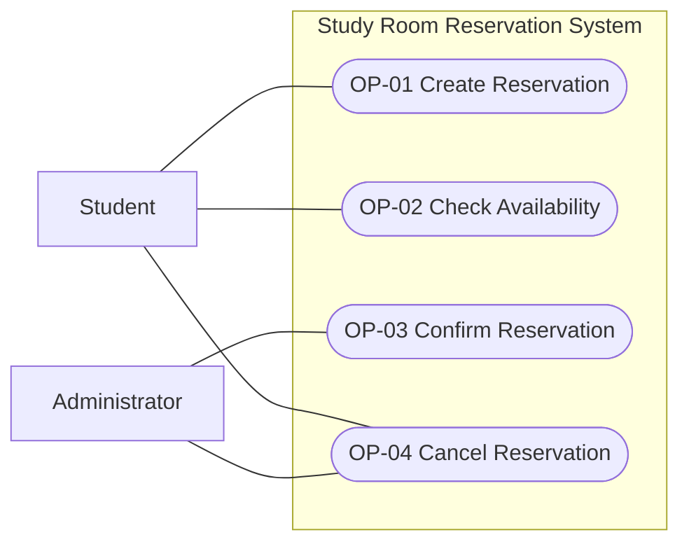

The Notification Service has no interaction in v0.1 and is therefore not
shown as a supporting actor. User/room setup and reads are supporting
capabilities, not additional core goals.

<a id="c02-v01-views-reservation-lifecycle-statechart"></a>

### Reservation lifecycle statechart

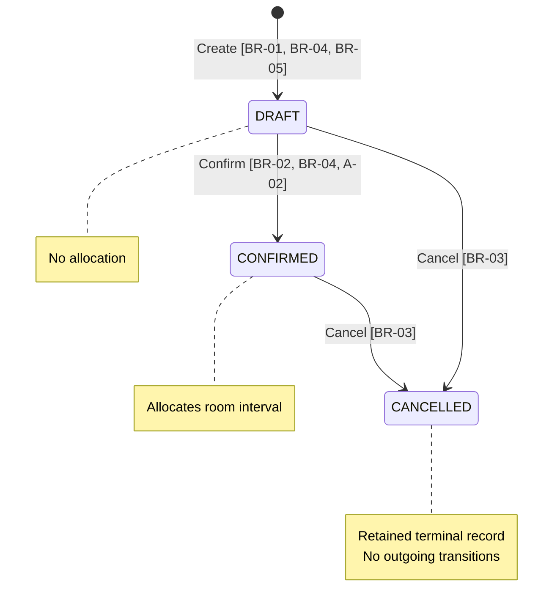

Rejected operations do not transition. Repeated Confirm and repeated Cancel
are rejected as defined in the slices. Check Availability reads state without
transitioning. Concurrent transitions must obey BR-02 and BR-03.

<a id="c02-v01-views-op-01-activity--create-reservation"></a>

### OP-01 activity — Create Reservation

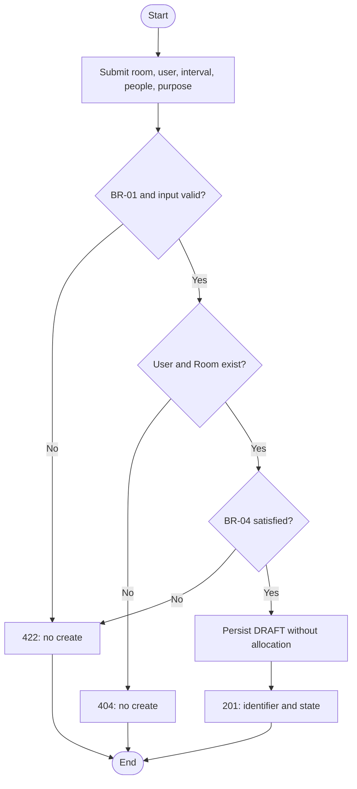

A-01 is assumed at entry. An occupied interval does not prevent Create.

<a id="c02-v01-views-op-02-activity--check-availability"></a>

### OP-02 activity — Check Availability

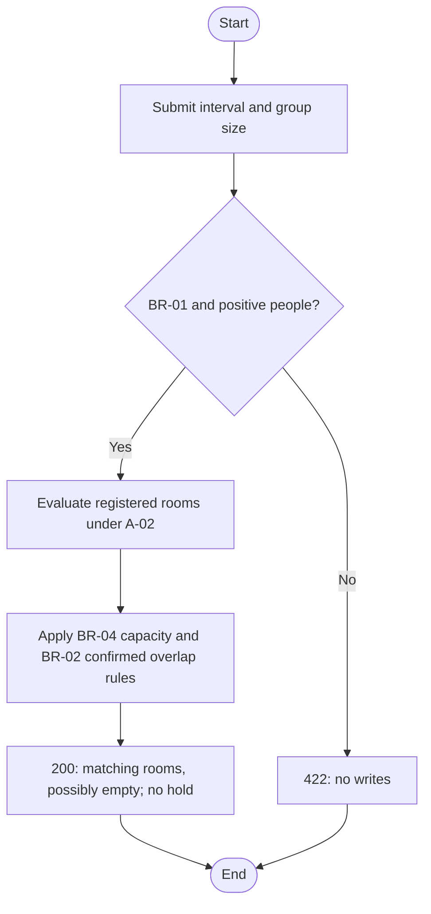

<a id="c02-v01-views-op-03-activity--confirm-reservation"></a>

### OP-03 activity — Confirm Reservation

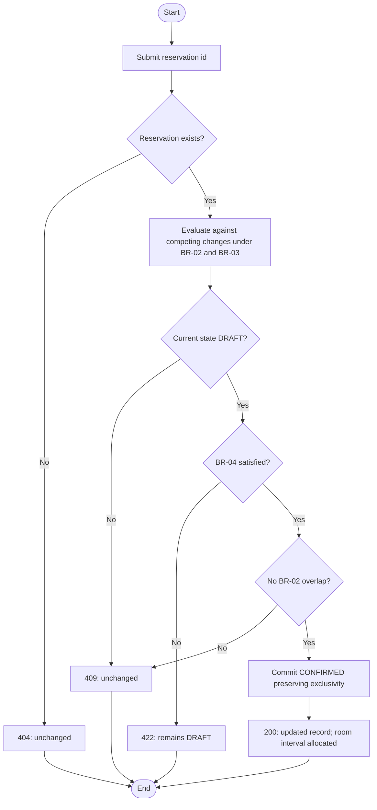

A-02 supplies the active-resource condition. The evaluate-through-commit
behavior is indivisible with respect to conflicting operations; the boxes
do not authorize an unsafe check-then-update implementation.

<a id="c02-v01-views-op-04-activity--cancel-reservation"></a>

### OP-04 activity — Cancel Reservation

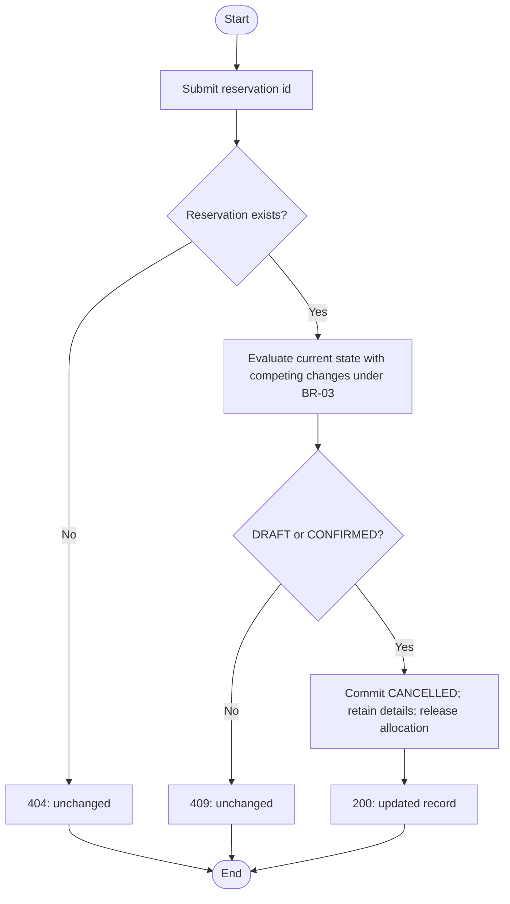

BR-03 has no time cutoff, so this flow contains no clock decision.


---

<a id="c02-change"></a>

<a id="c02-change-c02-change-card--approval-workflow-part-b12"></a>

## C02 change card — approval workflow (Part B.12)

Impact analysis performed on 2026-09-28 **before application edits**.
Baseline: v0.1; requested change: some Resources require an authorized person's
approval before CONFIRMED. Approval may be delayed, rejected or expire.
This impact analysis covers B.12–14.

<a id="c02-change-observed-starting-point"></a>

### Observed starting point

`src/main.py` exposes Create, Availability, Confirm and Cancel. Confirmation
checks DRAFT, capacity and overlap while holding the Room row lock; cancellation
uses the same lock. Models have no approval fields. Demo identity and the
assumption that all registered rooms are active are explicit v0.1 decisions.
The v0.1 acceptance suite uses isolated real PostgreSQL schemas.

<a id="c02-change-impact-analysis"></a>

### Impact analysis

| Area | Impact before implementation |
| --- | --- |
| Create / OP-01 / REQ-01 | Preserve DRAFT/no allocation; capture whether approval is required and a server-owned deadline. Protected resources need a future start so there is a useful decision window. Ordinary rooms keep v0.1 behavior. |
| Availability / OP-02 / REQ-02 | Blocking semantics unchanged: pending/approved/rejected/expired drafts do not allocate. Expose room approval policy so availability is not mistaken for permission to confirm. |
| Confirm / OP-03 / REQ-03 | Add approval eligibility guard evaluated at transition time; APPROVED alone never allocates. Capacity and overlap must still be checked because approval can be delayed. |
| Concurrent Confirm / REQ-04 | Existing exclusivity requirement unchanged; new decision/deadline must be evaluated consistently with concurrent Approve/Cancel. |
| Approve / new OP-05 | New assigned-approver actor. Record approve/reject decision and actor/time; enforce per-room permission within the trusted demo identity boundary. Reject is an outcome of this operation, not a sixth core goal. |
| Cancel / OP-04 / REQ-05 | Preserve DRAFT/CONFIRMED policy and retained records; any approval substate of DRAFT can be cancelled. No later approval may revive it. |
| Statechart | Use two dimensions: reservation lifecycle plus approval status. Pending, approved, rejected and expired are not allocations. Cancellation/confirmation ends the approval window. |
| Use-case view | Add assigned Approver and Approve Reservation; no invented notification actor. |
| Verification | Keep ordinary-room v0.1 regressions; add pending rejection, authorization, approve/reject, deadline boundaries, delayed overlap, and competing operations. |
| Persistence/setup | Add room policy, reservation approval metadata and decision enum. Existing databases need an explicit additive migration; create_all alone cannot upgrade them. |
| Interface | API/Swagger is the complete v0.2 interface; the existing UI remains a v0.1 demo. No UI rewrite is required by this assignment. |

<a id="c02-change-proposed-policy-and-alternatives"></a>

### Proposed policy and alternatives

Retain DRAFT/CONFIRMED/CANCELLED and track approval separately. This avoids
pretending APPROVED means allocated. Ordinary reservations use NOT_REQUIRED;
protected ones start PENDING. Approve accepts either APPROVED or REJECTED.
Only a pending, unexpired draft can receive one decision. No resubmission or
renewal in v0.2; a new reservation is needed after rejection/expiry.

Proposed deadline: earlier of Create + 24 hours and reservation start. At the
exact deadline, a pending or approved draft is EXPIRED. A committed CONFIRMED
reservation is never automatically cancelled by that deadline. Expiry is an
observable derived status, not a background job or mutation on GET.

Alternatives considered: allocate on approval (rejected: conflates decisions
and allocation); block availability while waiting (rejected: introduces holds);
introduce a queue/worker now (deferred: unnecessary to show correct expiry at
read/transition time). The selected policy is recorded in the v0.2 specification.

<a id="c02-change-architecture-drivers-carried-to-c03-not-solved-here"></a>

### Architecture drivers carried to C03, not solved here

- Trusted identity integration and per-resource authorization beyond the demo.
- Atomic state/decision checks under concurrent requests and retries.
- Authoritative clock, boundary semantics and multi-instance clock consistency.
- Durable decision attribution and future audit/history requirements.
- Schema evolution that preserves existing reservations.
- Potential notification/retry/scheduling needs if stakeholders later require
  proactive expiry messages; no delivery guarantees are invented now.

The subsequent implementation results and acceptance record are in
[Baseline v0.2 evidence](evidence-and-evolution.md#c02-v02-evidence).


---

<a id="c02-v02"></a>

<a id="c02-v02-baseline-v02--approval-workflow-part-b13"></a>

## Baseline v0.2 — approval workflow (Part B.13)

Status: implemented. Team acceptance is recorded in
[Baseline v0.2 evidence](evidence-and-evolution.md#c02-v02-evidence).
The deadline policy was selected on 2026-09-28. The
[change analysis](intent-and-change.md#c02-change) records the B.12 impact assessment.

<a id="c02-v02-changed-condition-and-scope"></a>

### Changed condition and scope

Some rooms require a decision by their assigned Approver before a reservation
can be confirmed. Waiting can be delayed, a decision can be rejection, and
pending or approved drafts can expire. Approval is permission, not allocation.
The runnable interface for v0.2 is the API/Swagger; no new browser UI is required.

The v0.1 trusted demo identity and all-registered-rooms-active assumptions remain.
The new operation enforces that the asserted user is the room's assigned
approver. `X-User-Id` is a trusted demo identity assertion, not authentication:
a caller can impersonate a user if the API is exposed to untrusted clients.
Production authentication remains an open architecture requirement.
User/room provisioning is trusted setup. No public API edits room policy or
approver assignments after creation. Self-approval is allowed if that user was
explicitly assigned; separation of duties is not an unstated constraint.

<a id="c02-v02-changed-and-unchanged-requirements"></a>

### Changed and unchanged requirements

| Requirement / slice | v0.2 effect |
| --- | --- |
| REQ-01 / OP-01 Create | DRAFT retained; initialize approval metadata according to Room policy; protected-room start must be future |
| REQ-02 / OP-02 Availability | Core outcome unchanged; only CONFIRMED allocates, so approval substates do not block; room response adds policy |
| REQ-03 / OP-03 Confirm | New guard: NOT_REQUIRED or still-valid APPROVED; pending/rejected/expired is a conflict |
| REQ-04 / OP-03 concurrency | Exclusive confirmed allocation unchanged; additionally coordinate with decision and cancellation |
| REQ-05 / OP-04 Cancel | Lifecycle/time policy unchanged; all approval substates of DRAFT can be cancelled |
| REQ-06 / OP-01 validation | Existing failures unchanged; add protected-room start/deadline validation |
| REQ-07 / OP-05 Approve | New assigned actor can record one approve/reject decision before expiry, without allocation |
| REQ-08 / time semantics | New observable expiry boundary on reads and state-change validation |

Unchanged rules from [v0.1](intent-and-change.md#c02-v01): BR-01 interval semantics,
BR-02 exclusive allocation, BR-03 cancellation policy, BR-04 capacity and
BR-07 read/atomicity principles. They still apply to ordinary and protected
rooms. BR-05 is extended with approval attribution; BR-06's Confirm eligibility
is extended by BR-08 below. Three reservation lifecycle states are unchanged.
Approve is a separate operation; Confirm continues to allocate the room.

<a id="c02-v02-new-shared-rules-and-state-semantics"></a>

### New shared rules and state semantics

| ID | Authoritative definition |
| --- | --- |
| BR-08 — Approval eligibility | Snapshot approval requirement at Create: ordinary room → NOT_REQUIRED; protected room → PENDING. Only NOT_REQUIRED or APPROVED with an unexpired window can Confirm a DRAFT. Approve never allocates or guarantees availability. |
| BR-09 — Decision authority | Room has one existing assigned User if requires_approval=true; ordinary room has no assigned approver. Only the assigned asserted identity may decide, only once, on a PENDING unexpired DRAFT. Decision is APPROVED or REJECTED with server-owned decided_by and decided_at. Repeats, reversals and resubmissions are rejected. |
| BR-10 — Deadline | For protected reservations, deadline=min(server UTC Create time + 24h, reservation start); start must be after Create time. At now >= deadline, pending or approved DRAFT has effective EXPIRED status. At now < deadline it remains eligible for its applicable action. Clock is sampled after acquiring transition serialization; time passing after a successful Confirm does not undo allocation. |
| BR-11 — Retention and expiry | Persist the original decision and deadline. Effective EXPIRED is derived on read/validation without a background task or GET mutation. REJECTED stays rejected; expired/rejected drafts can be cancelled but never reapproved. Create a new reservation to try again. After lifecycle leaves DRAFT, approval_status displays the recorded decision for history, not permission to act; no deadline is evaluated for CANCELLED/CONFIRMED. |
| BR-12 — Competing actions | Approve, Confirm, and Cancel must produce an outcome equivalent to one serial order. Competing approve/reject: exactly one valid decision succeeds. Approve/Cancel: Cancel succeeds, final CANCELLED; Approve succeeds only if first. Approve/Confirm: Confirm may succeed only if a valid approval precedes its eligibility check; otherwise reject without auto-retry. Concurrent eligible Confirm still obeys BR-02. |

New Room fields: `requires_approval` (default false), `approver_user_id` (nullable
foreign key). A reservation stores `approval_decision`, `approval_deadline`,
`decided_by`, `decided_at`; response also reports derived `approval_status`.
Client-supplied decision metadata is never used by Create. The stored decision
is NOT_REQUIRED/PENDING/APPROVED/REJECTED; EXPIRED is a derived response value.
All timestamps are timezone-aware. Existing migrated reservations keep
NOT_REQUIRED, preserving their prior eligibility and state.

<a id="c02-v02-op-01--create-reservation-v02"></a>

### OP-01 — Create Reservation (v0.2)

**Goal / user value:** record room-use intent and, where required, begin an
approval window without holding the room.

**Trigger:** student submits the v0.1 payload to `POST /reservations`.

**Observable requirement(s):** REQ-01/06: valid input creates one DRAFT and returns
201/id/state/approval metadata; invalid input creates nothing. Protected rooms
start PENDING; ordinary rooms retain NOT_REQUIRED behavior.

**Preconditions:** v0.1 input/reference/capacity conditions; for a protected room,
requested start is strictly after the sampled server Create time.

**Success postcondition:** persisted DRAFT and applicable deadline; no allocation.

**State change:** new → DRAFT with PENDING or NOT_REQUIRED approval.

**Referenced business rule(s) / invariant(s):** BR-01/02/04/05/07/08/10.

**Main success scenario:**

1. Student submits reservation data.
2. System validates existing user/room, time, purpose and capacity.
3. System derives approval requirement and deadline from trusted policy/time.
4. System persists DRAFT and returns its id, lifecycle and approval fields.

**Alternative / failure outcomes:** existing 404/422 outcomes unchanged;
protected-room start at or before now → 422/no create. Ordinary rooms may still
use past intervals. Overlap does not prevent creating a draft.

**Verification examples:** V01 protected Create → PENDING; V02 ordinary
regressions → NOT_REQUIRED; V03 start at now → 422; V04 deadline is the earlier
of +24h and start.

**Rationale / source:** change card requires approval for only some resources;
user-selected deadline policy requires a nonempty window.

<a id="c02-v02-op-02--check-availability-v02"></a>

### OP-02 — Check Availability (v0.2)

**Goal / user value:** find capacity-suitable, unallocated rooms while seeing
which rooms also require approval.

**Trigger:** GET `/rooms/available` with v0.1 query fields.

**Observable requirement(s):** REQ-02 unchanged: exact qualifying room list,
200, no holds/writes; each returned Room now includes its approval policy.

**Preconditions:** valid interval and positive people per v0.1.

**Success postcondition:** result respects capacity and confirmed overlaps;
reservations unchanged. Available does not imply approval has been granted.

**State change:** none.

**Referenced business rule(s) / invariant(s):** BR-01/02/04/07/08.

**Main success scenario:**

1. User submits interval and people.
2. System validates query and evaluates capacity/confirmed overlaps.
3. System returns qualifying rooms with their approval policy.

**Alternative / failure outcomes:** invalid query → 422; no match → 200/empty.
Pending, approved, rejected and expired DRAFT records never block a room.

**Verification examples:** V05 approve a draft, then search → room still present;
Confirm it → excluded. Existing adjacency and invalid-query tests remain valid.

**Rationale / source:** approval is separate permission; only confirmed allocation
is an exclusive hold. No waiting-list or provisional-hold policy was requested.

<a id="c02-v02-op-03--confirm-reservation-v02"></a>

### OP-03 — Confirm Reservation (v0.2)

**Goal / user value:** allocate a room once both permission and booking constraints hold.

**Trigger:** POST `/reservations/{id}/confirm` from the existing demo administrator.

**Observable requirement(s):** REQ-03/04: success 200/CONFIRMED only for eligible
DRAFT; preserve exclusive allocation under concurrent attempts. REQ-08 applies
the current deadline at validation, not an earlier search/approval response.

**Preconditions:** v0.1 DRAFT/capacity/no-overlap conditions plus BR-08 and BR-10.

**Success postcondition:** allocation committed; approval metadata retained.

**State change:** DRAFT → CONFIRMED; approval decision is not overwritten.

**Referenced business rule(s) / invariant(s):** BR-01/02/04/06/07/08/10/12.

**Main success scenario:**

1. Caller submits reservation id.
2. System evaluates current lifecycle and effective approval after competing changes.
3. System checks capacity and current confirmed overlaps.
4. System commits CONFIRMED while preserving exclusivity and returns the record.

**Alternative / failure outcomes:** pending, rejected or expired approval →
409/unchanged draft; existing missing-id/state/capacity/overlap failures retain
v0.1 semantics. Approval may succeed after another booking allocated the interval;
Confirm still rejects that overlap. No automatic confirmation on approval.

**Verification examples:** V06 pending/rejected/expired → 409; V07 approved
before deadline → CONFIRMED; V08 delayed approval followed by overlapping Confirm
→ 409; V09 two approved conflicting drafts → one confirmation succeeds.

**Rationale / source:** change card adds a necessary condition, not a replacement
for capacity/availability checks.

<a id="c02-v02-op-04--cancel-reservation-v02"></a>

### OP-04 — Cancel Reservation (v0.2)

**Goal / user value:** withdraw pending or decided requests and release any allocation.

**Trigger:** POST `/reservations/{id}/cancel` from student or administrator.

**Observable requirement(s):** REQ-05 unchanged: cancel eligible lifecycle state,
retain details and decision attribution, release allocation, reject repeat.

**Preconditions:** DRAFT or CONFIRMED; any approval substate; no time cutoff.

**Success postcondition:** CANCELLED retained record; no later Confirm/Approve allowed.

**State change:** DRAFT/CONFIRMED → CANCELLED; stored decision retained (BR-11).

**Referenced business rule(s) / invariant(s):** BR-02/03/06/07/11/12.

**Main success scenario:**

1. Caller requests cancellation.
2. System checks current lifecycle consistently with competing decisions.
3. System commits CANCELLED, preserves decision history and returns the record.

**Alternative / failure outcomes:** missing → 404; repeated Cancel → 409;
concurrent decision cannot resurrect the cancelled reservation. Effective expiry
is not persisted as a decision; cancellation retains the underlying decision.

**Verification examples:** V10 cancel pending/approved/rejected/expired drafts;
V11 concurrent Approve/Cancel ends CANCELLED; existing confirmed/repeated/past
cancellation cases remain unchanged.

**Rationale / source:** cancellation ends the request regardless of approval progress;
the v0.1 retained-record and unrestricted-time policy remains applicable.

<a id="c02-v02-op-05--approve-reservation"></a>

### OP-05 — Approve Reservation

**Goal / user value:** allow the assigned responsible person to approve or reject
use of a protected room, independently of resource allocation.

**Trigger:** assigned Approver submits `{"decision":"APPROVED"}` or
`{"decision":"REJECTED"}` to POST `/reservations/{id}/approve`, asserting demo
identity with `X-User-Id`.

**Observable requirement(s):** REQ-07: only the assigned asserted user can record
one decision on a pending unexpired DRAFT, returning 200 with decision/actor/time
and unchanged DRAFT lifecycle. REQ-08: now at/after deadline rejects a decision.

**Preconditions:** identity provided, existing reservation and assigned actor;
current DRAFT, effective PENDING, time before deadline.

**Success postcondition:** decision and attribution are durable; no room allocated.

**State change:** DRAFT/PENDING → DRAFT/APPROVED or DRAFT/REJECTED.

**Referenced business rule(s) / invariant(s):** BR-02/07/08/09/10/11/12.

**Main success scenario:**

1. Approver selects a pending reservation and an approve decision.
2. System requires the asserted identity and checks per-room assignment.
3. System evaluates current lifecycle, pending status and deadline.
4. System records APPROVED, deciding user and server timestamp atomically.
5. System returns the decision and DRAFT lifecycle, without confirming the room.

**Alternative / failure outcomes:**

- REJECTED input follows the same authorized flow, returning 200/REJECTED;
  this is a successful negative business decision, not an HTTP failure.
- Missing identity → 401; unknown/wrong/non-assigned user → 403. Ordinary rooms
  have no approver, so attempts to decide them are forbidden.
- Existing identity assertion but missing reservation → 404.
- Repeated/reversed decision, EXPIRED, CANCELLED or CONFIRMED → 409/no write.
- Invalid decision or malformed identity → 422/no write.
- Delayed decision before deadline is allowed; overlap is checked later by Confirm.

**Verification examples:** V12 assigned user approves with actor/time persisted;
V13 wrong/missing identity rejected; V14 rejection blocks Confirm and reversal;
V15 one microsecond before deadline allowed, exact deadline and after rejected;
V16 repeated and competing opposite decisions produce only one accepted decision;
V17 Approve/Confirm race either confirms after approval or rejects early Confirm.

**Rationale / source:** Part B introduces a real approval workflow with a new
responsible actor. A single decision operation covers acceptance and rejection
without creating a misleading allocation side effect.

<a id="c02-v02-changed-views-and-verification-plan"></a>

### Changed views and verification plan

See [v0.2 views](intent-and-change.md#c02-v02-views) for the actor-goal view, lifecycle,
approval-state view and five activity flows. The full slices above replace the
v0.1 slices for current behavior; v0.1 remains a historical baseline.

| Examples | Executable check in `tests/test_approval.py` |
| --- | --- |
| V01, V05, V07, V12 | `test_approval_is_permission_not_allocation` |
| V02 | existing `tests/test_baseline.py` ordinary-room regression suite |
| V03–V04 | `test_deadline_minimum_and_protected_past_start` |
| V06, V14 | `test_reject_cannot_confirm_but_can_cancel`; deadline tests |
| V08 | `test_delayed_approval_does_not_override_new_conflict` |
| V09 | `test_concurrent_approved_confirms_still_exclusive` |
| V10 | `test_cancel_approval_states_prevents_later_decisions`; rejection test |
| V11, V16–V17 | `test_approval_races`; `test_repeated_decision_and_invalid_input` |
| V13 | `test_only_assigned_approver_can_decide` |
| V15 | `test_deadline_boundary_on_confirm_or_approve` |
| V18: CONFIRMED survives deadline | `test_confirmed_allocation_survives_approval_deadline` |
| V19: old records survive upgrade | `test_migration_preserves_v01_records_and_is_repeatable` |

Exact-time cases replace the server clock deterministically rather than sleeping.
Concurrency cases synchronize two independent PostgreSQL sessions before state
transition locking. Passing cases support those scenarios, not every possible
interleaving or a production security/performance guarantee.

<a id="c02-v02-requirement-gate-and-consistency-review"></a>

### Requirement gate and consistency review

| Requirement | Meaning / rationale / observable result | State, time, concurrency and falsifier | Feasibility / verification / consistency / unknown |
| --- | --- | --- | --- |
| REQ-01/06 | Intent remains DRAFT; policy sets approval; reject invalid create | Create allocating or accepting protected past start would falsify it | Existing persistence plus metadata; V01–04 and v0.1 negatives; no new auth claim |
| REQ-02 | Available means unallocated with adequate capacity | Any pending/approved draft blocking search would falsify it | Same query; V05/regressions; aligns with BR-02 |
| REQ-03 | Confirm requires permission AND capacity/no conflict | Pending/expired confirming, or late approval bypassing overlap, falsifies it | Guarded transition; V06–08/V15; aligns with lifecycle |
| REQ-04 | One exclusive allocation under competition | Two conflicting committed CONFIRMED rows falsify it | Existing serialization; V09; broader scale remains C03 driver |
| REQ-05 | Withdraw without deleting or reviving | Approve reviving CANCELLED or retained fields disappearing falsifies it | Same lifecycle with decision retention; V10–11 and regressions |
| REQ-07 | Assigned actor records one decision without allocation | Wrong actor succeeds, repeated decision overwrites, or approval allocates falsifies it | Per-room check in trusted demo; V12–14/V16–17; real authentication unresolved for C03 |
| REQ-08 | Exact UTC deadline invalidates pending/approved draft eligibility | Success at deadline, or expiry cancelling CONFIRMED, falsifies it | Derived status and transition-time clock; V15/V18; multi-host clock policy is C03 work |

Cross-view review: all five goals have slices/activity flows; only CONFIRMED
blocks; both approval outcomes retain DRAFT; rejected/expired has no route to
Confirm; cancellation remains available from DRAFT; views use the same exact
time inequality. There is no notification actor or presumed background worker.
Acceptance and execution results are recorded in
[Baseline v0.2 evidence](evidence-and-evolution.md#c02-v02-evidence).

<a id="c02-v02-architecture-drivers-for-c03"></a>

### Architecture drivers for C03

Carry forward identity integration/per-room authorization, authoritative clock
and expiry semantics, atomic transitions under contention, retry/idempotency
policy, decision audit retention, and schema evolution. The minimal API uses
existing transaction structure and computes expiry on demand. No queue,
scheduler, microservice split or production identity provider is selected here.
Whether stakeholders require proactive expiry/decision notifications remains
unresolved; delivery is outside this version.


---

<a id="c02-v02-views"></a>

<a id="c02-v02-views-baseline-v02--behavior-views"></a>

## Baseline v0.2 — behavior views

Rules and guards reference [v0.2](intent-and-change.md#c02-v02). Approval and lifecycle are
separate dimensions. These are logical activity views, not architectural choices.

<a id="c02-v02-views-actor-goal-view"></a>

### Actor-goal view

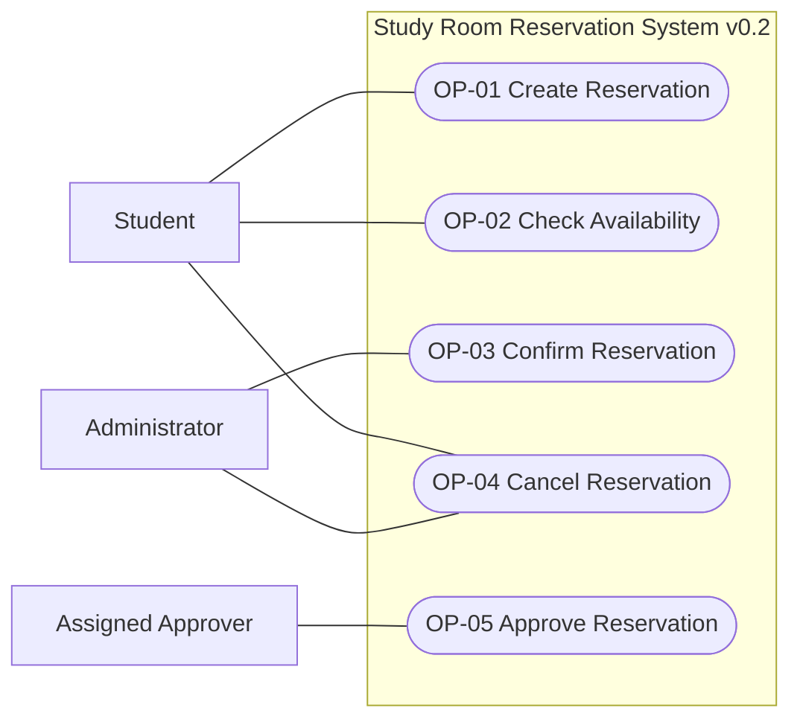

Approve includes an authorized rejection outcome. An Approver can also be an
administrator, but administrative UI access alone does not grant assignment.
No Notification Service interaction is implemented.

<a id="c02-v02-views-reservation-lifecycle"></a>

### Reservation lifecycle

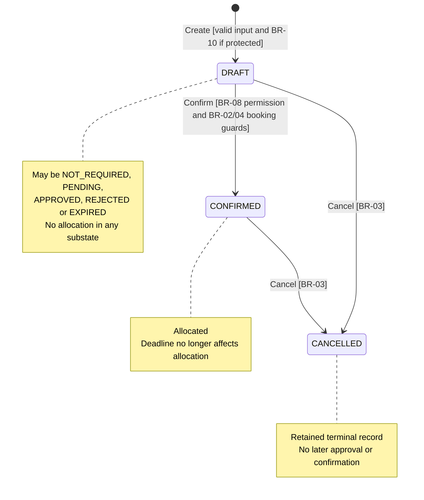

<a id="c02-v02-views-effective-approval-state-while-draft"></a>

### Effective approval state while DRAFT

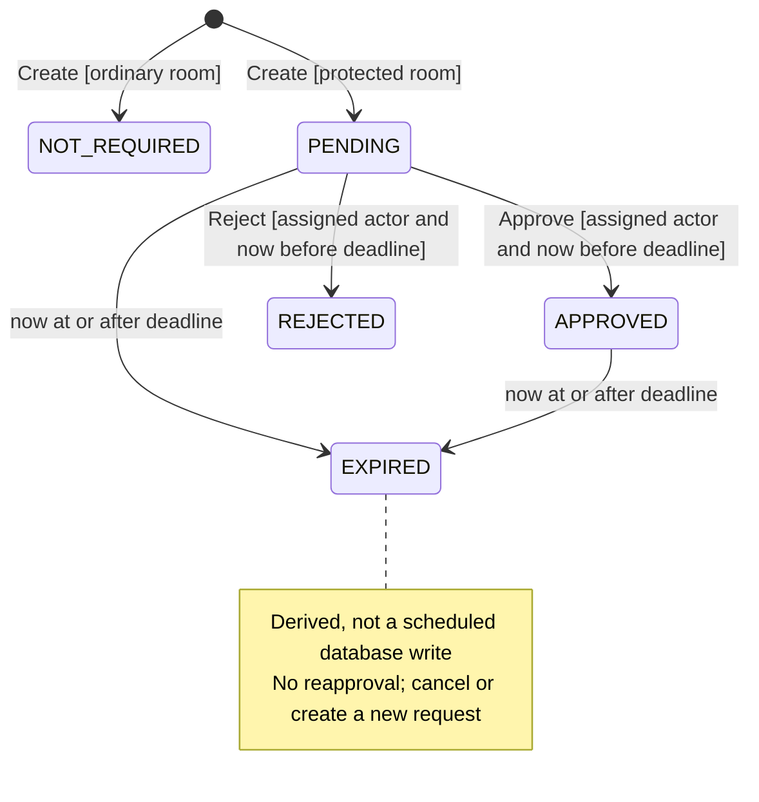

NOT_REQUIRED and unexpired APPROVED satisfy the permission guard for Confirm;
neither allocates by itself. Cancel ends the DRAFT lifecycle from any substate.
Once outside DRAFT, the API shows the recorded decision as history (BR-11), not
an active approval state. REJECTED has no approval transition; Cancel is still
available through the reservation lifecycle.

<a id="c02-v02-views-op-01-activity"></a>

### OP-01 activity

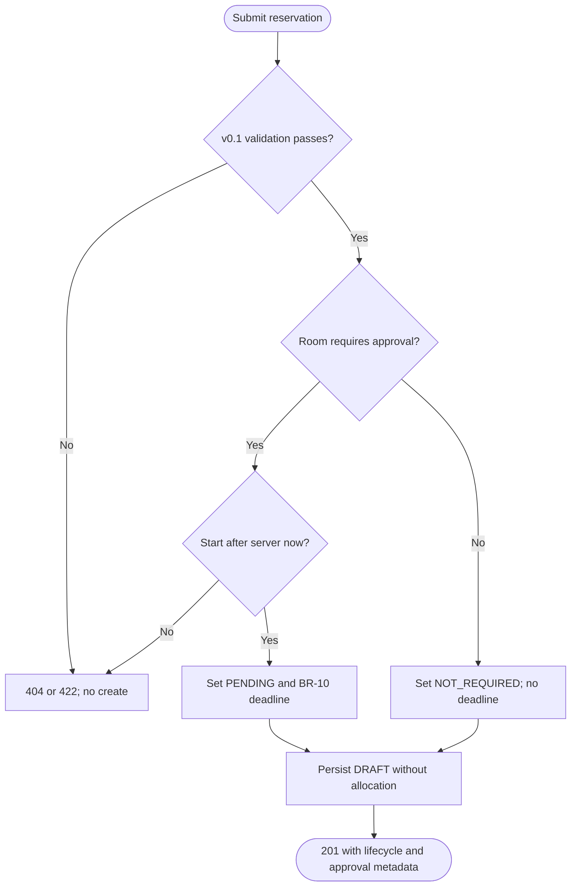

<a id="c02-v02-views-op-02-activity"></a>

### OP-02 activity

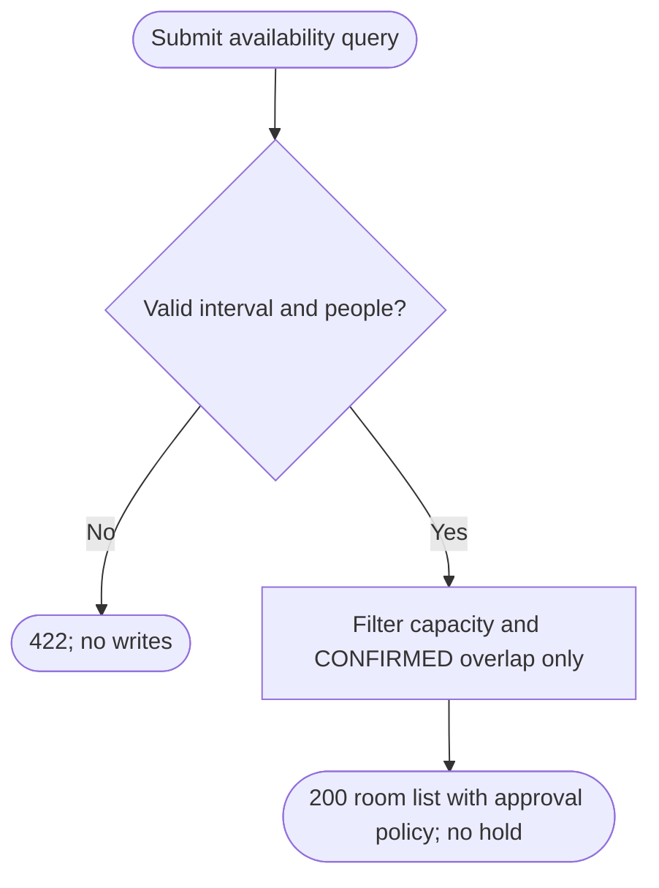

<a id="c02-v02-views-op-03-activity"></a>

### OP-03 activity

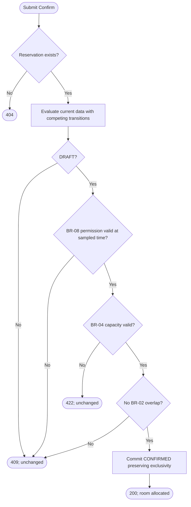

Evaluate-through-commit is consistent with BR-12; the flow does not prescribe
an unsafe non-atomic check/update sequence.

<a id="c02-v02-views-op-04-activity"></a>

### OP-04 activity

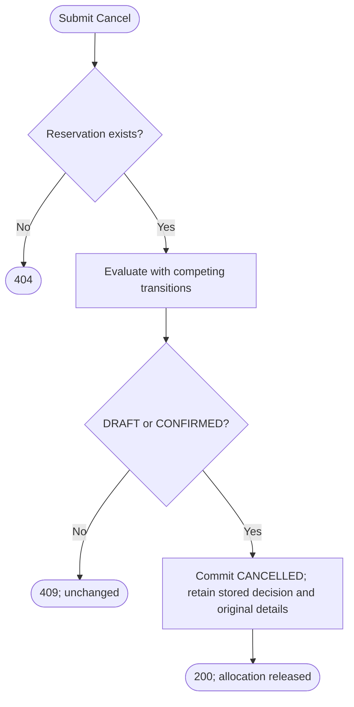

No approval-state or clock restriction is added to cancellation.

<a id="c02-v02-views-op-05-activity"></a>

### OP-05 activity

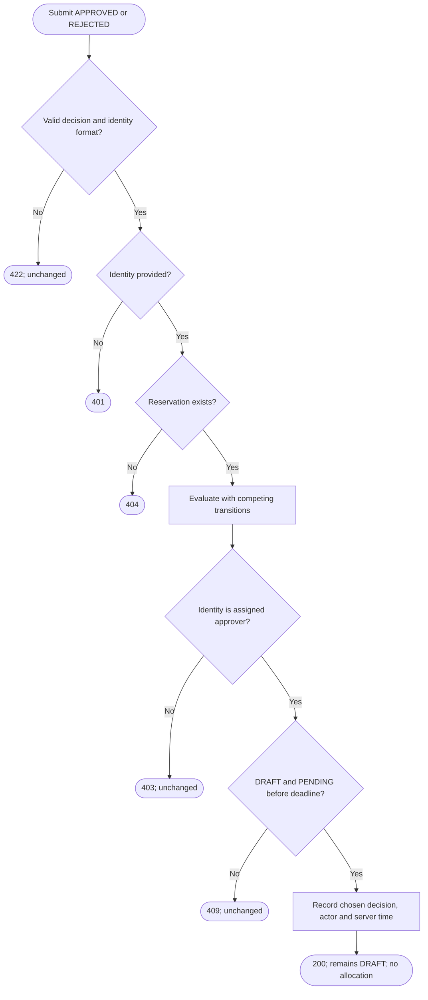
